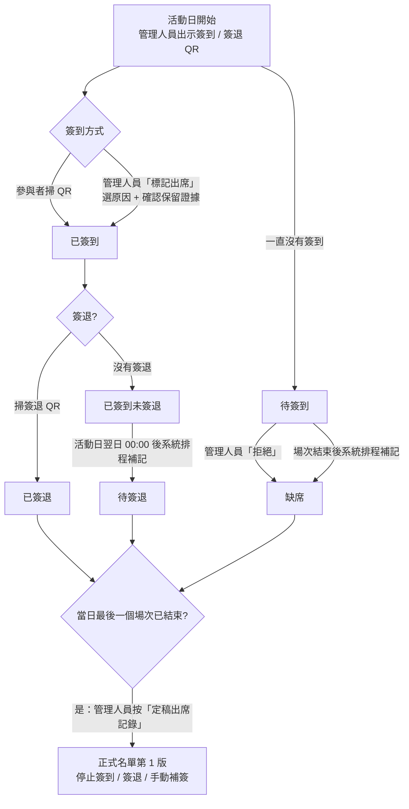
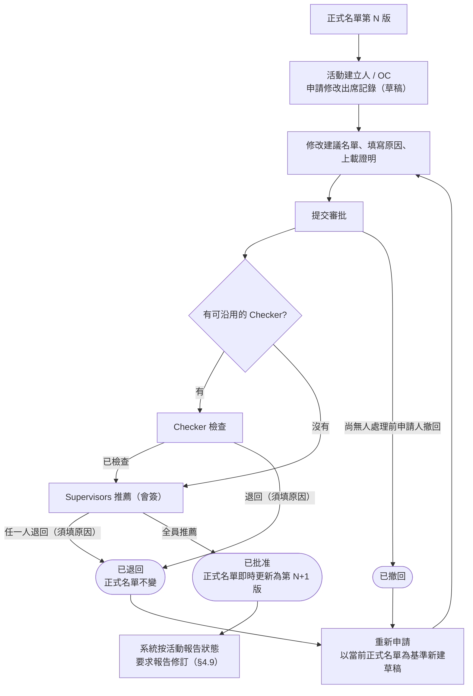

# 活動出席（QR 簽到、手動補簽、定稿與出席記錄變更）

> 本文檔面向 Demo 執行人、UAT 測試人與業務培訓人員，目標是讓使用者**不依賴開發人員陪同**，也能完成 QR 簽到、手動補簽、定稿出席記錄，以及定稿後的出席記錄變更申請與審批。
>
> 內容以 **2026-10 的實際運作狀況（as-built）** 為準；與 2026-09 之前版本有出入之處已直接改寫，不另註記。
> 角色稱呼以系統角色的正式名稱為準（見 [roles-menus-permissions-matrix.md](roles-menus-permissions-matrix.md)）。
> 出席記錄變更獲批後如何帶動「活動報告」修訂，見 [activity-report-submission-design.md](activity-report-submission-design.md) §1.9 與 [activity-report-submission-guide.md](activity-report-submission-guide.md) §4.5。

---

## 1. 模組概覽

### 1.1 業務目標

記錄參與者在活動現場的出席情況（簽到 / 簽退），在每一個活動日結束後把當日的出席結果**定稿**為一份正式名單；定稿之後如發現漏記或錯記，透過**出席記錄變更申請**經審批後更正。正式名單是活動報告「出席」一節與後續統計的唯一依據。

### 1.2 出席名單的生命週期

出席名單以**活動日**為單位管理（同一日的多個場次一併處理）：

| 階段 | 畫面顯示 | 可以做什麼 |
|:--|:--|:--|
| 收集中 | 「收集中」 | 參與者掃 QR 簽到 / 簽退；管理人員手動補簽、標記缺席；系統排程自動補記缺席 / 未簽退 |
| 正式名單第 1 版 | 「正式名單 · 第 1 版」 | 當日最後一個場次結束後，由管理人員按「定稿出席記錄」產生。此後**停止簽到、簽退與手動補簽** |
| 變更審批中 | 「本場次的出席記錄變更申請待審批……」 | 審批完成前，正式名單、統計與匯出仍維持原版本 |
| 正式名單第 N+1 版 | 「正式名單 · 第 N+1 版」 | 變更申請獲最後一位 Supervisor 推薦後**即時生效**；舊版本保留可查 |

> 定稿是**手動指令**，系統不會自動定稿。系統排程只會在收集階段替未簽到者補記缺席、替未簽退者補記未簽退（見 §4.3），補記後名單仍是「收集中」。

### 1.3 出席結果

管理出席頁面把當日名單分成五個頁籤，頁籤上的數字是全量統計，不受翻頁影響：

| 頁籤 | 含義 |
|:--|:--|
| 待簽到 | 應到但尚未簽到 |
| 已簽到 | 已簽到、尚未簽退 |
| 待簽退 | 已簽到，活動日已過但沒有簽退（由系統補記） |
| 已簽退 | 已簽到並已簽退 |
| 缺席 | 被標記缺席（人手「拒絕」或系統補記） |

定稿時，每人的結果歸入以下四種正式狀態之一：**已出席**（有簽到及簽退）、**未簽退**（有簽到、無簽退）、**缺席**（沒有簽到）、**已拒絕**（被拒絕簽到者保留原判定）。

### 1.4 與其他模組的關係

- **應到名單**：報名獲最終批准、或嘉賓邀請獲接受時，系統即把該人加入出席名單；婉拒邀請的嘉賓不會加入。
- **活動報告**：報告「出席」一節讀取各活動日的**正式名單**（見 [activity-report-submission-guide.md](activity-report-submission-guide.md) §1.4）。出席記錄變更獲批後，系統會按報告當時的狀態要求報告修訂（§4.9）。
- **活動狀態**：活動所有場次的翌日 00:00 均已過去後，系統排程把活動轉為「已完成」。

---

## 2. 角色與職責

| 角色 | 職責 |
|:--|:--|
| 參與者（Student / Guest） | 掃 QR 自助簽到 / 簽退 |
| 能管理該活動出席的人員：活動建立人、活動 OC 成員、該活動的 Supervisor、活動所屬學生組織的組長（Group Leader）、管理員 | 出示 QR、手動補簽、標記缺席、定稿出席記錄、查看名單記錄與版本歷史 |
| 活動建立人、活動 OC 成員 | **發起**出席記錄變更申請（畫面只向這兩類人顯示發起按鈕）；在尚無人處理前撤回自己的申請 |
| Activity Application Checker | 檢查出席記錄變更申請（只在可沿用的情況下才有此環節，見 §4.7） |
| Supervisor | 推薦或退回出席記錄變更申請；**全員推薦**才生效 |
| 系統（排程） | 收集階段自動補記缺席 / 未簽退；活動結束後把活動轉為「已完成」；把已批准的出席變更帶到活動報告 |

> 組長的判定依賴學生組織成員名單上登記的職位，客戶環境（UAT / PROD）該資料普遍空白，因此「組長」這一條在客戶環境實際上很少生效，詳見 [activity-report-submission-guide.md](activity-report-submission-guide.md) §7。

---

## 3. 流程圖

### 3.1 收集與定稿

### 3.2 出席記錄變更申請與審批

---

## 4. 關鍵步驟詳述

入口：**組織者中心 → 管理出席**。先選學年與活動，再在「當前日程」選擇活動日頁籤。同一日的多個場次合併為一個頁籤。

### 4.1 QR 簽到 / 簽退（參與者自助）

- 活動資訊卡右上方有「簽到二維碼」與「簽退二維碼」兩個按鈕，打開後可選**動態二維碼**（按設定秒數自動更新）或**靜態二維碼**；活動尚未開始時動態二維碼不可用，可改用靜態二維碼。
- 2026-09 調整：二維碼放大並加上白邊，手機較易掃描；二維碼直接連到簽到頁。參與者若尚未登入，會先被帶到登入頁，**登入後自動返回簽到頁**完成簽到，不必重掃。
- **只限場次當日**：自助掃碼只在該場次的日期當天有效。日期未到會提示「此場次尚未開始，只可於場次當日進行簽到簽退」；日期已過則提示「此場次已結束……」。系統只比對日期，不比對時分。
- **同日多場次一次簽到**：在某一場次簽到，會同時記錄同一日所有場次的簽到。
- **同日不可重複簽到**：當日已有簽到記錄即不能再簽，包括已簽退之後。
- **可重複簽退**：每次簽退都會保留記錄，名單以**最後一次**簽退時間為準；簽退會清除系統補記的「未簽退」。
- **遲到簽到會清除誤補的缺席**：若系統已替該場次補記缺席，參與者稍後在同日簽到時，該缺席記錄會被移除。
- **已定稿的活動日**：兩個二維碼按鈕會變灰，提示「當天出席記錄已定稿」；即使用舊二維碼掃描，系統也會拒絕並提示「此場次的出席記錄已定稿，如需更正請提交變更申請」。

### 4.2 手動補簽與標記缺席（管理人員）

在「待簽到」頁籤勾選人員後，表格上方提供兩個操作（其他頁籤不提供批次操作）：

**標記出席（手動簽到）**——2026-09 起須說明原因並確認保留證據：

1. 按「標記出席」，彈出「手動簽到確認」對話框。
2. **原因**（必選）：二維碼無法掃描 / 手機或網絡故障 / 無手機，已由 OC 核實 / 自助簽到不可用 / 其他。選「其他」時須填寫**補充說明**。
3. 勾選「我確認將保留支持證據並在核查時提供。本操作不得用於偽造出席記錄。」——未勾選時「確認」按鈕不可按。
4. 確認後，系統為所選人員記錄簽到（同樣覆蓋同日所有場次）。

稽核：系統記錄原因、補充說明、操作人與證據確認。在該人員的「詳情」中可看到「原因」與「補充說明」。缺少原因或未確認證據的請求，即使繞過畫面直接送出也會被系統拒絕。

其他規則：

- 手動簽到與掃碼走同一套檢查：報名須已獲批准、不在黑名單內、符合年齡要求；同日已有簽到的人不能再簽。
- 手動補簽**不受「只限場次當日」限制**，可事後補登；但畫面要求活動已開始（活動開始日當天或之後）。
- 沒有系統帳號的嘉賓無法用此方式補簽。

**拒絕（標記缺席）**：確認後把所選人員標記為缺席，作用於**整個活動日**；當日已簽到的人不能被標記缺席。

> 管理端目前畫面只提供「標記出席」與「拒絕」兩個批次操作，**沒有人手補簽退的按鈕**；漏簽退者由系統補記為「未簽退」，定稿後如需更正，走 §4.6 的變更申請。

### 4.3 系統排程自動補記

系統定時排程（執行頻率按環境設定）會處理已結束的場次：

| 時點 | 處理 |
|:--|:--|
| 場次結束後 | 報名已獲批准、或嘉賓邀請已接受，但當日沒有任何出席記錄者 → 補記**缺席** |
| 場次日期翌日 00:00 後 | 已簽到但沒有簽退者 → 補記**未簽退**（「待簽退」頁籤） |
| 活動所有場次的翌日 00:00 均已過 | 活動轉為「已完成」 |

排程**不會定稿**，也不會改動已定稿的活動日。

### 4.4 定稿出席記錄

- **誰**：能管理該活動出席的人員（§2）都看得到「定稿出席記錄」按鈕。
- **何時**：當日**最後一個場次結束後**才可按；之前按鈕為灰色，滑鼠停留時提示可定稿的時間。
- **確認對話框**列出：當日所有場次、按現有頁籤人數預覽的定稿結果，以及警告「定稿後將產生正式名單第 1 版，並停止當天的簽到和簽退。此後的修正須透過變更申請並經審批。」

| 定稿前的頁籤 | 定稿後的正式狀態 |
|:--|:--|
| 已簽退 | 已出席 |
| 已簽到、待簽退 | 未簽退 |
| 待簽到、缺席 | 缺席 |

- **整日一併定稿**：同一日的所有場次一次定稿為同一份正式名單。
- **重複定稿無害**：若當日已被他人定稿，系統提示「該日期此前已定稿（第 N 版），未作任何更改」，不會產生新版本。
- **會被拒絕的情況**：當日場次尚未全部結束；場次日期或時間缺漏、無法判斷結束時間；場次結束時間早於開始時間（跨午夜）。後兩者屬活動排程資料問題，須先修正排程。

### 4.5 狀態提示列與主要按鈕

選定活動日後，「整理活動記錄」標題下方有一條**狀態提示列**，右上方只有一個隨狀態變化的**主要按鈕**，另有「記錄」下拉選單（§4.8）。

| 當日狀況 | 提示列 | 主要按鈕 |
|:--|:--|:--|
| 收集中，當日場次未結束 | 收集中。當天最後一個場次結束後（日期 時間）方可定稿 | 定稿出席記錄（灰色） |
| 收集中，當日場次已全部結束 | 當天場次已全部結束。請定稿出席記錄…… | 定稿出席記錄 |
| 已定稿，沒有進行中的申請 | 正式名單 · 第 N 版。修正須透過變更申請 | 申請修改出席記錄（只限活動建立人 / OC） |
| 已定稿，本人有未提交的草稿 | ……您在本場次有一份未提交的草稿 | 繼續編輯草稿 |
| 已定稿，草稿依據的版本已過時 | 您的草稿基於第 X 版，而名單現已是第 N 版 | 申請修改出席記錄（先確認是否從目前版本新建草稿） |
| 已定稿，有申請待審批 | 本場次的出席記錄變更申請待審批。審批完成前，正式名單仍為第 N 版 | 查看申請（申請人另有「撤回」） |
| 已定稿，本人上一份申請已退回 / 撤回 | 本場次的出席記錄變更申請：已退回（或已撤回），並顯示審批意見 | 重新申請 |

已批准的變更若已帶到活動報告，提示列會多一個「報告觸發：……」標籤，按下可查看報告觸發狀態（§5.3）。頁面不會自動刷新——審批在別處完成後，按提示列的「重新整理」即可讀取最新狀態。

### 4.6 申請修改出席記錄（活動建立人 / OC）

**前提**：該活動日已定稿；本場次沒有其他申請正在審批（同一場次同一時間只允許一份申請待審批）。

1. 按「申請修改出席記錄」，系統以目前正式名單（第 N 版）為基準建立草稿，標題顯示「基於正式名單第 N 版」。
2. 在**建議名單**中修改。可篩選姓名 / 學號、狀態，或「只顯示已修改的列」：

   | 可以做 | 規則 |
   |:--|:--|
   | 修改參加者類別、出席狀態、簽到 / 簽退時間 | 狀態須與時間相符（見下表）；時間不能晚於現在 |
   | 取消「計入」（排除某人） | 須填寫**排除原因**；正式名單上的人**不能刪除**，只能排除 |
   | 重新計入先前被排除的人 | 狀態與時間仍須有效 |
   | 「新增參與者」 | 須填寫**新增原因**；同一人不能重複出現；草稿中新增的行可「移除」 |

   | 出席狀態 | 簽到時間 | 簽退時間 |
   |:--|:--|:--|
   | 已出席 | 必填 | 必填，不能早於簽到 |
   | 未簽退 | 必填 | 必須留空 |
   | 缺席 / 已拒絕 | 必須留空 | 必須留空 |

3. **新增參與者**對話框分「已報名參與者」與「嘉賓」兩個頁籤：
   - 「已報名參與者」只列出**符合資格**的學生：其目前有效的報名狀態為待推薦、待審批或已批准，且**報名提交時間早於活動最後一個場次的計劃結束時間**。報名尚未獲批的學生也可加入，畫面會註明「報名尚未獲批，仍須完成出席變更審批」。
   - 每位候選人旁顯示「報名資格依據」（報名狀態、提交時間、最後場次計劃結束時間，以香港時間顯示）；同一依據會隨申請保存，Supervisor 審批時看到的是提交時記錄的依據。
   - 已在名單中的人顯示「已在名單中」，不能重複加入。學號按權限遮蔽顯示。
   - 提交時系統會重新核對新增學生的報名資格；若期間報名被取消或資格改變，提交會被拒絕。
4. **變更原因**（提交時必填，最多 2000 字）。
5. **上載證明文件**（例如醫生證明或已簽署的簽到表），可標示為「整體證明」或某位參與者的「個人證明」。
6. 「預覽」可查看本次變更內容；「儲存草稿」可稍後繼續；「提交審批」前會再確認一次，**提交後不可再編輯**。

提交會被拒絕的常見情況：

| 情況 | 提示 |
|:--|:--|
| 建議名單與正式名單完全相同 | 沒有可提交的變更 |
| 草稿建立後正式名單已更新 | 草稿已過期，須從目前版本重新建立 |
| 同一草稿在另一視窗被修改過 | 草稿已在其他地方被修改，已重新載入 |
| 本場次已有一份申請待審批 | 該場次已有一份變更申請正在審批中 |
| 活動沒有可用的 Supervisor | 該活動沒有可用的督導員審核此出席變更 |
| 本環境尚未啟用出席變更審批 | 出席變更審批流程尚未配置（見 §7） |

### 4.7 出席記錄變更的審批

審批人從**我的待辦**進入「出席變更審核」頁（待辦類型顯示為「出席變更」），頁面列出：目前正式名單（第 N 版）、建議名單、變更內容（新增 / 移除 / 修改）、變更原因、支持附件（可下載）、新增學生的報名資格依據、前次審批意見。

**審批人從哪裏來**（提交時由系統自動決定，申請人不能指定）：

| 環節 | 來源 | 不適用時 |
|:--|:--|:--|
| Checker | 沿用該活動**活動報告**最近一次由 Coordinator 分派的 Checker，且此人仍持有 Activity Application Checker 角色、帳號仍啟用 | **跳過 Checker 環節**，頁面提示「本次變更沒有檢查環節，直接由督導員審核」。活動尚無報告、或報告從未分派過 Checker 時都屬此情況 |
| Supervisors | 沿用活動報告最近一次分派的 Supervisor 名單（須仍是本活動的督導員）；否則用活動全部督導員；已停用的帳號自動剔除 | 一位可用的 Supervisor 都沒有時，**不能提交** |

> 出席記錄變更**沒有 Coordinator 環節**。

**審批動作**（2026-09 起先選「決定」，再填意見，再提交）：

| 環節 | 可選決定 | 結果 |
|:--|:--|:--|
| Checker | 已檢查 / 退回 | 已檢查 → 進入 Supervisors 推薦；退回 → 申請「已退回」 |
| Supervisor（多人並行） | 推薦 / 退回 | **全員推薦** → 申請「已批准」，正式名單**即時**更新為第 N+1 版；**任一人退回** → 申請「已退回」，其餘 Supervisor 的待辦一併取消 |

- **退回必須填寫原因**，畫面在未填時不能提交；繞過畫面直接送出同樣會被拒絕。推薦 / 已檢查的意見可選填。
- 退回後正式名單不變。申請人按「重新申請」會以**當前**正式名單為基準新建一份申請，並在編輯器中顯示上一次申請的審批意見；舊申請及其審批記錄保留不變。
- **撤回**：申請人可在「查看申請」頁或狀態提示列撤回，須填寫撤回原因；**只限尚未有任何審批人處理前**，Checker 或任一 Supervisor 一旦處理過即不能撤回。
- 審批期間，正式名單、統計與匯出仍維持第 N 版，建議名單只在審核頁可見。
- 審批人收到待辦通知；申請結束（批准 / 退回）時申請人收到結果通知。
- 通用審批介面不能處理出席變更任務（系統會拒絕），必須經「出席變更審核」頁處理，以確保名單生效與報告聯動同時完成。

### 4.8 記錄：版本歷史與變更記錄

活動日頁籤選定後，「記錄」下拉選單提供兩項，在同一個側欄中以頁籤切換：

- **出勤名冊版本歷史**：每個正式版本的版本號、狀態、參與人數、日期；第 1 版標示「初始提交」，由變更產生的版本可按「查看變更申請」跳到對應申請。尚未定稿時顯示「該日期尚未定稿，暫無正式版本」。
- **出勤變更記錄**：本場次所有申請的編號、狀態（草稿 / 審批中 / 已批准 / 已退回 / 已撤回）、基準版本、生效版本、申請人、變更原因、觸發狀態、建立與審批時間；可查看詳情，申請人可在此繼續草稿、撤回或重新申請。按「觸發狀態」可查看報告觸發詳情（§5.3）。

能查看記錄與下載附件的人：能管理該活動出席的人員、該申請的申請人、該申請的審批人。附件下載會先核對檔案確實屬於該申請，其他人不能憑檔案編號取得。

### 4.9 與活動報告的聯動

只有**已批准**的出席變更會影響活動報告（草稿、審批中、已退回、已撤回的申請一律不會）。系統在批准後按報告當時的狀態處理：

| 出席變更獲批時，活動報告的狀態 | 系統處理 |
|:--|:--|
| 尚未建立報告 | 不代建報告，觸發狀態顯示「已阻塞」（原因：無報告）；日後建立報告時自動承接 |
| 草稿 / 已退回 / 需要修訂 | 由下一輪報告直接採用更新後的名單，並通知 OC 核對 |
| 待聯署（OC 共簽中） | **終止本輪共簽**（已簽記錄保留於歷史），報告轉「需要修訂」，須全體 OC 重新簽署 |
| 審批中 | 不打斷進行中的審批，觸發狀態「已阻塞」（原因：報告審批中）；審批頁顯示「出席記錄又有更新」提示，審批人可自行決定繼續或退回。本輪結束後系統接續處理 |
| 已批准 | **開啟報告修訂輪**：報告轉「需要修訂」，原已批准版本保留 |

報告修訂輪的完整路徑（誰重簽、誰重審）見 [activity-report-submission-design.md](activity-report-submission-design.md) §1.9。

---

## 5. 狀態一覽

### 5.1 出席方式

系統為每一筆出席記錄保留其來源：參與者掃碼、管理人員手動（附原因）、由同日另一場次的簽到 / 簽退**連帶記錄**、系統排程自動補記（缺席 / 未簽退）、出席記錄變更獲批後寫入。畫面的「詳情」目前只顯示手動補簽的「原因」與「補充說明」，其餘來源不在畫面上標示。

> 「連帶記錄」不是另一次出席。統計多場次活動的出席人次時，不應把它當作獨立的一次出席重複計算。

### 5.2 出席記錄變更申請狀態

| 狀態（畫面標籤） | 含義 |
|:--|:--|
| 草稿 | 申請人編輯中，未送審 |
| 審批中 | 已提交，Checker / Supervisors 處理中 |
| 已批准 | 全員推薦，正式名單已更新 |
| 已退回 | Checker 或任一 Supervisor 退回；可重新申請 |
| 已撤回 | 申請人在無人處理前撤回；可重新申請 |

### 5.3 報告觸發狀態

| 狀態（畫面標籤） | 含義 |
|:--|:--|
| 未觸發 | 申請尚未批准，不影響報告 |
| 待處理 | 已批准，系統正在處理 |
| 已阻塞 | 暫時未能承接，例如尚未建立報告、報告審批中、或本環境未啟用報告修訂聯動；系統會定時重試，等待條件滿足 |
| 已啟動 | 已由某一輪報告承接；**不代表報告已獲批准**，報告可能仍在修訂或共簽中 |

觸發詳情另顯示承接的輪次狀態：等待報告修訂 / 報告已提交審批 / 本輪審批已結束 / 本輪已結束。若顯示「報告更新未完成，請聯絡管理員處理」，表示系統多次重試失敗，須由管理員跟進。

---

## 6. 端到端 Demo 指南

### 6.1 準備條件

- 一個已獲批准並已發布、且有已批准報名的活動；最好包含「同一日多個場次」與「不同日期」兩種場次，以演示同日連帶與按日定稿。
- 至少 3 名已錄取學生帳號（甲：完整簽到簽退；乙：只簽到不簽退；丙：不出席）；另 1 名有報名、但未被列入名單或需補入的學生（丁），用於變更申請。
- 活動建立人或 OC 成員帳號（管理出席、發起變更）。
- 該活動已存檔至少 1 位 Supervisor（2 位以上可演示會簽）；如要演示 Checker 環節，該活動的活動報告須曾由 Coordinator 分派過 Checker。
- **環境前提**：出席記錄變更審批與報告修訂聯動各有一項環境開關，並需要相應的資料庫更新。演示 §6.4 之前，請先向系統管理員確認目標環境已啟用；未啟用時提交申請會提示「出席變更審批流程尚未配置」。

### 6.2 主線：簽到 → 簽退 → 定稿

1. 管理人員進「管理出席」，選擇活動與活動日，打開「簽到二維碼」。
2. 學生甲用手機掃碼（未登入者先登入，登入後自動返回簽到頁）→ 簽到成功。
   - 驗證點：「已簽到」頁籤出現甲；若當日有多個場次，其他場次同樣顯示已簽到。
3. 學生乙同樣簽到，但之後不簽退；學生甲掃「簽退二維碼」→ 進入「已簽退」。
4. 學生丙全程不簽到。
5. 當日最後一個場次結束後，按「定稿出席記錄」→ 核對對話框中的場次與預覽人數 → 確認定稿。
   - 驗證點：提示「出席記錄已定稿，正式名單第 1 版已生效」；標題旁標籤變為「正式名單 · 第 1 版」；兩個二維碼按鈕變灰；「記錄 → 出勤名冊版本歷史」出現第 1 版（初始提交）；甲為已出席、乙為未簽退、丙為缺席。
6. 用學生帳號再次掃同一二維碼 → 被拒絕（已定稿）。

### 6.3 旁支：手動補簽與標記缺席

在**另一個尚未定稿**的活動日操作：

1. 「待簽到」頁籤勾選一名未能掃碼的學生 → 「標記出席」→ 選原因（例如「手機或網絡故障」）、勾選證據確認 → 確認。
   - 驗證點：不選原因或不勾選確認時「確認」不可按；成功後該學生進入「已簽到」；開啟其「詳情」可見「原因」。
2. 勾選另一名學生 → 「拒絕」→ 確認。
   - 驗證點：該學生進入「缺席」頁籤，同日其他場次一併標記。

### 6.4 主線：出席記錄變更申請 → 審批 → 正式名單第 2 版

接續 §6.2 已定稿的活動日：

1. **活動建立人 / OC** 按「申請修改出席記錄」。
2. 把學生乙改為「已出席」並填入實際簽退時間；「新增參與者」加入學生丁並填寫新增原因；填寫變更原因；上載一份證明文件。
3. 「儲存草稿」→ 關閉再開啟。
   - 驗證點：修改與附件仍在；丁只出現一次；狀態提示列顯示「您在本場次有一份未提交的草稿」，主要按鈕變為「繼續編輯草稿」。
4. 「提交審批」並確認。
   - 驗證點：狀態提示列顯示待審批；正式名單、頁籤人數與匯出**仍是第 1 版**。
5. （如有 Checker）**Checker** 從我的待辦打開申請 → 核對變更內容與附件（可下載）→ 決定「已檢查」→ 提交。若沒有可沿用的 Checker，頁面提示沒有檢查環節，直接到下一步。
6. **第一位 Supervisor** →「推薦」。驗證點：申請仍為審批中，正式名單仍為第 1 版。
7. **最後一位 Supervisor** →「推薦」。
   - 驗證點：申請「已批准」；申請人按「重新整理」後標籤變為「正式名單 · 第 2 版」；乙為已出席、丁出現一次；版本歷史保留第 1 版，第 2 版可跳到對應申請。
8. 打開「出勤變更記錄」中該申請的觸發狀態，按 §4.9 核對報告處理是否符合活動報告當時的狀態。

### 6.5 旁支：退回、撤回與過期草稿

1. **退回**：再提交一份申請，由任一 Supervisor 選「退回」——不填原因時不能提交；填寫後申請「已退回」，正式名單不變，其他 Supervisor 的待辦消失。申請人按「重新申請」→ 新草稿顯示上一次的審批意見。
2. **撤回**：提交後、尚無人處理前，申請人在狀態提示列按「撤回」並填寫原因 → 「已撤回」。再提交一份並讓 Checker 先處理，此時撤回會被拒絕（「該變更申請已開始審核，無法撤回」）。
3. **同場次只能一份待審批**：已有一份審批中時，另一份草稿提交會被拒絕。
4. **過期草稿**：保留一份基於第 2 版的草稿，另一份申請獲批使名單到第 3 版，再提交原草稿 → 提示草稿已過期，須從目前版本重新建立。

---

## 7. 邊界與已知限制

- **兩項環境開關**：出席記錄變更審批與「出席變更帶動報告修訂」各有一項環境開關，預設關閉。前者未開時無法提交變更申請；後者未開時已批准的變更一律停在「已阻塞」，開啟後系統自動接續處理，不需要重新審批。客戶環境的啟用狀態須向系統管理員確認。
- **舊活動的名單需要資料遷移**：新版出席名單在報名獲批或嘉賓接受邀請時建立。在此機制上線前已完成報名審批的活動，名單需經資料遷移才會完整顯示；**該遷移尚未完成**，UAT 請使用上線後新建並審批報名的活動。
- **同日多場次的變更申請只作用於頁籤所代表的場次**：定稿與簽到都是整日處理，但一份變更申請只更正該活動日頁籤所代表的一個場次；同日其他場次的名單不會隨之更改。
- **手動補簽不受「場次當日」限制**，管理人員可為已過去的活動日補登（只要該日尚未定稿）；這是刻意保留的做法。
- **已定稿活動日的「標記出席」/「拒絕」按鈕仍可按**，但系統會拒絕並提示已定稿；二維碼按鈕則已變灰。
- **沒有人手補簽退的操作**（見 §4.2）。
- **自動補記依賴排程**：場次結束後要等下一次排程執行才會補記缺席 / 未簽退，Demo 時需等候或請管理員觸發排程。
- **定稿須由人手執行**：當日場次結束後如無人定稿，該日會一直停在「收集中」，報告出席一節也不會引用該日的正式名單（見 [activity-report-submission-guide.md](activity-report-submission-guide.md) §1.4）。
- **原「出席記錄審核」流程已停用**，由本文的出席記錄變更審批取代；舊入口會提示「該出席審核入口已由出席變更審批流程取代」。
- **流動版審批頁**：在流動版打開出席變更待辦時，會自動轉到完整的「出席變更審核」頁處理（如未自動跳轉，可按「開啟審核頁面」）。
- 嘉賓沒有系統帳號時以電郵識別，請避免重複電郵；這類嘉賓無法手動補簽。
- 頁面不會自動刷新：審批在別處完成後，請按狀態提示列的「重新整理」。
