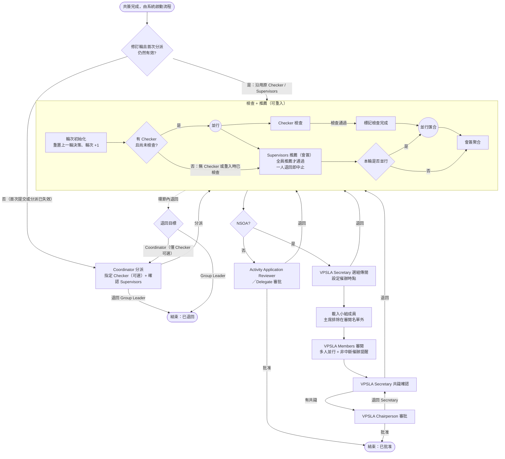

# 活動報告提交與審批流程

> 本文檔描述 SLAS 系統中「活動報告」（活動結束後的總結報告）提交與審批的完整業務流程，覆蓋 NSOA 與非 NSOA 兩種場景。
> 內容以 **2026-10 的實際運作狀況（as-built）** 為準，與 2026-07 的初版設計稿及 2026-09 需求批註有出入之處已直接改寫，不另註記；2026-09 需求批註的落實情況見 §8.4。
> 文中角色稱呼一律採用系統角色的正式名稱（見 [roles-menus-permissions-matrix.md](roles-menus-permissions-matrix.md)）。
> 步驟化的操作指引見 [activity-report-submission-guide.md](activity-report-submission-guide.md)。

> **⚠️ 同名釐清。** 系統中有兩套「活動報告」：本文描述的是活動結束後的**總結報告**；另一套是事件回報性質的翌日 / 兩週報告（R01 / R14），見 [activity-report-guide.md](activity-report-guide.md)。兩者的入口、狀態與審批鏈完全獨立。

---

## 1. 流程概覽

### 1.1 業務目標

活動結束後，由 Group Leader 代表全體 OC（活動籌備委員會）提交活動總結報告，經全體 OC 共簽後進入審批：Coordinator 分派角色 → Checker 檢查（可選）→ 全體 Supervisor 推薦 →

- **NSOA 活動**：VPSLA Secretary 選組傳閱 → VPSLA Members 審閱 → VPSLA Secretary 共識確認 → VPSLA Chairperson 審批；
- **非 NSOA 活動**：跳過 VPSLA 各環節，由 Activity Application Reviewer 或其 Delegate 直接審批。

報告**獲批准之後**，如該活動的出席記錄經「出席記錄變更」審批而更新，系統會開啟一輪**報告修訂**：Group Leader 修訂、全體 OC 重新共簽、沿用首次分派的 Checker / Supervisors 重新審批（§1.9）。

### 1.2 觸發條件與前置門檻

流程**不是由填寫報告觸發**，而是由「最後一位 OC 完成共簽」觸發。起草與發起共簽的門檻分開（2026-09 調整）：**活動獲批准即可起草，活動結束後才可發起共簽**。門檻依序是：

| # | 門檻 | 適用於 | 不滿足時 |
|:--|:--|:--|:--|
| 1 | 活動申請已獲批准 | 建立、預載、儲存草稿、發起共簽 | 全部拒絕 |
| 2 | 該活動尚無報告（一活動一報告） | 建立 | 不能重複建立 |
| 3 | 操作者屬於該活動的**籌委會**（見門檻 3 說明） | 建立 / 編輯 / 發起與撤回共簽 | 拒絕 |
| 4 | 活動結束日期已過 | 發起共簽 | 不能發起共簽（草稿仍可編輯與儲存） |
| 5 | §10「照片 / 短片已取得相關人士同意」已勾選 | 發起共簽 | 不能發起共簽 |
| 6 | OC 名單非空，且每位 OC 都有系統帳號（無帳號者系統嘗試自動建立） | 發起共簽 | 不能發起共簽 |
| 7 | 手工新增（非預載）的 OC 須是活動已登記的 OC 成員，否則必須填寫**差異備註** | 發起共簽 | 不能發起共簽 |
| 8 | 本輪快照名單內的 OC **全部**完成簽署 | 流程啟動 | 流程不啟動 |

> **§11 聲明不是發起共簽的門檻。** §11 的真實性聲明由每位 OC 在簽署對話框中閱讀並勾選「我已審閱報告，並同意簽署本聲明」後才能簽署；發起共簽時檢查的是 §10 的媒體同意。
>
> **出席依據在發起共簽時固定。** 發起共簽的同時，系統記錄本輪報告所引用的各活動日正式出席名單版本，OC 簽署的就是這一份依據；之後出席記錄再變更，不會改寫本輪已固定的依據（見 §1.9）。

> **門檻 3 的認定範圍（2026-09 定案）。** 下列任一身分皆可建立、編輯與發起共簽，能看見報告的人就能修改與提交，不再區分讀寫權限：
>
> 1. **該活動的建立人**（申請人）；
> 2. **該活動的 OC 成員**——同時涵蓋系統在申請存檔時登記的名冊與申請人自行填寫的名單，兩者取聯集；
> 3. **該活動所屬學生組織的組長**。
>
> 檢視報告詳情另外再放寬給**該報告 OC 名單上的成員**，供共簽時查閱。
>
> 演進過程：最初只認組長；2026-08 加入建立人，解決「自己籌辦活動的建立人在列表裡看不到該活動」；2026-09 再加入活動 OC 成員——組長的認定依賴學生組織成員名單上登記的職位，而客戶環境該欄位普遍空白（見 §8.3），改以活動自身的籌委會名單判斷後，不需要任何資料回填即可生效。
>
> 文中其餘章節為行文簡潔，仍以「Group Leader」代稱這一組人。

### 1.3 報告狀態總覽

| 狀態 | 業務含義 | Group Leader 後續操作 |
|:--|:--|:--|
| 草稿（Draft） | 內容可自由編輯 | 編輯、發起共簽 |
| 共簽中（Pending Endorsement） | 內容與 OC 名單鎖定 | 撤回共簽（回草稿；修訂輪則回「需要修訂」） |
| 已提交（Submitted） | 審批流程進行中 | 只能查看 |
| 已退回（Returned） | 已退回 Group Leader | 修改後**重新共簽**再提交 |
| 已批准（Approved） | 審批通過 | — |
| 需要修訂（Change Requested） | 出席記錄經審批變更，原出席依據已失效（§1.9） | 修訂後**重新共簽**再提交 |

另有一個僅存在於「管理活動報告」列表的顯示狀態「未開始（Not Started）」，表示該活動可以報告但尚未建立報告。

> 畫面上的中文狀態標籤依次為：草稿、待聯署、審批中、已退回、已批准、需要修訂、未開始。
>
> 「已批准」不再是絕對的終局：出席記錄其後若經審批變更，報告會轉入「需要修訂」，但原已批准的版本與記錄保持不變，直至修訂輪獲批准為止。

**流程內部各環節不改動主狀態**——報告在整個審批期間都是「已提交」，當前所處環節由待辦任務呈現（與活動發布審批一致）。

### 1.4 NSOA 與非 NSOA 路徑差異

| 環節 | NSOA | 非 NSOA |
|:--|:--|:--|
| Coordinator 分派 | ✓ | ✓ |
| Checker 檢查 | 可選 | 可選 |
| Supervisors 推薦（會簽） | ✓ | ✓ |
| VPSLA Secretary 選組傳閱 | ✓ | — |
| VPSLA Members 審閱 | ✓ | — |
| VPSLA Secretary 共識確認 | ✓ | — |
| VPSLA Chairperson 審批 | ✓ | — |
| Activity Application Reviewer / Delegate 審批 | — | ✓ |

分支由活動本身的 NSOA 屬性在流程啟動時決定，中途不會改變。

### 1.5 退回矩陣

| 發起環節 | 可選退回目標 | 實際去向 | 報告狀態 |
|:--|:--|:--|:--|
| Coordinator | **只有 Group Leader** | 流程結束 | 已退回 |
| Checker | Coordinator / Group Leader | 回 Coordinator 分派環節 / 流程結束 | 已提交 / 已退回 |
| Supervisor | **只有 Group Leader** | 流程結束 | 已退回 |
| Activity Application Reviewer | 無選項 | 重跑 Supervisor 推薦輪次 | 已提交 |
| VPSLA Secretary（選組） | 無選項 | 重跑 Supervisor 推薦輪次 | 已提交 |
| VPSLA Secretary（共識） | 無選項 | 重跑 Supervisor 推薦輪次 | 已提交 |
| VPSLA Chairperson | 無選項 | 回 VPSLA Secretary 共識環節 | 已提交 |
| VPSLA Members | **無退回動作** | — | — |

所有「退回」都**必須填寫審批意見**：意見欄在可退回時標示為必填，未填寫時退回按鈕不可按；繞過畫面直接送出同樣會被系統拒絕。

三個要點：

1. **只有「退回 Group Leader」會結束整個審批流程**並把報告轉為「已退回」；其餘退回都在同一輪審批之內流轉，報告維持「已提交」，Group Leader 不需要也不能介入。
2. **審批後段（Reviewer / VPSLA 選組 / VPSLA 共識）的退回一律回到 Supervisor 推薦環節**，而不是退回 Group Leader。重跑時如果 Checker 已完成檢查，不會再次拉起 Checker 任務，只重建 Supervisor 會簽。
3. **Supervisor 的退回只有一個去向**（2026-09 調整）：一律退回 Group Leader、結束本輪。原先可選「退回 Checker」，但該路徑會令審批重新展開一輪檢查與推薦、流程始終不結束，報告因此永遠到不了「已退回」、申請人也收不到通知，故予以取消。另一層原因是 Supervisors 為並行會簽，多人同時選擇不同的退回目標本身就沒有一致語義。

### 1.6 Checker 與 Supervisor 的並行門控

- **Coordinator 指定了 Checker**：Checker 任務與 Supervisors 會簽任務**同時**建立，但在 Checker 完成之前，**Supervisor 的待辦是隱藏的**（2026-09 調整，見下）。
- **Coordinator 未指定 Checker**：不建立 Checker 任務，門控直接視為已完成，Supervisors 會簽立即可辦。
- **Supervisor 必須等 Checker 完成才能提交**：這是**系統層強制校驗**，不只是畫面上的按鈕禁用——繞過介面直接送出同樣會被拒絕。

> **待辦可見性（2026-09 調整）。** 原先兩個任務同時出現在各自待辦，Supervisor 點進去只會看到一個被鎖住的提交按鈕——一條**看得到卻辦不了**的待辦。現在系統會把「本輪尚待 Checker」的 Supervisor 待辦整條隱藏，Checker 送出檢查結果後自動重現，中間不需要任何補償動作。待辦列表、任務計數、統計與「能否操作」四處採同一判斷，不會出現數字對不上的情況。

### 1.7 會簽規則與輪次

- Supervisors 為**多人會簽**：**全員推薦**才算通過；**任一位確認退回**立即中止本輪，其餘 Supervisor 的未辦任務一併取消。
- 每次進入「檢查 + 推薦」環節都會先做**輪次初始化**：把上一輪的聚合結果與各人單票重置為中性值、輪次號 +1。這保證重入後的新一輪不會被上一輪的殘留決策影響。
- 共簽同樣分輪次：報告被退回之後重新提交會令共簽輪次 +1，並要求**全體 OC 重新簽署**——內容已變更，原簽署失效。
- 撤回共簽、或共簽因出席記錄變更而被終止時，已收集的簽署**保留於歷史**，不再刪除；報告詳情只顯示本輪的簽署情況。

### 1.8 歷次審批的可追溯性

一份報告可以經歷多輪審批。每次啟動都會登記一筆審批記錄（含共簽輪次、起訖時間、結果）。報告詳情頁的審批歷史，是把**歷次審批**的意見合併呈現，因此退回重提之後仍能往回翻閱首輪的意見與 Supervisor 推薦記錄。表單 §12「Supervisor 認可」區塊即由這批記錄渲染，不另存簽名。

### 1.9 出席記錄變更引發的報告修訂輪（2026-09 新增）

活動出席名單在每個活動日**定稿**後成為正式名單；之後的更正須經「出席記錄變更」審批（OC 申請 → Checker〔可選〕→ 全體 Supervisor 推薦，見 [activity-attendance-guide.md](activity-attendance-guide.md) §4.6–§4.7）。變更獲批准後正式名單即時更新，系統再按**報告當時的狀態**決定如何處理：

| 出席變更獲批時的報告狀態 | 系統處理 | 報告狀態 |
|:--|:--|:--|
| 尚未建立報告 | 不代建報告；等待報告建立，建立時由首輪直接採用新名單 | — |
| 草稿 / 已退回 / 需要修訂 | 由下一輪直接採用新名單；通知 OC 核對 | 不變 |
| 共簽中 | **終止本輪共簽**（已簽記錄保留於歷史），要求修訂後全體 OC 重新簽署 | 需要修訂 |
| 已提交（審批中） | **不打斷審批**：審批頁顯示「出席記錄又有更新」提示，審批人自行決定繼續或退回；本輪結束後系統接續處理（批准則開啟修訂輪，退回則由下一輪採用） | 不變 |
| 已批准 | **開啟報告修訂輪**；原已批准輪次及其簽署、意見、出席依據保持不變，仍是有效版本，直至修訂輪獲批准 | 需要修訂 |

多於一份出席變更先後獲批時：修訂輪尚未發起共簽前，後來的變更併入同一輪；修訂輪已在共簽中，按「共簽中」處理；已在審批中，則排隊至本輪結束後再處理。

**修訂輪的路徑：**

1. 報告轉「需要修訂」，系統通知全體 OC；若報告原已批准，同時通知首次分派的 Checker 與 Supervisors。
2. Group Leader 修訂報告（「出席」一節已讀取最新正式名單），發起共簽。
3. **全體 OC 重新簽署**——上一輪的簽署不能沿用。
4. 末簽啟動審批時，系統核對首次 Coordinator 分派的人選是否仍然有效：
   - **全部有效**：**跳過 Coordinator**，直接沿用原 Checker 與 Supervisors；原有 Checker 的必須**重新檢查**（不沿用上一輪的檢查結論），Supervisors 的待辦同樣在檢查完成前隱藏。
   - **任一失效**：仍交 Coordinator 重新分派，審批頁說明原因（沒有可沿用的分派記錄 / 原督導員已不是本活動督導員 / 原督導員帳號已停用 / 原初審員已不再持有角色 / 原初審員帳號已停用），並預填仍然有效的 Checker。
5. 其後的檢查、Supervisors 會簽、NSOA 的 VPSLA 四環節或非 NSOA 的 Reviewer 審批，與首次提交**完全相同**，退回矩陣（§1.5）亦相同。修訂輪中如 Checker 選擇「退回 Coordinator」，同樣會出現 Coordinator 分派任務。
6. 修訂輪被退回 Group Leader 時，報告轉「已退回」；修訂後重新共簽，仍屬同一修訂輪，再次按第 4 步判斷是否跳過 Coordinator。
7. 修訂輪獲批准後成為報告新的有效版本；歷次輪次均可在審批歷史中追溯。

**畫面上如何辨認修訂輪：** 待辦類型顯示「活動報告（變更輪）」；審批頁標題旁有「報告修訂」標籤及提示「請核對更新後的出席記錄及報告內容，再繼續審批」；報告頁在「需要修訂」狀態顯示「出席記錄已獲批准變更，請修訂活動報告」。

> 本聯動在每個環境都有一項開關，預設關閉；關閉期間已批准的出席變更會停在等待狀態，開啟後由系統自動接續，不需要重新審批出席變更。

---

## 2. 角色與職責

**本流程不新增系統角色**，全部複用既有角色。

| 角色 | 流程環節 | 指派方式 | 可做的動作 |
|:--|:--|:--|:--|
| Group Leader | 流程外 | 活動建立人、活動 OC 成員，或活動所屬學生組織的組長（見 §1.2 門檻 3） | 建立 / 編輯報告、發起與撤回共簽 |
| OC 成員 | 流程外 | 活動成員中角色屬於 OC 者 | 簽署；末簽觸發流程啟動 |
| Coordinator | 分派 | 全體 Coordinator 為候選人 | 分派 / 退回 |
| Activity Application Checker | 檢查 | Coordinator 指定單人 | 檢查通過 / 退回 |
| Supervisor | 推薦 | 該活動已存檔的督導**全量**，介面唯讀、Coordinator 只確認不增刪 | 推薦 / 確認退回（**只退 Group Leader**） |
| VPSLA Secretary | 選組傳閱、共識確認 | 全體 VPSLA Secretary 為候選人 | 選組傳閱、共識確認 / 退回 |
| VPSLA Members | 審閱 | 由所選 VPSLA 審批小組載入，**主席自動排除在審閱名單外** | 只有「已審閱」 |
| VPSLA Chairperson | 審批 | 所選小組的主席 | 批准 / 退回 |
| Activity Application Reviewer／Delegate | 審批（非 NSOA） | 全體 Reviewer / Delegate 為候選人，Delegate 經代理設定解析 | 批准 / 退回 |

**分派時的系統校驗**：

- 被指定為 Checker 的人**必須持有 Activity Application Checker 角色**，否則拒絕分派；
- 被確認的 Supervisors **必須是該活動已存檔督導名單的子集**。畫面上的下拉已帶出該名單全量並**設為唯讀**（2026-08 起 Coordinator 不能再摘掉其中任何一位），系統的子集校驗作為第二道防線保留；
- Supervisors 不得為空。

---

## 3. 流程圖

---

## 4. 步驟詳述

### ① Coordinator 分派

- **誰**：全體 Coordinator（共用同一待辦，先取者處理）。
- **動作**：
  - **分派** — 指定 Checker（可留空表示不需檢查）、確認 Supervisors 名單（該名單唯讀，等同該活動已存檔督導全量）。
  - **退回** — 唯一去向是 Group Leader，流程結束、報告轉「已退回」。
- **校驗**：見 §2 的分派校驗三條。

### ② Checker 檢查（可選）

- **誰**：Coordinator 指定的那一位 Activity Application Checker。
- **動作**：檢查通過（Supervisor 的待辦隨即出現）／ 退回至 Coordinator 或 Group Leader。
- 未指定 Checker 時本環節不存在，門控直接視為已完成。

### ③ Supervisors 推薦（會簽）

- **誰**：Coordinator 確認的全體 Supervisor，並行處理。
- **動作**：推薦 ／ 確認退回（**唯一去向是 Group Leader**，流程結束、報告轉「已退回」）。
- **門控**：有 Checker 而尚未檢查完成時，Supervisor 的待辦不會出現；即使繞過介面直接送出，系統層仍會拒絕。
- **聚合**：全員推薦 → 進入下一階段；任一人退回 → 立即中止本輪並依退回目標路由。

### ④ 非 NSOA：Reviewer 審批

- **誰**：全體 Activity Application Reviewer／Delegate。
- **動作**：批准（流程結束、報告轉「已批准」）／ 退回（重跑 Supervisor 推薦輪次）。

### ⑤ NSOA：VPSLA 選組傳閱

- **誰**：全體 VPSLA Secretary。
- **動作**：選定傳閱小組 + 設定催辦提醒時點（**兩者皆必填**）／ 退回（重跑 Supervisor 推薦輪次）。

### ⑥ NSOA：VPSLA Members 審閱

- **誰**：所選小組的成員（**主席不列入審閱名單**），多人並行。
- **動作**：只有「已審閱」，**沒有退回**。
- **催辦**：到達設定時點時，系統向尚未提交的成員發出提醒。這是**非中斷**提醒——不會自動完成任務、不視為無異議，流程持續等待全員提交。逾時語義待需求方確認（見 §8）。

### ⑦ NSOA：VPSLA 共識確認

- **誰**：全體 VPSLA Secretary。
- **動作**：確認有共識（送交主席）／ 退回（重跑 Supervisor 推薦輪次）。

### ⑧ NSOA：VPSLA Chairperson 審批

- **誰**：所選小組的主席。
- **動作**：批准（流程結束、報告轉「已批准」）／ 退回（回到 ⑦ 共識確認）。

### ⑨ 流程結束後的回寫

| 結束方式 | 報告狀態 | 附帶處理 |
|:--|:--|:--|
| 批准 | 已批准 | 清空退回原因；如有出席變更因本輪審批中而排隊，隨即開啟修訂輪（§1.9） |
| 退回 Group Leader | 已退回 | 記錄退回原因；**共簽狀態一併重置**，重新提交須全體 OC 再簽一輪；排隊中的出席變更由下一輪採用 |

兩種結束都會回寫該輪審批的結果與結束時間，供 §1.8 的跨輪次追溯使用。

---

## 5. 通知設計

待辦與通知中的環節名稱，按 2026-09 需求批註統一改稱 **Activity Report**（不再使用 Post-event Evaluation Report），並提供三語翻譯：Role Assignment / Activity Report Submission Check / Activity Report Submission Recommendation / VPSLA Selection and Circulation Check / Activity Report Review / VPSLA Consensus Check / Activity Report Approval（繁體依次為：角色分配、活動報告提交檢查、活動報告提交推薦、VPSLA 選組及傳閱檢查、活動報告審閱、VPSLA 共識檢查、活動報告審批）。

> 需求文檔的第一個步驟名 **Post-event Evaluation Report Submission**（現稱 Activity Report Submission）對應流程的起點（共簽完成觸發），不是待辦任務，因此不會出現在待辦列表中，也未納入上述任務名翻譯。

| 觸發點 | 接收人 |
|:--|:--|
| 發起共簽 | 全體 OC 成員（含直達簽署頁的連結） |
| 全員簽署完成、流程啟動 | Group Leader + Coordinator |
| 各審批環節到達 | 對應角色（**Checker 與 Supervisors 同時**收到） |
| 退回（各來源） | 退回目標方（Group Leader / Coordinator / Checker / Supervisors / VPSLA Secretary） |
| 審批通過 | Group Leader + 全體 OC |
| VPSLA 催辦時點到達 | 尚未提交的 Members（僅提醒，不改變任務狀態） |
| 出席變更獲批，報告需要修訂 / 改用新名單 | 全體 OC；報告原已批准時另加首次分派的 Checker 與 Supervisors（「活動報告需要修訂」） |

---

## 6. 權限與菜單

菜單「管理活動報告」掛在**組織者中心**下，預設授予 Group Leader 角色。功能權限分為五級，可按角色分別開放：查看報告與列表、建立草稿、儲存草稿、發起 / 撤回共簽與簽署、審批端動作。

---

## 7. 與需求文檔 2.2 節的逐條對應

| 需求條目 | 落實方式 |
|:--|:--|
| 1 Group Leader 代表提交 | 建立 / 編輯 / 發起共簽三處均校驗操作者為活動所屬學生組織的組長、活動建立人或活動 OC 成員（§1.2 門檻 3） |
| 2 全體 OC 共簽 | 分輪次的共簽快照，末簽即時啟動流程，不會出現「簽完但流程沒起」的中間態（§1.2、§1.7） |
| 3 Coordinator 角色分派 | §4① |
| 4 Checker 可選 | 未指定 Checker 時不建立該任務，門控直接放行（§1.6） |
| 5 Checker / Supervisor 同時待辦 | 並行建立兩個任務（§1.6） |
| 6 Supervisor 需待 Checker 完成 | 系統層強制門控（§1.6） |
| 7 一名 Supervisor 即可確認退回 | 會簽即時中止，其餘任務一併取消（§1.7） |
| 8 全員推薦才通過 | 會簽聚合 + 每輪重置（§1.7） |
| 9 NSOA 走 VPSLA 四環節 | §4⑤–⑧ |
| 10 非 NSOA 由 Reviewer / Delegate 審批 | §4④ |
| 11 OC 名單預載 + 差異備註 | 預載自活動成員，逐行保留「是否預載」標記與差異備註欄；手工新增而非活動登記 OC 者，差異備註必填（§1.2 門檻 7） |
| 12 PDF 匯出 | **範圍外**，見 §8 |

---

## 8. 範圍外、待確認與已知限制

### 8.1 範圍外（明確不做）

- **PDF 匯出**（需求第 12 條）：長期需求，本期不實作。
- **VPSLA 環節的 AI 摘要與多輪共識循環**：活動發布審批有，報告流程需求未要求，結構預留可後加。

### 8.2 待需求方確認

1. **VPSLA Members 審閱逾時語義**：需求文檔未定義截止規則或「逾期視為無異議」。自動完成任務會直接改變審批結果，屬新增業務規則。確認前的做法是：僅在設定時點發催辦提醒，不自動完成，流程等待全員提交。
2. **§11 聲明的簡體中文措辭**：模板僅提供英文與繁體原文（實作時逐字沿用），簡體為新譯本。該聲明涉及學生紀律處分與法律責任，正式上線前須經需求方確認。

### 8.3 已知限制

- **VPSLA（NSOA）分支尚無完整實跑記錄**：截至 2026-08，測試環境已有多份報告走完非 NSOA 路徑並結案，但 VPSLA 選組、Members 審閱、共識、主席四個環節的歷史記錄為 0。§1.5 的退回矩陣中，「退回 Group Leader」已有實跑記錄，**「Checker 退回 Coordinator」以及審批後段（Reviewer／VPSLA 選組／VPSLA 共識／Chairperson）的各條退回尚未被走過**（「Supervisor 退回 Checker」曾有實跑記錄，該路徑已於 2026-09 取消，見 §1.5 要點 3）。UAT 應優先覆蓋 NSOA 全鏈與這批未走過的退回路徑。
- **VPSLA Members 沒有退回動作**，只能標記「已審閱」。
- **Coordinator 的退回只有一個去向**（Group Leader），介面不提供其他選項。
- **修訂輪尚未有完整實跑記錄**：截至 2026-09 下旬，測試環境已實跑「出席變更 → 尚無報告 → 建立報告時承接」；「已批准報告 → 修訂輪 → 跳過 Coordinator → 重新審批」這條主路徑仍待 UAT 覆蓋。
- **出席依據來自定稿名單**：報告「出席」一節只採用已定稿活動日的正式名單；若所有活動日都未定稿，改以舊有方式（簽到記錄、已批准報名與嘉賓）組成，該輪的出席依據在系統內記為無法核實。請在發起共簽前先定稿所有活動日。

### 8.4 2026-09 需求批註的落實情況

2026-09 的需求批註（Activity Report Submission Design 20260906）中，截至 2026-10-09 已落實：

| 批註 | 落實方式 |
|:--|:--|
| 審批通過即可起草，活動結束後才可發起共簽 | §1.2 門檻 1、4 |
| 統一稱 Activity Report，並預載第 04 節活動目標 | §5 環節名稱；活動目標預載自活動申請的「活動目標闡述」，重新開啟草稿不會覆蓋已編輯內容 |

以下批註**尚未落實**，現行行為仍如本文所述：Supervisor 退回 Coordinator、多名 Checker 任一完成、Coordinator 增刪 Supervisor、VPSLA Members 三種意見及逾期視為 Neutral、主席與 Members 並行查看、通知擴展至早前參與審批人員、管理員重設 / 轉移起草權。其中「學生修訂後 Checker 必須複查」目前只在出席變更引發的修訂輪中強制（§1.9 第 4 步）；一般退回後重新提交仍由 Coordinator 決定是否指定 Checker。
