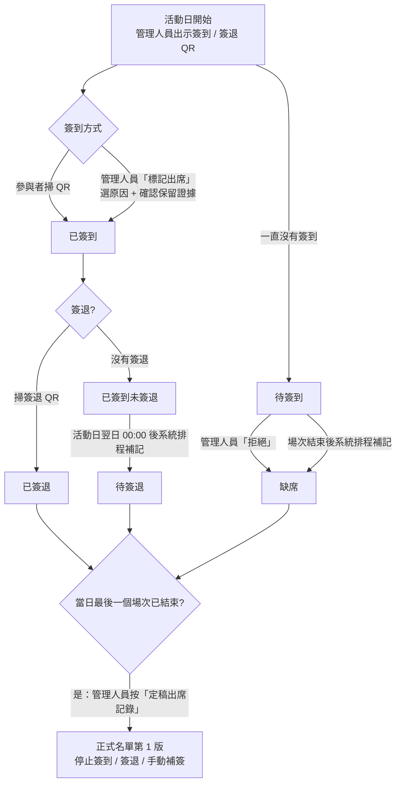
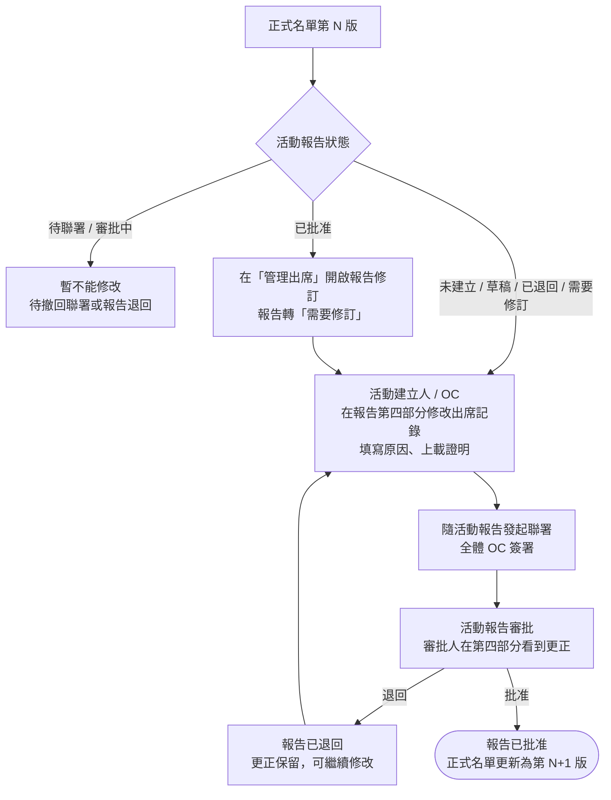

# 活動出席（QR 簽到、手動補簽、定稿與出席更正）

> 本文檔面向 Demo 執行人、UAT 測試人與業務培訓人員，目標是讓使用者**不依賴開發人員陪同**，也能完成 QR 簽到、手動補簽、定稿出席記錄，以及定稿後在活動報告中更正出席記錄。
>
> 內容以 **2026-11 的實際運作狀況（as-built）** 為準；與 2026-09 之前版本有出入之處已直接改寫，不另註記。
> 角色稱呼以系統角色的正式名稱為準（見 [roles-menus-permissions-matrix.md](roles-menus-permissions-matrix.md)）。
> **出席記錄的更正隨活動報告一併審批**（按 2026-11-19 客戶意見，2026-11-26 上線）：不再設獨立的出席記錄變更審批。報告一方的處理見 [activity-report-submission-guide.md](activity-report-submission-guide.md) §5.10。

---

## 1. 模組概覽

### 1.1 業務目標

記錄參與者在活動現場的出席情況（簽到 / 簽退），在每一個活動日結束後把當日的出席結果**定稿**為一份正式名單；定稿之後如發現漏記或錯記，在**活動報告第四部分**直接修改出席記錄；更正隨活動報告一併審批，報告獲批准時寫入正式名單。正式名單是活動報告「出席」一節與後續統計的唯一依據。

### 1.2 出席名單的生命週期

出席名單以**活動日**為單位管理（同一日的多個場次一併處理）：

| 階段 | 畫面顯示 | 可以做什麼 |
|:--|:--|:--|
| 收集中 | 「收集中」 | 參與者掃 QR 簽到 / 簽退；管理人員手動補簽、標記缺席；系統排程自動補記缺席 / 未簽退 |
| 正式名單第 1 版 | 「正式名單 · 第 1 版」 | 當日最後一個場次結束後，由管理人員按「定稿出席記錄」產生。此後**停止簽到、簽退與手動補簽** |
| 更正待生效 | 「活動報告中有本日的出席更正……」 | 活動建立人 / OC 在活動報告第四部分修改出席記錄；報告獲批准前，正式名單、統計與匯出仍維持原版本 |
| 正式名單第 N+1 版 | 「正式名單 · 第 N+1 版」 | 活動報告**獲批准時生效**；舊版本保留可查 |

> 定稿是**手動指令**，系統不會自動定稿。系統排程只會在收集階段替未簽到者補記缺席、替未簽退者補記未簽退（見 §4.3），補記後名單仍是「收集中」。

### 1.3 出席結果

管理出席頁面把當日名單分成五個頁籤，頁籤上的數字是全量統計，不受翻頁影響：

| 頁籤 | 含義 |
|:--|:--|
| 待簽到 | 應到但尚未簽到 |
| 已簽到 | 已簽到、尚未簽退 |
| 待簽退 | 已簽到，活動日已過但沒有簽退（由系統補記） |
| 已簽退 | 已簽到並已簽退 |
| 缺席 | 被標記缺席（人手「拒絕」或系統補記） |

定稿時，每人的結果歸入以下四種正式狀態之一：**已出席**（有簽到及簽退）、**未簽退**（有簽到、無簽退）、**缺席**（沒有簽到）、**已拒絕**（被拒絕簽到者保留原判定）。

### 1.4 與其他模組的關係

- **應到名單**：報名獲最終批准、或嘉賓邀請獲接受時，系統即把該人加入出席名單；婉拒邀請的嘉賓不會加入。
- **活動報告**：報告第四部分的「出席」按場次列出各活動日的名單，出席記錄就在這裏更正（§4.6）；更正隨報告審批，報告獲批准時才寫入正式名單（§4.9）。
- **活動狀態**：活動所有場次的翌日 00:00 均已過去後，系統排程把活動轉為「已完成」。

---

## 2. 角色與職責

| 角色 | 職責 |
|:--|:--|
| 參與者（Student / Guest） | 掃 QR 自助簽到 / 簽退 |
| 能管理該活動出席的人員：活動建立人、活動 OC 成員、該活動的 Supervisor、活動所屬學生組織的組長（Group Leader）、管理員 | 出示 QR、手動補簽、標記缺席、定稿出席記錄、查看名單記錄與版本歷史 |
| 活動建立人、活動 OC 成員 | 在活動報告第四部分**更正**已定稿的出席記錄；活動報告已批准時，在「管理出席」開啟報告修訂 |
| 活動報告的審批人（Coordinator、Checker、Supervisor、Reviewer / VPSLA） | 在活動報告審批中一併審核出席更正（§4.7） |
| 系統（排程） | 收集階段自動補記缺席 / 未簽退；活動結束後把活動轉為「已完成」 |
| 系統（報告獲批准時） | 把出席更正寫入正式名單，產生新版本 |

> 組長的判定依賴學生組織成員名單上登記的職位，客戶環境（UAT / PROD）該資料普遍空白，因此「組長」這一條在客戶環境實際上很少生效，詳見 [activity-report-submission-guide.md](activity-report-submission-guide.md) §7。

---

## 3. 流程圖

### 3.1 收集與定稿

### 3.2 在活動報告中更正出席

---

## 4. 關鍵步驟詳述

入口：**組織者中心 → 管理出席**。先選學年與活動，再在「當前日程」選擇活動日頁籤。同一日的多個場次合併為一個頁籤。活動選單**只列出已獲批准的活動**；未獲批准的活動（草稿、審批中、已退回或已拒絕）不會出現，不能為其管理出席。

### 4.1 QR 簽到 / 簽退（參與者自助）

- 活動資訊卡右上方有「簽到二維碼」與「簽退二維碼」兩個按鈕，打開後可選**動態二維碼**（按設定秒數自動更新）或**靜態二維碼**；活動尚未開始時動態二維碼不可用，可改用靜態二維碼。
- 2026-09 調整：二維碼放大並加上白邊，手機較易掃描；二維碼直接連到簽到頁。參與者若尚未登入，會先被帶到登入頁，**登入後自動返回簽到頁**完成簽到，不必重掃。
- **全屏顯示**：二維碼生成後可按「全屏顯示」把二維碼放大至整個畫面，方便現場投影或以平板展示；按畫面右上角的「×」（電腦亦可按 Esc）返回。瀏覽器不支援原生全螢幕功能時（例如部分手機或平板瀏覽器），二維碼同樣會鋪滿瀏覽器畫面。
- **只限場次當日**：自助掃碼只在該場次的日期當天有效。日期未到會提示「此場次尚未開始，只可於場次當日進行簽到簽退」；日期已過則提示「此場次已結束……」。系統只比對日期，不比對時分。
- **同日多場次一次簽到**：在某一場次簽到，會同時記錄同一日所有場次的簽到。
- **同日不可重複簽到**：當日已有簽到記錄即不能再簽，包括已簽退之後。
- **可重複簽退**：每次簽退都會保留記錄，名單以**最後一次**簽退時間為準；簽退會清除系統補記的「未簽退」。
- **遲到簽到會清除誤補的缺席**：若系統已替該場次補記缺席，參與者稍後在同日簽到時，該缺席記錄會被移除。
- **已定稿的活動日**：兩個二維碼按鈕會變灰，提示「當天出席記錄已定稿」；即使用舊二維碼掃描，系統也會拒絕並提示「此場次的出席記錄已定稿，如需更正請在活動報告中修改」。

### 4.2 手動補簽與標記缺席（管理人員）

在「待簽到」頁籤勾選人員後，表格上方提供兩個操作（其他頁籤不提供批次操作）：

**標記出席（手動簽到）**——2026-09 起須說明原因並確認保留證據：

1. 按「標記出席」，彈出「手動簽到確認」對話框。
2. **原因**（必選）：二維碼無法掃描 / 手機或網絡故障 / 無手機，已由 OC 核實 / 自助簽到不可用 / 其他。選「其他」時須填寫**補充說明**。
3. 勾選「我確認將保留支持證據並在核查時提供。本操作不得用於偽造出席記錄。」——未勾選時「確認」按鈕不可按。
4. 確認後，系統為所選人員記錄簽到（同樣覆蓋同日所有場次）。

稽核：系統記錄原因、補充說明、操作人與證據確認。在該人員的「詳情」中可看到「原因」與「補充說明」。缺少原因或未確認證據的請求，即使繞過畫面直接送出也會被系統拒絕。

其他規則：

- 手動簽到與掃碼走同一套檢查：報名須已獲批准、不在黑名單內、符合年齡要求；同日已有簽到的人不能再簽。
- 手動補簽**不受「只限場次當日」限制**，可事後補登；但畫面要求活動已開始（活動開始日當天或之後）。
- 沒有系統帳號的嘉賓無法用此方式補簽。

**拒絕（標記缺席）**：確認後把所選人員標記為缺席，作用於**整個活動日**；當日已簽到的人不能被標記缺席。

> 管理端目前畫面只提供「標記出席」與「拒絕」兩個批次操作，**沒有人手補簽退的按鈕**；漏簽退者由系統補記為「未簽退」，定稿後如需更正，在活動報告中修改（§4.6）。

### 4.3 系統排程自動補記

系統定時排程（執行頻率按環境設定）會處理已結束的場次：

| 時點 | 處理 |
|:--|:--|
| 場次結束後 | 報名已獲批准、或嘉賓邀請已接受，但當日沒有任何出席記錄者 → 補記**缺席** |
| 場次日期翌日 00:00 後 | 已簽到但沒有簽退者 → 補記**未簽退**（「待簽退」頁籤） |
| 活動所有場次的翌日 00:00 均已過 | 活動轉為「已完成」 |

排程**不會定稿**，也不會改動已定稿的活動日。

### 4.4 定稿出席記錄

- **誰**：能管理該活動出席的人員（§2）都看得到「定稿出席記錄」按鈕。
- **何時**：當日**最後一個場次結束後**才可按；之前按鈕為灰色，滑鼠停留時提示可定稿的時間。
- **確認對話框**列出：當日所有場次、按現有頁籤人數預覽的定稿結果，以及警告「定稿後將產生正式名單第 1 版，並停止當天的簽到和簽退。此後的更正須在活動報告中修改，隨報告一併審批。」

| 定稿前的頁籤 | 定稿後的正式狀態 |
|:--|:--|
| 已簽退 | 已出席 |
| 已簽到、待簽退 | 未簽退 |
| 待簽到、缺席 | 缺席 |

- **整日一併定稿**：同一日的所有場次一次定稿為同一份正式名單。
- **重複定稿無害**：若當日已被他人定稿，系統提示「該日期此前已定稿（第 N 版），未作任何更改」，不會產生新版本。
- **會被拒絕的情況**：當日場次尚未全部結束；場次日期或時間缺漏、無法判斷結束時間；場次結束時間早於開始時間（跨午夜）。後兩者屬活動排程資料問題，須先修正排程。

### 4.5 狀態提示列與主要按鈕

選定活動日後，「整理活動記錄」標題下方有一條**狀態提示列**，右上方只有一個隨狀態變化的**主要按鈕**，另有「記錄」下拉選單（§4.8）。定稿後，「管理出席」只供查看；出席記錄的更正一律在活動報告中進行。

| 當日狀況 | 提示列 | 主要按鈕 |
|:--|:--|:--|
| 收集中，當日場次未結束 | 收集中。當天最後一個場次結束後（日期 時間）方可定稿 | 定稿出席記錄（灰色） |
| 收集中，當日場次已全部結束 | 當天場次已全部結束。請定稿出席記錄…… | 定稿出席記錄 |
| 已定稿，報告中沒有本日的更正 | 正式名單 · 第 N 版。如需更正，請在活動報告第四部分修改出席記錄；更正隨報告一併審批 | 在活動報告中修改出席（只限活動建立人 / OC） |
| 已定稿，報告中有本日的更正 | 活動報告中有本日的出席更正，將隨報告一併審批。報告獲批准前，正式名單仍為第 N 版 | 在活動報告中修改出席 |
| 活動報告待聯署或審批中 | 活動報告待聯署 / 審批中，暫不能修改出席記錄 | （沒有按鈕） |
| 活動報告已批准 | 正式名單 · 第 N 版。活動報告已批准；如需更正，須開啟報告修訂，全體 OC 須重新聯署 | 開啟報告修訂（只限活動建立人 / OC） |

「在活動報告中修改出席」會直接打開該活動的報告。頁面不會自動刷新——報告狀態在別處改變後，按提示列的「重新整理」即可讀取最新狀態。

### 4.6 在活動報告中更正出席（活動建立人 / OC）

**前提**：該活動日已定稿；活動報告可以編輯（草稿、已退回或需要修訂）。報告已批准時，須先在「管理出席」按「開啟報告修訂」（§4.9）。

1. 打開活動報告，進入**第四部分「活動記錄」**。「出席」按場次分頁籤列出每個已定稿的場次；有更正的場次，頁籤旁標示「已修改 N 人」。
2. 在要更正的場次按「修改出席記錄」，名單即可直接編輯。每個場次只有一份更正，該活動的建立人與 OC 共同編輯。可篩選姓名 / 學號、狀態，或「只顯示已修改的列」：

   | 可以做 | 規則 |
   |:--|:--|
   | 修改參加者類別、出席狀態、簽到 / 簽退時間 | 狀態須與時間相符（見下表）；時間不能晚於現在。改動過的欄位下方以刪除線顯示原值 |
   | 取消「計入」（排除某人） | 須填寫**排除原因**；正式名單上的人**不能刪除**，只能排除 |
   | 重新計入先前被排除的人 | 狀態與時間仍須有效 |
   | 「新增參與者」 | 須填寫**新增原因**；同一人不能重複出現；新增的行可「移除」 |

   | 出席狀態 | 簽到時間 | 簽退時間 |
   |:--|:--|:--|
   | 已出席 | 必填 | 必填，不能早於簽到 |
   | 未簽退 | 必填 | 必須留空 |
   | 缺席 / 已拒絕 | 必須留空 | 必須留空 |

3. **新增參與者**對話框分「已報名參與者」與「嘉賓」兩個頁籤：
   - 「已報名參與者」只列出**符合資格**的學生：其目前有效的報名狀態為待推薦、待審批或已批准，且**報名提交時間早於活動最後一個場次的計劃結束時間**。報名尚未獲批的學生也可加入，畫面會註明「報名尚未獲批，須經活動報告審批」。
   - 每位候選人旁顯示「報名資格依據」（報名狀態、提交時間、最後場次計劃結束時間，以香港時間顯示）；同一依據會隨更正保存，報告審批人看到的是發起聯署時記錄的依據。
   - 已在名單中的人顯示「已在名單中」，不能重複加入。學號按權限遮蔽顯示。
4. **更正原因**（發起聯署前必填，最多 2000 字）。
5. **上載證明文件**（例如醫生證明或已簽署的簽到表），可標示為「整體證明」或某位參與者的「個人證明」。
6. 按報告的「儲存草稿」，出席更正與報告其他內容一併儲存；「還原為正式名單」可捨棄該場次的全部更正。

更正**沒有獨立的「提交審批」**：OC 發起報告聯署時，各場次的更正隨報告一併提交，此後內容鎖定。發起聯署時，系統會：

| 檢查 | 不通過時 |
|:--|:--|
| 每份更正已填寫更正原因 | 不能發起聯署，提示補填 |
| 新增學生的報名資格未改變（期間報名被取消或資格改變） | 不能發起聯署，提示須移除該學生 |
| 更正後的名單與正式名單相同 | 視為沒有更正，報告照常引用正式名單 |

同一份更正在另一視窗被修改過時，儲存會提示「已在其他地方被修改，已重新載入」。

### 4.7 出席更正的審批

出席更正**沒有獨立的審批流程**，隨活動報告一併審批：

- **審批人與環節**完全按活動報告的規則（Coordinator 分派、Checker 檢查、Supervisors 推薦、Activity Application Reviewer 或 VPSLA 批准），見 [activity-report-submission-guide.md](activity-report-submission-guide.md) §5。
- **審批頁**第四部分的「出席」與 OC 看到的是同一張表（唯讀）：新增的人標示「新增」，被排除的人標示「已排除」並附原因，改動過的欄位以刪除線顯示原值；表下列出更正原因與證明文件（可下載），新增學生另列報名資格依據。
- 審批人對出席更正有異議時，**退回整份報告**；不設「只批准報告、否決出席更正」的選項。
- **報告退回**：更正保留，OC 繼續修改後重新發起聯署。
- **撤回**：待聯署期間起草人撤回聯署，報告回到草稿（或需要修訂），更正保留可再修改。報告進入審批後不能撤回，與報告的規則相同。
- **報告獲批准**：每個有更正的場次，正式名單更新為第 N+1 版，版本記錄對應的報告審批輪次；之後按報告規則重新同步 ELAT（[activity-report-submission-guide.md](activity-report-submission-guide.md) §6.7）。
- 報告審批期間，正式名單、統計與匯出仍維持第 N 版。

### 4.8 記錄：版本歷史與更正記錄

活動日頁籤選定後，「記錄」下拉選單提供兩項，在同一個側欄中以頁籤切換：

- **出勤名冊版本歷史**：每個正式版本的版本號、參與人數、生效日期；第 1 版標示「初始提交」，由更正產生的版本可按「查看活動報告」打開對應的報告。尚未定稿時顯示「該日期尚未定稿，暫無正式版本」。
- **出勤修訂記錄**：每一筆已生效的更改，列出原本狀態、更新後狀態、更正原因、修改人、修改時間、出席方式、生效版本，以及批准人。

能查看記錄與下載附件的人：能管理該活動出席的人員、該活動報告的審批人。附件下載會先核對檔案確實屬於該活動，其他人不能憑檔案編號取得。

### 4.9 與活動報告的聯動

能否更正出席記錄，取決於活動報告當時的狀態：

| 活動報告狀態 | 能否更正出席記錄 | 更正何時生效 |
|:--|:--|:--|
| 草稿 / 已退回 / 需要修訂 | 可以，在報告第四部分修改 | 報告獲批准時 |
| 待聯署 | 不可以（內容鎖定）；起草人撤回聯署後可再修改 | — |
| 審批中 | 不可以；如需修改，待報告退回 | — |
| 已批准 | 須先在「管理出席」按「開啟報告修訂」：報告轉「需要修訂」，原已批准版本保留，並自動打開報告；之後按草稿處理 | 修訂輪獲批准時 |

- **開啟報告修訂**前會再確認一次，提示「報告將轉為需要修訂，修改後全體 OC 須重新聯署，並重新審批」。
- 修訂輪尚未發起聯署前，OC 可「取消報告修訂」：捨棄所有出席更正，報告回到已批准。
- 修訂輪的審批路徑（誰重簽、誰重審）見 [activity-report-submission-guide.md](activity-report-submission-guide.md) §5.10。

---

## 5. 狀態一覽

### 5.1 出席方式

系統為每一筆出席記錄保留其來源：參與者掃碼、管理人員手動（附原因）、由同日另一場次的簽到 / 簽退**連帶記錄**、系統排程自動補記（缺席 / 未簽退）、出席更正隨活動報告獲批准後寫入。畫面的「詳情」目前只顯示手動補簽的「原因」與「補充說明」，其餘來源不在畫面上標示。

> 「連帶記錄」不是另一次出席。統計多場次活動的出席人次時，不應把它當作獨立的一次出席重複計算。

### 5.2 出席更正的狀態

| 狀態 | 含義 |
|:--|:--|
| 編輯中 | 報告可編輯，更正可在第四部分繼續修改 |
| 已鎖定 | 活動報告待聯署或審批中，更正不能修改 |
| 已生效 | 活動報告已批准，正式名單已更新為新版本 |

還原為正式名單或取消報告修訂後，更正不留存，該場次回到正式名單。

---

## 6. 端到端 Demo 指南

### 6.1 準備條件

- 一個已獲批准並已發布、且有已批准報名的活動，活動報告為草稿或尚未建立；最好包含「同一日多個場次」與「不同日期」兩種場次，以演示同日連帶與按日定稿。
- 至少 3 名已錄取學生帳號（甲：完整簽到簽退；乙：只簽到不簽退；丙：不出席）；另 1 名有報名、但未被列入名單或需補入的學生（丁），用於出席更正。
- 活動建立人或 OC 成員帳號（管理出席、在報告中更正出席、發起報告聯署）。
- 活動報告審批所需的帳號（Coordinator、Supervisor、Reviewer 等），見 [activity-report-submission-guide.md](activity-report-submission-guide.md) §8.1。

### 6.2 主線：簽到 → 簽退 → 定稿

1. 管理人員進「管理出席」，選擇活動與活動日，打開「簽到二維碼」。
2. 學生甲用手機掃碼（未登入者先登入，登入後自動返回簽到頁）→ 簽到成功。
   - 驗證點：「已簽到」頁籤出現甲；若當日有多個場次，其他場次同樣顯示已簽到。
3. 學生乙同樣簽到，但之後不簽退；學生甲掃「簽退二維碼」→ 進入「已簽退」。
4. 學生丙全程不簽到。
5. 當日最後一個場次結束後，按「定稿出席記錄」→ 核對對話框中的場次與預覽人數 → 確認定稿。
   - 驗證點：提示「出席記錄已定稿，正式名單第 1 版已生效」；標題旁標籤變為「正式名單 · 第 1 版」；兩個二維碼按鈕變灰；「記錄 → 出勤名冊版本歷史」出現第 1 版（初始提交）；甲為已出席、乙為未簽退、丙為缺席。
6. 用學生帳號再次掃同一二維碼 → 被拒絕（已定稿）。

### 6.3 旁支：手動補簽與標記缺席

在**另一個尚未定稿**的活動日操作：

1. 「待簽到」頁籤勾選一名未能掃碼的學生 → 「標記出席」→ 選原因（例如「手機或網絡故障」）、勾選證據確認 → 確認。
   - 驗證點：不選原因或不勾選確認時「確認」不可按；成功後該學生進入「已簽到」；開啟其「詳情」可見「原因」。
2. 勾選另一名學生 → 「拒絕」→ 確認。
   - 驗證點：該學生進入「缺席」頁籤，同日其他場次一併標記。

### 6.4 主線：在活動報告中更正出席 → 隨報告審批 → 正式名單第 2 版

接續 §6.2 已定稿的活動日，活動報告為草稿：

1. **活動建立人 / OC** 在「管理出席」按「在活動報告中修改出席」→ 打開報告，進入第四部分。
2. 在該場次的頁籤按「修改出席記錄」。把學生乙改為「已出席」並填入實際簽退時間；「新增參與者」加入學生丁並填寫新增原因；填寫更正原因；上載一份證明文件。
   - 驗證點：乙的狀態欄下方以刪除線顯示原值；丁只出現一次。
3. 按報告的「儲存草稿」→ 離開再打開報告。
   - 驗證點：修改與附件仍在；「管理出席」狀態提示列顯示「活動報告中有本日的出席更正」。
4. 發起聯署，全體 OC 簽署。
   - 驗證點：第四部分改為唯讀並標示改動；「管理出席」顯示暫不能修改；正式名單、頁籤人數與匯出**仍是第 1 版**。
5. 按活動報告的審批路徑處理至批准（見 [activity-report-submission-guide.md](activity-report-submission-guide.md) §8）。審批頁第四部分可見同一張標示了改動的表與附件。
   - 驗證點：報告「已批准」；「管理出席」按「重新整理」後標籤變為「正式名單 · 第 2 版」；乙為已出席、丁出現一次；版本歷史保留第 1 版。

### 6.5 旁支：退回、撤回聯署與報告修訂

1. **報告退回**：在 §6.4 第 5 步由審批人退回報告 → 正式名單仍為第 1 版；第四部分的更正保留，OC 可繼續修改後重新聯署。
2. **撤回聯署**：發起聯署後、報告進入審批前，起草人撤回聯署 → 第四部分恢復可編輯，更正仍在。
3. **還原為正式名單**：在第四部分按「還原為正式名單」→ 該場次回到正式名單，頁籤旁不再標示「已修改」。
4. **報告已批准後更正**：在「管理出席」按「開啟報告修訂」並確認 → 報告轉「需要修訂」並自動打開；在第四部分更正後，全體 OC 重新聯署、重新審批；批准後正式名單更新為下一版本。修訂輪發起聯署前按「取消報告修訂」→ 報告回到已批准，更正捨棄。

---

## 7. 邊界與已知限制

- **舊活動的名單需要資料遷移**：新版出席名單在報名獲批或嘉賓接受邀請時建立。在此機制上線前已完成報名審批的活動，名單需經資料遷移才會完整顯示；**該遷移尚未完成**，UAT 請使用上線後新建並審批報名的活動。
- **出席按場次更正**：定稿與簽到都是整日處理，但報告第四部分按場次分頁籤，同日多個場次須分別更正。
- **手動補簽不受「場次當日」限制**，管理人員可為已過去的活動日補登（只要該日尚未定稿）；這是刻意保留的做法。
- **已定稿活動日的「標記出席」/「拒絕」按鈕仍可按**，但系統會拒絕並提示已定稿；二維碼按鈕則已變灰。
- **沒有人手補簽退的操作**（見 §4.2）。
- **自動補記依賴排程**：場次結束後要等下一次排程執行才會補記缺席 / 未簽退，Demo 時需等候或請管理員觸發排程。
- **定稿須由人手執行**：當日場次結束後如無人定稿，該日會一直停在「收集中」，報告出席一節也不會引用該日的正式名單（見 [activity-report-submission-guide.md](activity-report-submission-guide.md) §1.4）。
- **原「出席記錄審核」流程已停用**；出席更正一律隨活動報告審批。
- 嘉賓沒有系統帳號時以電郵識別，請避免重複電郵；這類嘉賓無法手動補簽。
- 頁面不會自動刷新：報告狀態在別處改變後，請按狀態提示列的「重新整理」。
