# 活動報告（活動總結報告）操作手冊

> 本手冊面向**活動 OC（籌委會）**、**各審批角色**與 **SAO 管理員**，涵蓋活動總結報告的完整操作：參與者問卷 → 報告起草 → OC 聯署 → 審批 → ELAT 同步。讀完本手冊，使用者應可**不依賴開發人員陪同**完成整個流程。
>
> 內容以 **2026-11 的實際運作狀況（as-built）** 為準。截圖取自測試環境，畫面語言為英文；截圖中的活動、帳號與問卷名稱（如「6号-导入」、「S2-FIXTURE」）是測試資料，正式環境以實際名稱為準。
>
> 設計層面的環節條件與需求對應見 [activity-report-submission-design.md](activity-report-submission-design.md)；角色稱呼以系統角色的正式名稱為準（見 [roles-menus-permissions-matrix.md](roles-menus-permissions-matrix.md)）。

> 本手冊的「活動報告」指活動結束後的**總結報告**（OC 名單、財務收支、出席、照片影片、問卷結果、聲明）。翌日 / 兩週**事件報告**（R01 / R14）是另一套功能，見 [incident-report-guide.md](incident-report-guide.md)。

---

## 目錄

1. [概覽](#1-概覽)
    - [1.1 整體流程](#11-整體流程)
    - [1.2 角色與職責](#12-角色與職責)
    - [1.3 報告狀態](#13-報告狀態)
2. [參與者問卷](#2-參與者問卷)
    - [2.1 進入問卷範本頁面（SAO）](#21-進入問卷範本頁面sao)
    - [2.2 設定發送時間（SAO）](#22-設定發送時間sao)
    - [2.3 建立問卷範本（SAO）](#23-建立問卷範本sao)
    - [2.4 管理範本與設定預設（SAO）](#24-管理範本與設定預設sao)
    - [2.5 為個別活動指定範本（SAO）](#25-為個別活動指定範本sao)
    - [2.6 問卷發送規則](#26-問卷發送規則)
    - [2.7 參與者填寫問卷](#27-參與者填寫問卷)
3. [起草活動報告](#3-起草活動報告)
    - [3.1 誰可以起草](#31-誰可以起草)
    - [3.2 建立報告](#32-建立報告)
    - [3.3 填寫報告各部分](#33-填寫報告各部分)
    - [3.4 報告中的問卷結果](#34-報告中的問卷結果)
4. [OC 聯署](#4-oc-聯署)
    - [4.1 發起聯署](#41-發起聯署)
    - [4.2 OC 簽署](#42-oc-簽署)
    - [4.3 撤回聯署](#43-撤回聯署)
    - [4.4 轉移起草權（SAO）](#44-轉移起草權sao)
5. [審批](#5-審批)
    - [5.1 審批流程圖](#51-審批流程圖)
    - [5.2 從待辦進入審批頁](#52-從待辦進入審批頁)
    - [5.3 Coordinator 分派](#53-coordinator-分派)
    - [5.4 Checker 檢查](#54-checker-檢查)
    - [5.5 Supervisor 推薦](#55-supervisor-推薦)
    - [5.6 Activity Application Reviewer 審批（非 NSOA）](#56-activity-application-reviewer-審批非-nsoa)
    - [5.7 VPSLA 審批（NSOA）](#57-vpsla-審批nsoa)
    - [5.8 退回與重新提交](#58-退回與重新提交)
    - [5.9 審批結果與通知](#59-審批結果與通知)
    - [5.10 出席記錄變更引發的報告修訂](#510-出席記錄變更引發的報告修訂)
6. [ELAT 同步](#6-elat-同步)
    - [6.1 哪些活動會同步](#61-哪些活動會同步)
    - [6.2 Supervisor 填寫 ELAT 資料](#62-supervisor-填寫-elat-資料)
    - [6.3 同步時間與內容](#63-同步時間與內容)
    - [6.4 SAO 管理 ELAT 同步](#64-sao-管理-elat-同步)
    - [6.5 同步狀態](#65-同步狀態)
7. [報告內容與入口](#7-報告內容與入口)
8. [端到端 Demo 指南](#8-端到端-demo-指南)
9. [邊界與已知限制](#9-邊界與已知限制)
10. [常見問題](#10-常見問題)

---

## 1. 概覽

### 1.1 整體流程

活動獲批准後，活動 OC 即可起草報告；活動結束後，系統按 SAO 設定的時間向簽到者發送問卷。OC 填好報告後發起聯署，全體 OC 簽署後報告進入審批：Coordinator 分派、Checker 檢查（可選）、全體 Supervisor 推薦，再由 Activity Application Reviewer（非 NSOA）或 VPSLA（NSOA）批准。報告獲批准後，Supervisor 填寫的 ELAT 資料會在當晚同步到 ELAT。

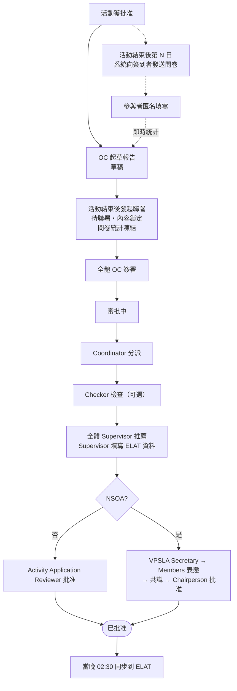

### 1.2 角色與職責

| 角色 | 可做的事 |
|:--|:--|
| 活動 OC（含活動建立人、所屬學生組織 Group Leader） | 起草及修改報告、發起及撤回聯署、簽署；查看問卷即時統計 |
| 活動參與者（曾簽到者） | 匿名填寫問卷，每人一次 |
| Coordinator | 分派 Checker 與 Supervisors，或退回學生 |
| Activity Application Checker | 檢查通過，或退回 Coordinator / 學生 |
| Supervisor | 推薦，或退回 Coordinator / 學生；修訂問卷 AI 總結；填寫 ELAT 資料 |
| Activity Application Reviewer／Delegate | 批准或退回（非 NSOA） |
| VPSLA Secretary | 選擇傳閱小組及投票截止時間；看投票結果後確認共識或退回（NSOA） |
| VPSLA Members | 表態：Approve / Neutral / Return（NSOA） |
| VPSLA Chairperson | 成員表態期間可唯讀查看報告；最終批准或退回（NSOA） |
| SAO 管理員 | 設定問卷發送時間及範本；轉移報告起草權；管理 ELAT 同步 |

### 1.3 報告狀態

| 狀態（畫面標籤） | 意思 | OC 可做的事 |
|:--|:--|:--|
| Not Started（未開始） | 活動可報告，但尚未建立報告（列表上的顯示，不是報告的實際狀態） | Create Report |
| Draft（草稿） | 可自由編輯 | 儲存草稿、發起聯署 |
| Pending Endorsement（待聯署） | 等待全體 OC 簽署，**內容與名單鎖定** | 簽署、撤回聯署 |
| Submitted（審批中） | 全體 OC 已簽署，審批進行中 | 查看、追蹤進度 |
| Returned（已退回） | 被退回學生 | 修改後**重新發起聯署** |
| Approved（已批准） | 審批通過 | 查看 |
| Change Requested（需要修訂） | 出席記錄經審批變更，須修訂（見 [5.10](#510-出席記錄變更引發的報告修訂)） | 修改後**重新發起聯署** |

---

## 2. 參與者問卷

活動結束後，系統按 SAO 設定的時間，自動向**所有曾簽到的參與者**發送一份匿名問卷。問卷結果自動匯總到活動報告：

- **選擇題與評分題**：系統統計每個選項的人數及百分比、評分分佈及平均分。
- **文字題**：由 AI 生成英文總結；Supervisor 審批時可修訂。

本節 2.1–2.5 由 **SAO 管理員**操作；2.7 是參與者的操作；問卷結果在報告中的呈現見 [3.4](#34-報告中的問卷結果)。

### 2.1 進入問卷範本頁面（SAO）

**步驟 1**：以 SAO 管理員身份登入，點選左側選單 **Management Centre**，再點 **Survey Templates**。

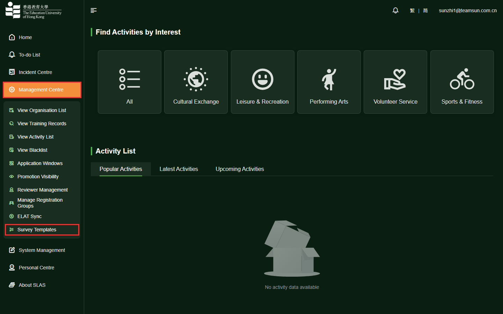

**步驟 2**：頁面上方一行是**發送時間設定**，下方是**問卷範本列表**，標有 **Default** 的是預設範本。

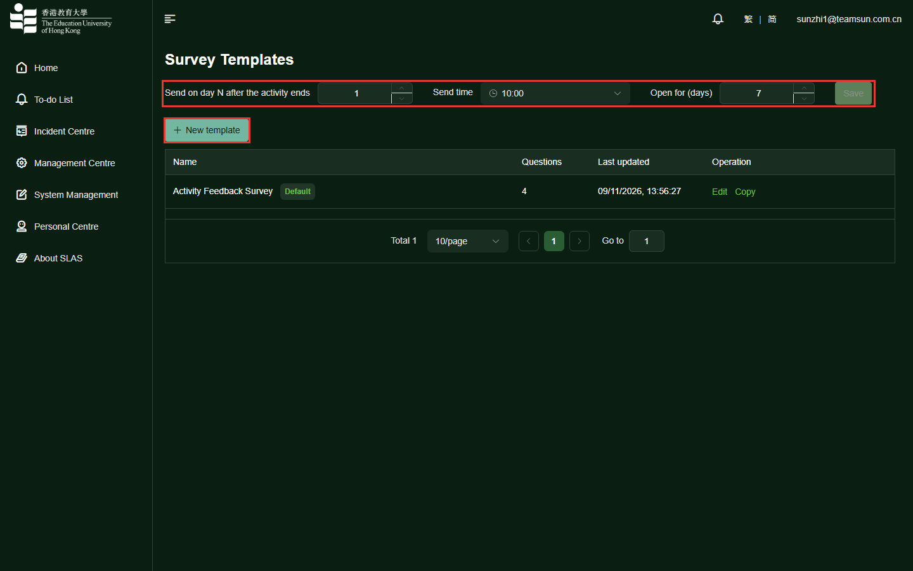

### 2.2 設定發送時間（SAO）

發送時間設定適用於**所有活動**：

| 欄位 | 意思 | 可設定範圍 |
|:--|:--|:--|
| **Send on day N after the activity ends** | 活動結束日之後第幾日發送。1 = 結束翌日；0 = 結束當日 | 0–30 |
| **Send time** | 當日幾點發送 | 00:00–23:30，每 30 分鐘一格 |
| **Open for (days)** | 發送後開放填寫多少日 | 1–60 |

> 例：活動於 11 月 7 日結束，設定為「第 1 日、10:00、7 日」，問卷會於 **11 月 8 日 10:00** 發出，開放至 **11 月 15 日 10:00**。

**步驟 1**：修改需要調整的欄位。點 **Send time** 可從下拉清單選擇時間。

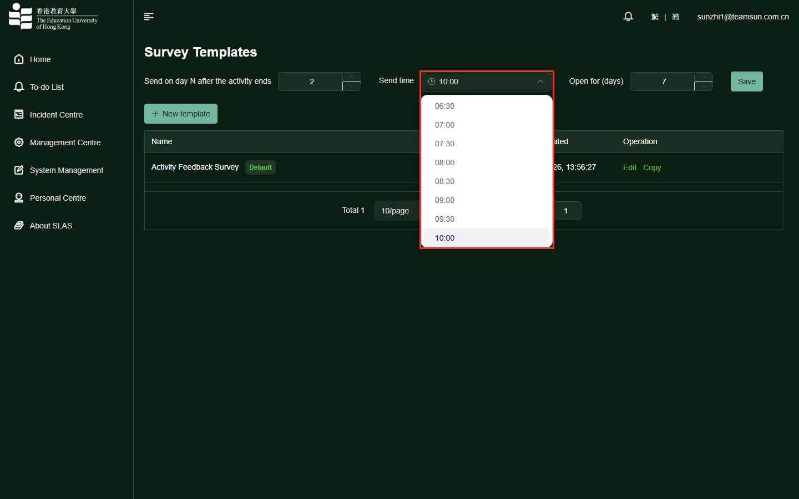

**步驟 2**：修改後，右邊的 **Save** 按鈕會變為可按。下圖示範改為「結束後第 2 日 09:30 發送，開放 14 日」。

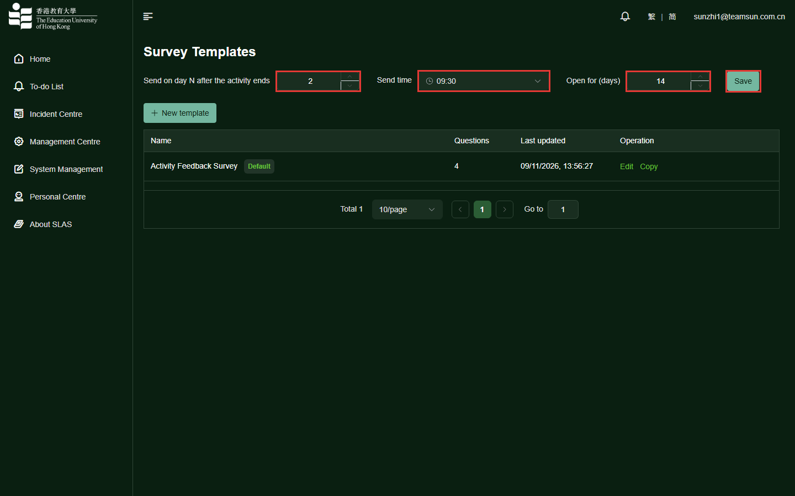

**步驟 3**：點 **Save**，畫面上方顯示「Save Successful」即已儲存。

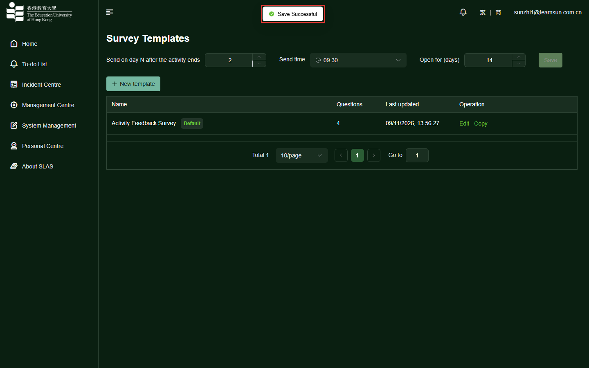

!!! note "設定何時生效"
    新設定只影響**尚未發送**的問卷；已發送的問卷按發送當時的設定計算截止時間。系統每 10 分鐘檢查一次，問卷會在設定時間後 10 分鐘內發出。

### 2.3 建立問卷範本（SAO）

**步驟 1**：點 **New template**，彈出「New survey template」視窗。視窗有 **Design**（編輯）及 **Preview**（預覽）兩個頁籤，新範本預先放入一道評分題。

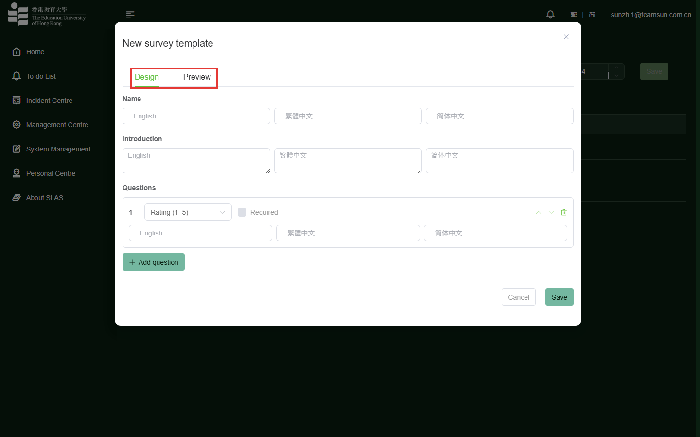

**步驟 2**：填寫範本資料。每一項都有**英文、繁體中文、簡體中文**三個輸入框，參與者看到與其介面語言相同的版本。

- **Name**：範本名稱，三種語言必填。
- **Introduction**：問卷開頭的說明文字，選填。
- **Questions**：題目。每道題可選題型、勾選 **Required**（必答）。

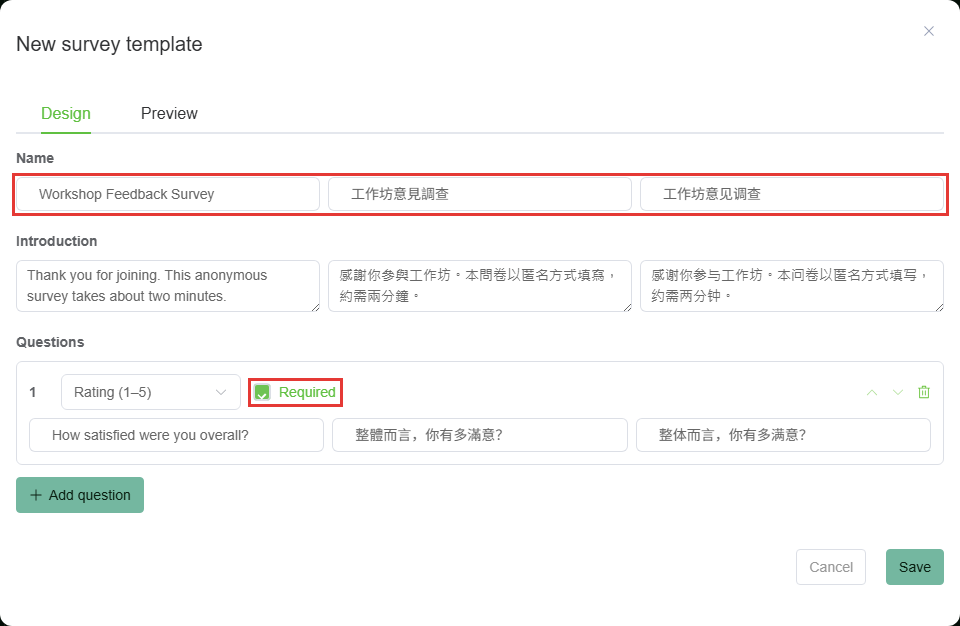

**步驟 3**：點 **Add question**，選擇題型加入新題目。

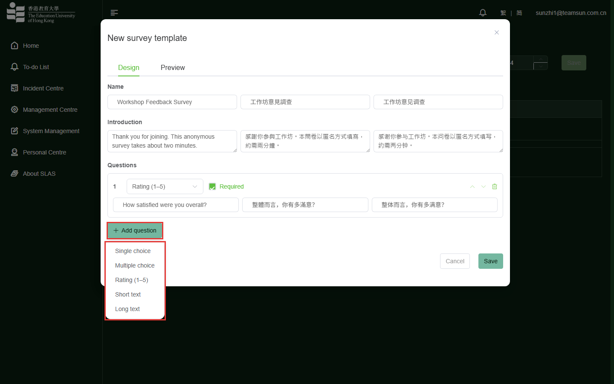

| 題型 | 參與者如何作答 | 報告中如何呈現 |
|:--|:--|:--|
| **Single choice**（單選） | 選一個選項 | 每個選項的人數及百分比 |
| **Multiple choice**（多選） | 可選多個選項 | 每個選項的人數及百分比 |
| **Rating (1–5)**（評分） | 選 1 至 5 顆星 | 1–5 分的分佈及平均分 |
| **Short text**（單行文字） | 輸入一行文字 | 作答人數；內容納入 AI 總結 |
| **Long text**（多行文字） | 輸入多行文字 | 作答人數；內容納入 AI 總結 |

**步驟 4**：完成所有題目。單選及多選題點 **Add option** 增加選項；每道題右上角可**上移**、**下移**或**刪除**；選項右邊的 **×** 可刪除選項。

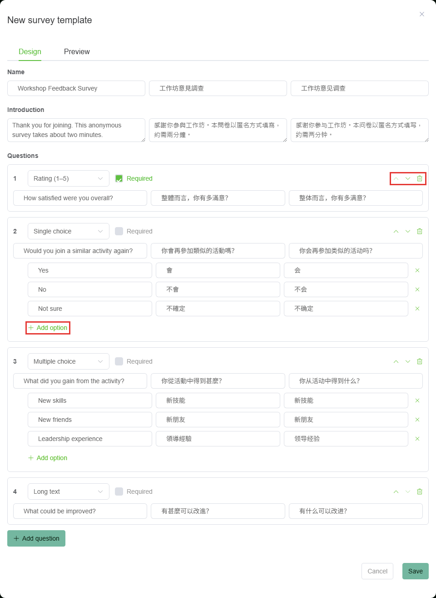

**步驟 5**：切換到 **Preview** 頁籤查看參與者看到的問卷，可點 **English / 繁體中文 / 简体中文** 切換語言逐一檢查。

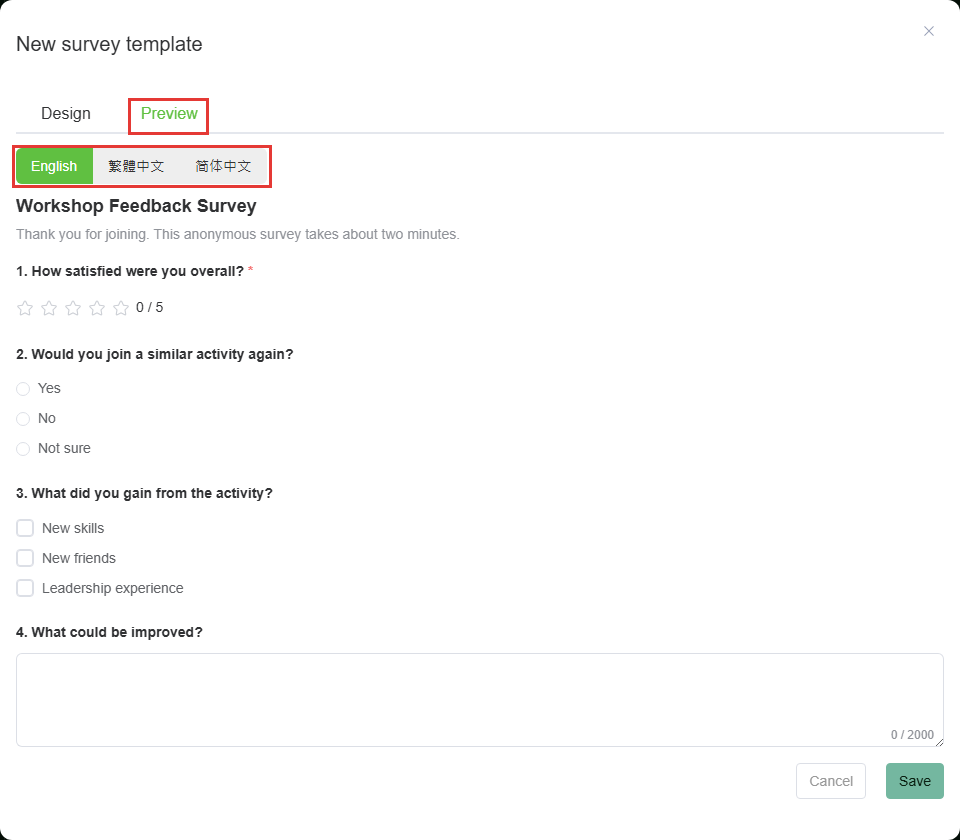

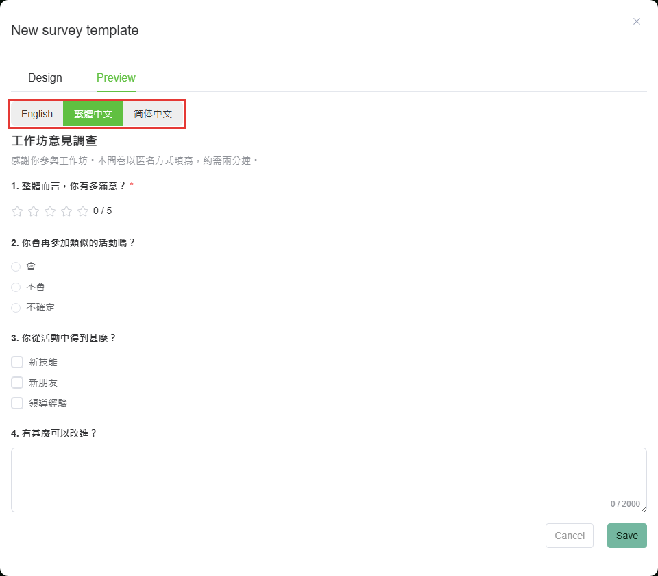

**步驟 6**：點 **Save** 儲存，新範本出現在列表中。

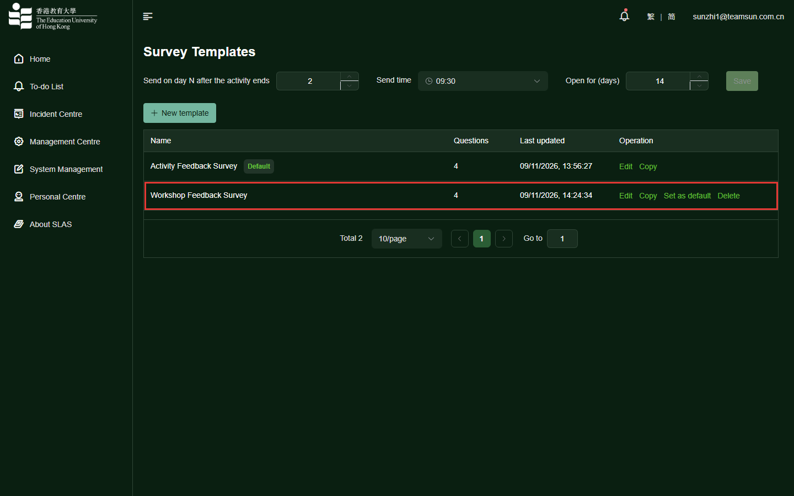

!!! warning "儲存前系統會檢查"
    - 名稱及每道題目都要填齊三種語言。
    - 至少 1 道、最多 50 道題目。
    - 單選及多選題至少 2 個、最多 20 個選項，每個選項都要填齊三種語言。

    未填齊時，畫面上方會提示是哪一題、缺了甚麼。

### 2.4 管理範本與設定預設（SAO）

列表中每個範本的 **Operation** 欄：

| 操作 | 作用 |
|:--|:--|
| **Edit** | 修改範本內容 |
| **Copy** | 複製成一份新範本（不會成為預設） |
| **Set as default** | 設為預設範本 |
| **Delete** | 刪除範本 |

所有活動預設使用**預設範本**，同一時間只有一份。

**步驟 1**：在要設為預設的範本上點 **Set as default**。

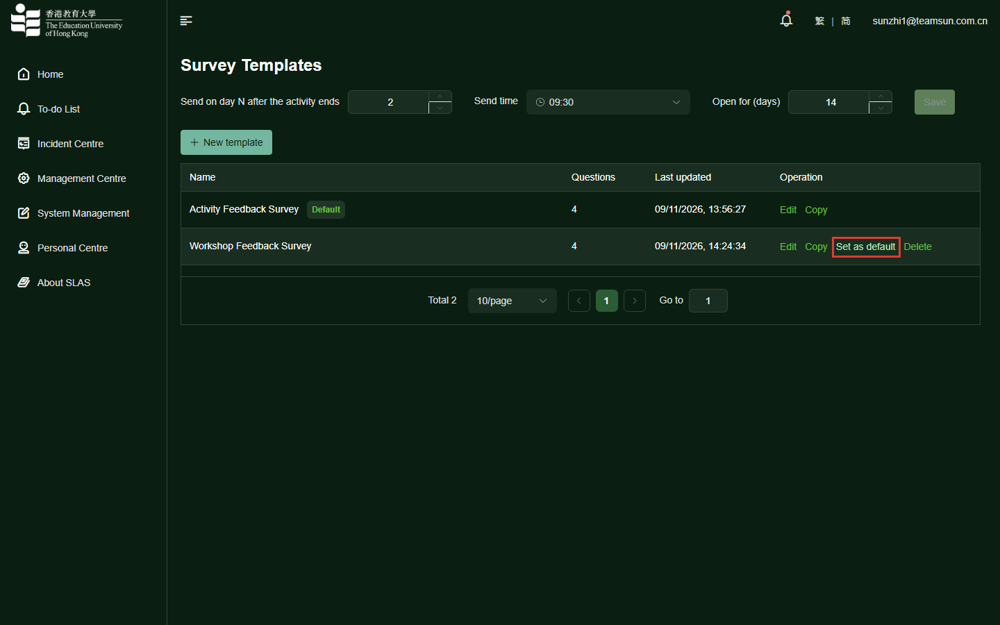

**步驟 2**：該範本名稱旁顯示 **Default**，原來的預設範本恢復為普通範本。

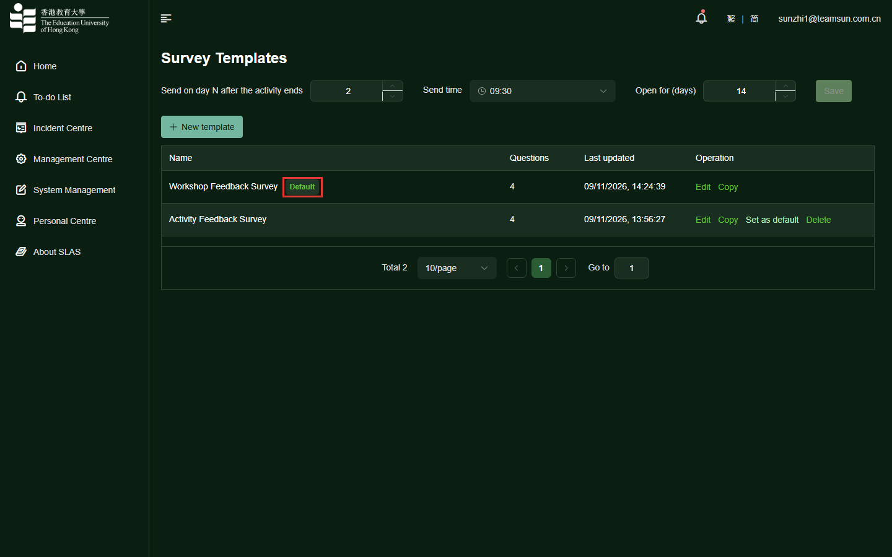

!!! note "預設範本的規則"
    - 建立的**第一份範本**自動成為預設範本。
    - 預設範本**不能刪除**；如需刪除，請先把另一份設為預設。
    - 某活動已指定某份範本、而該活動問卷尚未發送時，該範本也不能刪除。
    - 問卷發送時，系統把當時的範本內容複製給該活動使用。之後修改或刪除範本，**只影響之後發送的問卷**。

### 2.5 為個別活動指定範本（SAO）

如某個活動需要使用另一份範本，可在問卷發送**之前**單獨指定。

**步驟 1**：點 **Management Centre → View Activity List**，在該活動一行的 **Actions** 欄點最右邊的問卷按鈕（滑鼠移上去顯示「Participant Survey」）。

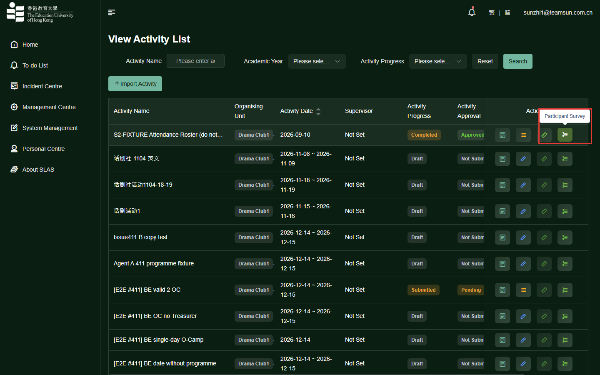

**步驟 2**：彈出「Participant Survey」視窗。「Default template (…)」表示跟隨預設範本，括號內是現時的預設範本名稱。

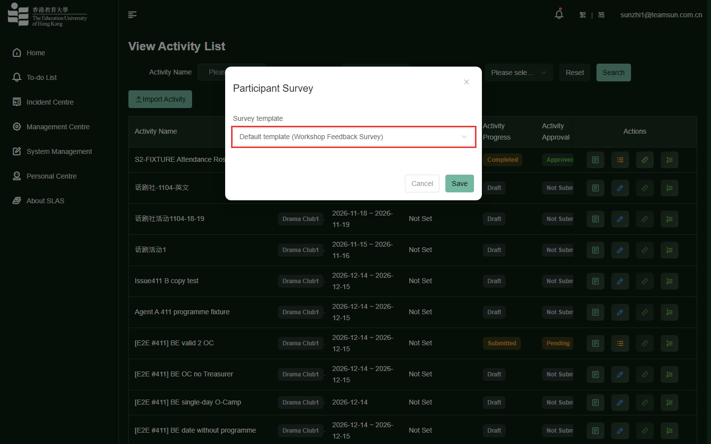

**步驟 3**：點下拉框選擇範本。

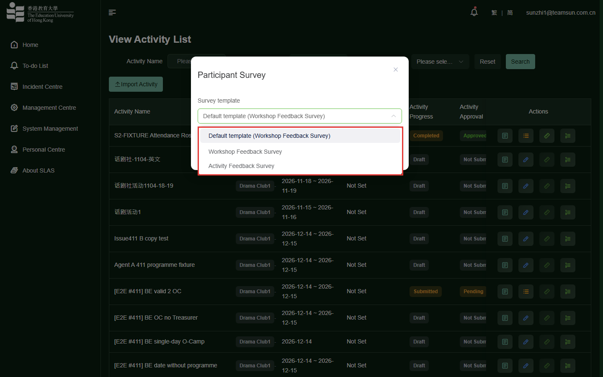

**步驟 4**：選定後點 **Save**。

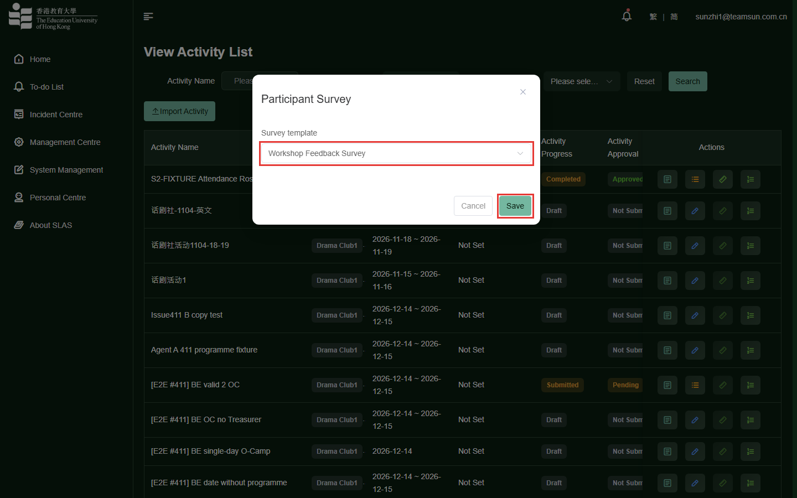

**步驟 5**：畫面上方顯示「Save Successful」即已儲存。如要改回跟隨預設範本，再次打開視窗選「Default template」並儲存。

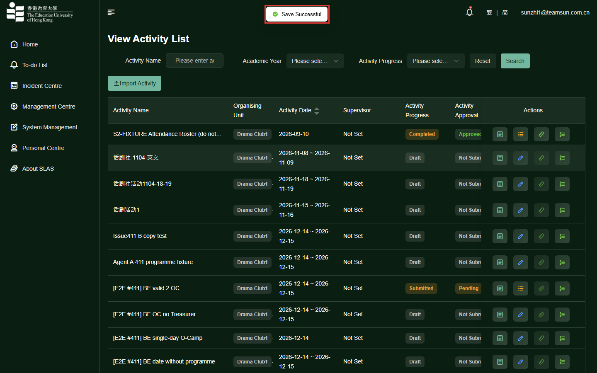

**問卷發送後**，不能再更換範本。此時再點問卷按鈕，視窗顯示實際發送的問卷（**Survey**）、發送時間（**Sent**）、截止時間（**Closes**）及作答人數 / 收件人數（**Responses**）。

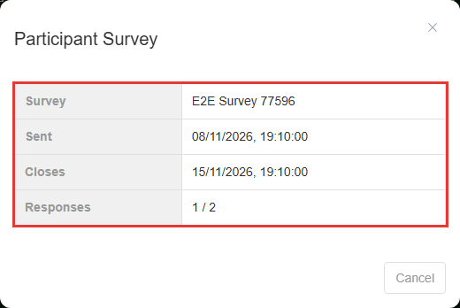

若活動沒有任何人簽到，或發送時系統內沒有任何範本，問卷不會發出，視窗顯示「Not sent」及原因。

### 2.6 問卷發送規則

| 項目 | 規則 |
|:--|:--|
| 哪些活動會發送 | 已審批通過、未取消的活動，每個活動只發一份 |
| 發送給誰 | 該活動**任何一節曾簽到**的參與者，包括 OC 成員。訪客沒有系統帳戶，不會收到 |
| 何時發送 | 活動結束日後第 N 日的指定時間（見 [2.2](#22-設定發送時間sao)），於該時間後 10 分鐘內發出 |
| 通知方式 | 每位收件人收到**一則站內信**及**一封電郵**，按其語言偏好顯示，內有「填寫問卷」按鈕。**不會發送提醒** |
| 填寫期 | 發送後開放的日數，截止後不再接受作答 |
| 匿名 | 系統只記錄「誰已作答」以防重複提交，**答案本身不與任何人關聯**；SAO、OC 及審批人都看不到誰答了甚麼 |
| 補發 | 因系統維護等原因錯過發送時間，恢復後會補發；但到期超過 3 日的不會補發（例如功能上線前已結束的舊活動） |

### 2.7 參與者填寫問卷

**步驟 1**：參與者點站內信或電郵中的「填寫問卷」按鈕，以 SLAS 帳戶登入後進入問卷頁面。頁面顯示問卷名稱、活動名稱、說明、匿名提示及截止時間；紅色 **\*** 是必答題。

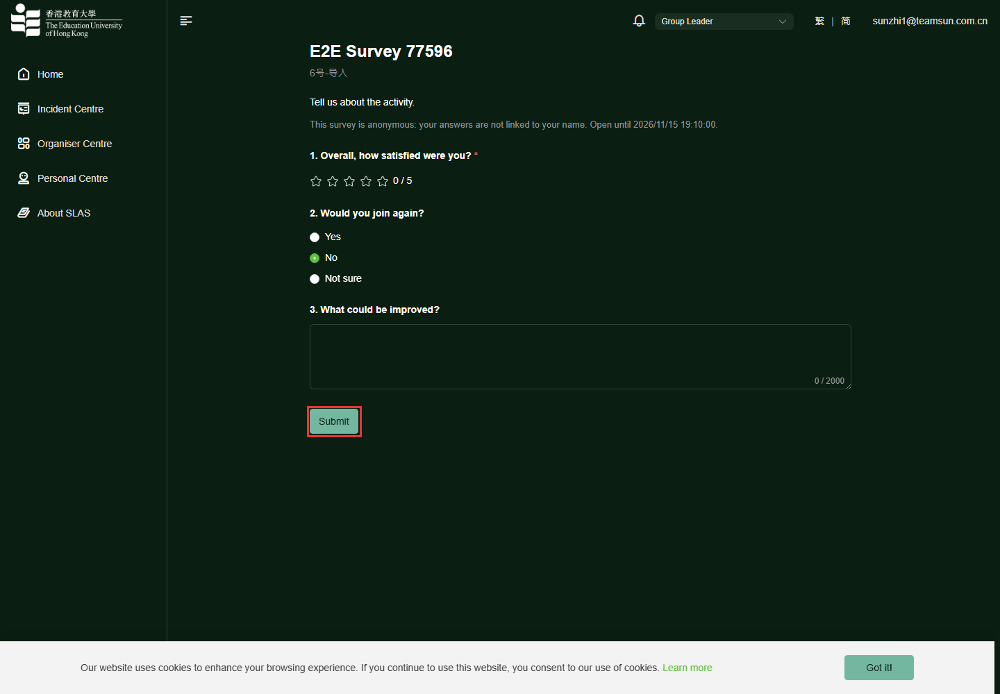

**步驟 2**：作答後點 **Submit**。有必答題未答時，畫面提示「Please answer every required question」。

**步驟 3**：提交成功後顯示感謝頁面。每人只能提交一次，之後再打開亦顯示此頁面。

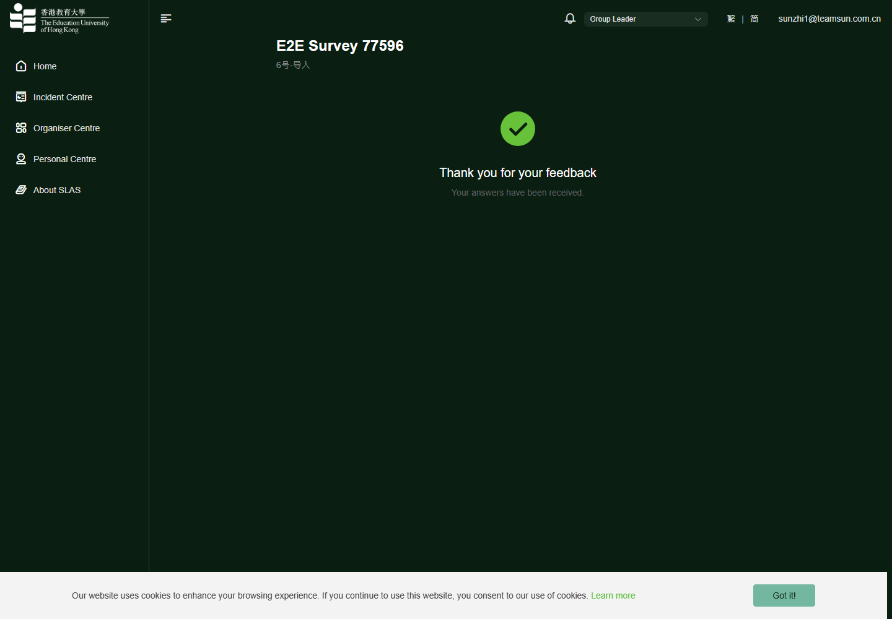

!!! note "無法填寫的情況"
    - **問卷已截止**：頁面顯示「This survey has closed」。
    - **不是收件人**（例如沒有簽到）：頁面顯示「This survey is not available to you」。

    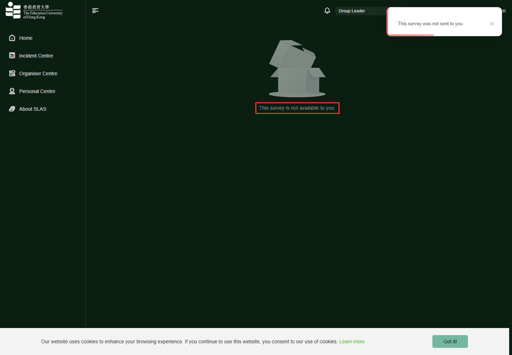

---

## 3. 起草活動報告

### 3.1 誰可以起草

以下任一身分都可建立、編輯報告，以及發起和撤回聯署：

- 該活動**籌委會（OC）的成員**——活動申請時登記在 OC 名單上的學生；
- 該活動的**建立人**；
- 活動所屬學生組織的 **Group Leader**。

報告建立後，報告 OC 名單上的人都能開啟報告（查看與簽署）。

起草條件：

- **活動申請已獲批准**即可建立報告、填寫與儲存草稿，不必等活動結束。
- **活動結束日期已過**才能發起聯署。
- 一個活動**只能有一份**報告。

### 3.2 建立報告

**步驟 1**：登入後點左側選單 **Organiser Centre → Manage Activity Reports**。列表顯示你可以報告的活動及報告狀態，可按活動名稱、報告狀態及活動日期篩選。

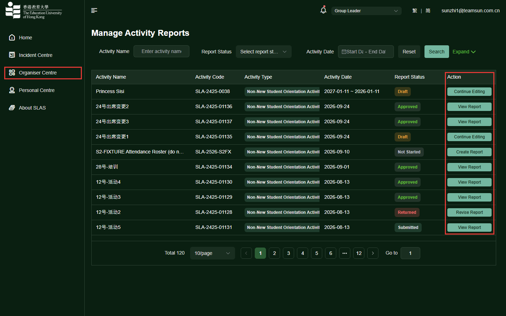

Action 欄按報告狀態顯示不同按鈕：

| 報告狀態 | 按鈕 |
|:--|:--|
| Not Started | **Create Report** |
| Draft | **Continue Editing** |
| Returned / Change Requested | **Revise Report** |
| 其他 | **View Report** |

**步驟 2**：在狀態為「Not Started」的活動上點 **Create Report**，系統即建立草稿並帶入預載資料。

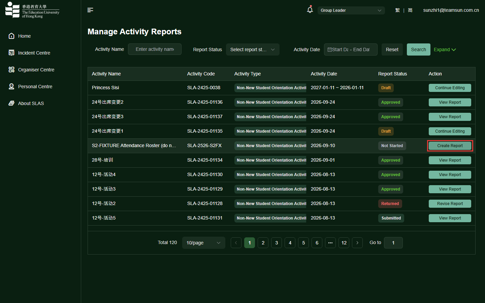

### 3.3 填寫報告各部分

報告分為五個部分，頁面頂部的步驟條可快速跳到各部分。頁面底部固定顯示當前狀態及 **Save Draft**、**Start Endorsement** 按鈕。

**Part 1 — Activity Information（活動資料）**

活動名稱、主辦單位及 **OC 名單**由系統預載。OC 名單可增刪改：手工新增一行時**輸入學號即自動帶出英文姓名與課程編號**；每行可勾選「On-site Leader」「On-site Observer」。修改預載內容請在該行的 **Discrepancy Remark** 說明；手工新增、且不是活動已登記 OC 的成員，差異備註**必填**。

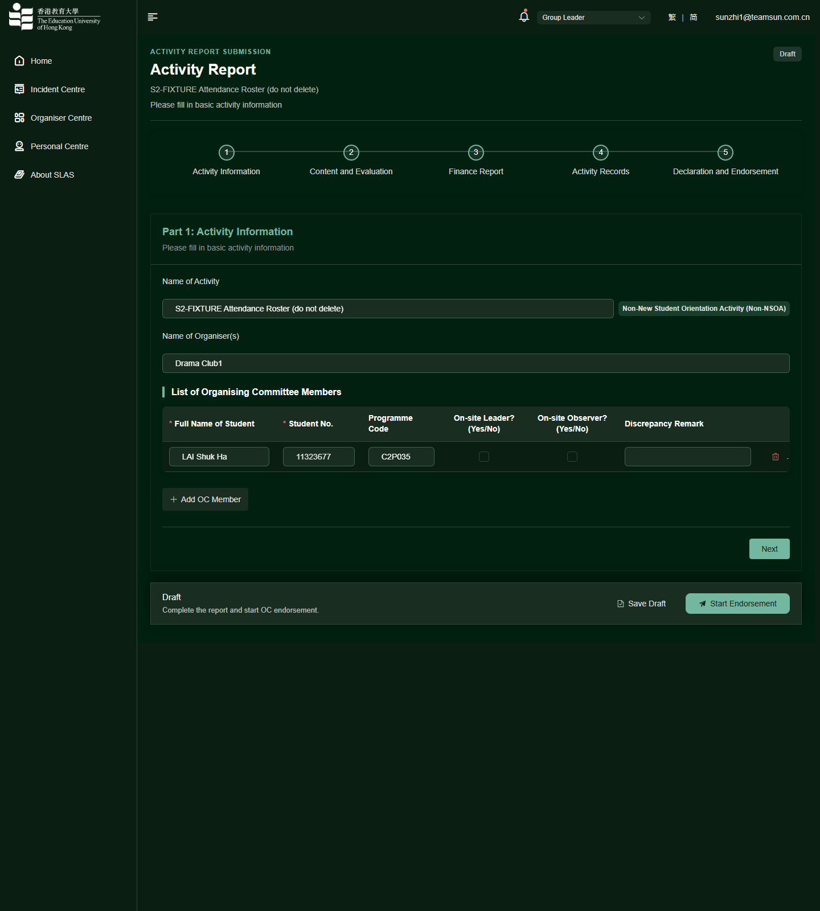

**Part 2 — Content and Evaluation（內容與評估）**

**活動目標**預載自活動申請時填寫的「活動目標闡述」，可修改；另填寫**執行總結**、**觀察與檢討**、**建議事項**。

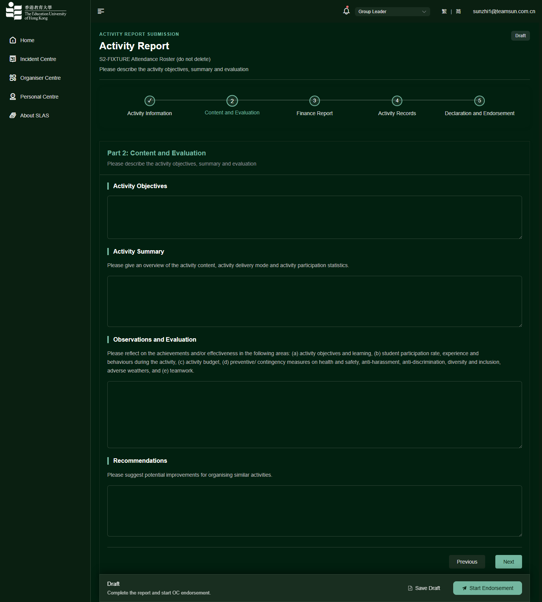

**Part 3 — Finance Report（財務報告）**

收入與支出兩張表：**預計**欄預載自活動申請的預算，**實際**欄由填報人填寫；四項合計由系統自動計算。

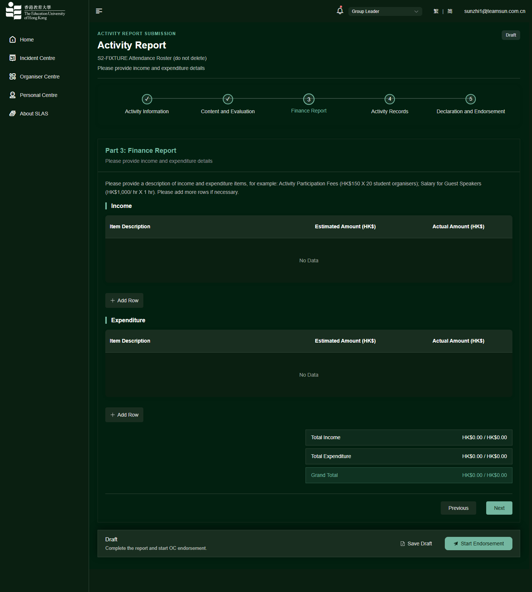

**Part 4 — Activity Records（活動記錄）**

- **出席**：讀取各活動日**已定稿的正式出席名單**，不能在報告中修改；出席有誤須回到「管理出席」提出出席記錄變更申請（見 [activity-attendance-guide.md](activity-attendance-guide.md)）。可另外上傳出席附件。
- **照片 / 影片**：上傳後須勾選「本人確認已就提交的照片 / 短片取得相關人士的同意」，否則無法發起聯署。
- **Participant Survey**：問卷結果，見 [3.4](#34-報告中的問卷結果)。

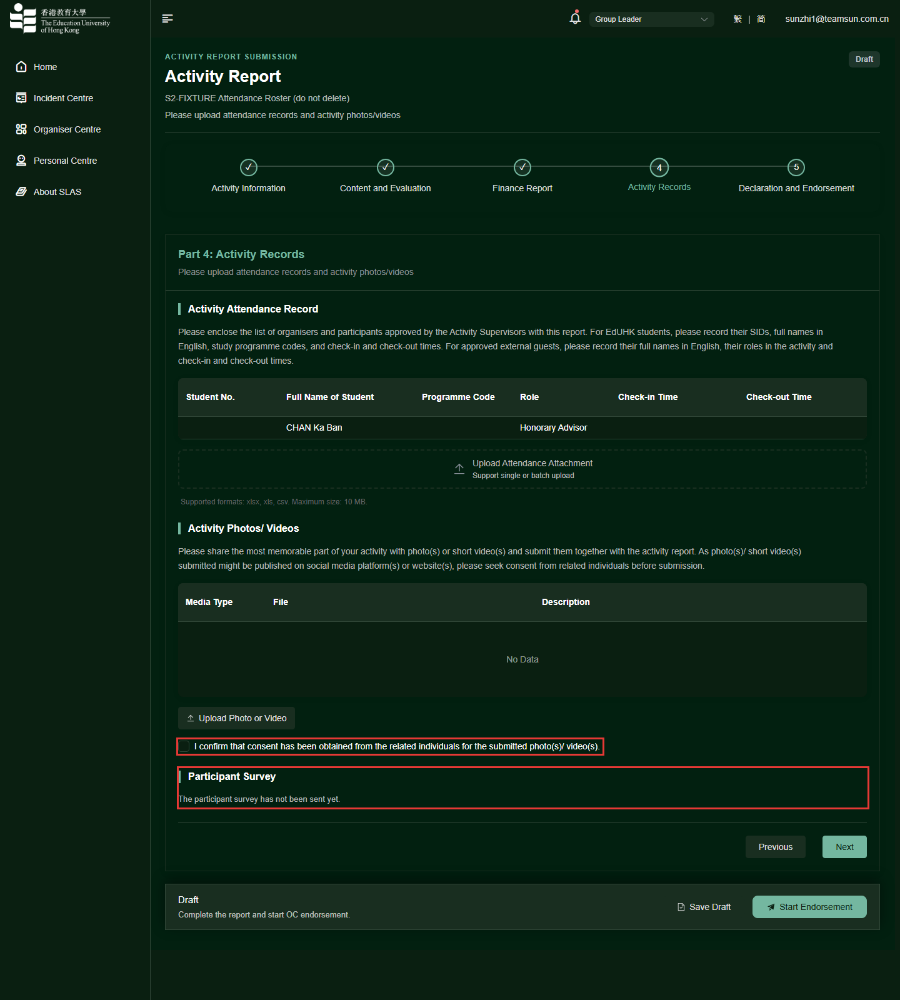

**Part 5 — Declaration and Endorsement（聲明與聯署）**

顯示真實性聲明全文、OC 簽署進度，以及審批中 Supervisor 的推薦結果（唯讀）。聲明由**每位 OC 在簽署時**確認。

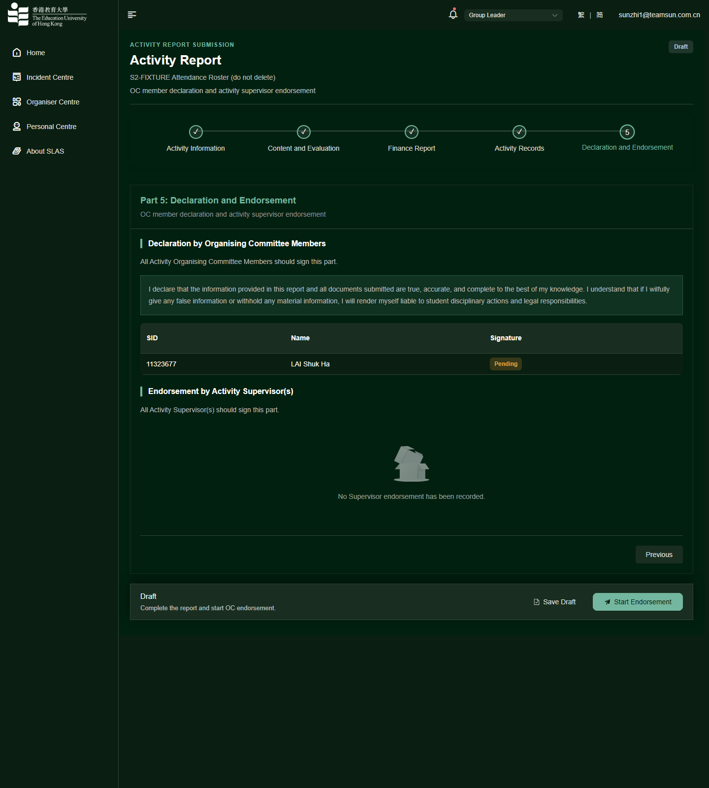

!!! tip "請先定稿出席記錄再發起聯署"
    報告只採用**已定稿**活動日的正式出席名單；尚未定稿的活動日不會計入。所有活動日都未定稿時，系統改以簽到記錄、已批准報名及嘉賓組成出席名單。

### 3.4 報告中的問卷結果

問卷結果顯示在 Part 4 的「**Participant Survey**」區塊。問卷尚未發送時，區塊顯示問卷尚未發出。

**起草時：即時統計**

報告處於草稿、已退回或需要修訂時，顯示**即時統計**，即截至打開頁面時收到的所有答案；此時**沒有 AI 總結**。區塊頂部註明「as of（時間）, X of Y participants answered」。

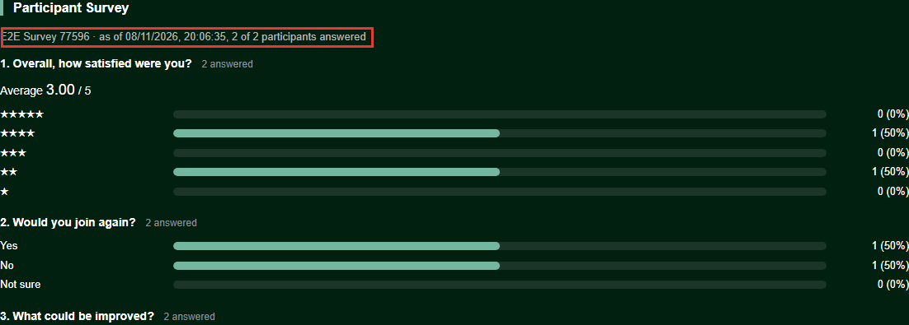

**發起聯署時：凍結統計並生成 AI 總結**

1. **凍結統計**：以發起聯署那一刻的答案為準，之後才收到的答案不計入這一輪；報告被退回後重新發起聯署，會按當時的答案再凍結一次。
2. **生成 AI 總結**：約一分鐘內，AI 把**文字題答案**整理成英文總結（主要意見、正面回饋、問題及建議），不引述原文、不包含可識別個人的資料。

問卷仍在填寫期內也可以發起聯署，**不會被擋**；報告會註明統計時間及當時的作答人數。

| AI 總結顯示 | 意思 |
|:--|:--|
| The summary is being generated… | 正在生成，稍後重新整理頁面 |
| No participant wrote any comments. | 沒有人填寫文字題 |
| The summary could not be generated. | 生成失敗，Supervisor 可重新生成 |

**審批時：查看文字答案及修訂 AI 總結**

審批人在報告審批頁可看到凍結的統計、AI 總結，以及底部的「**Written answers**」——所有匿名文字答案，按題目分組、隨機排序。OC 看不到這一部分。

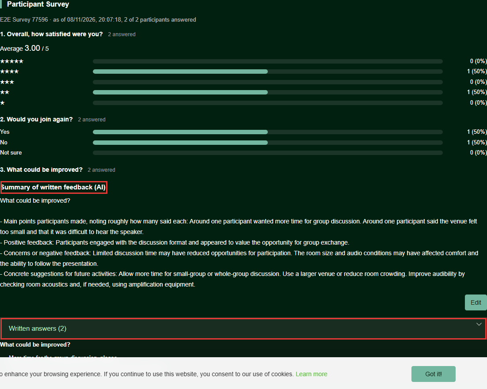

**只有 Supervisor**（在 Supervisor 推薦步驟）可修訂 AI 總結：

1. 點總結下方的 **Edit**，修改內容。
2. 點 **Save**。報告顯示修訂後的內容，並註明「Revised by（修訂人）at（時間）」。

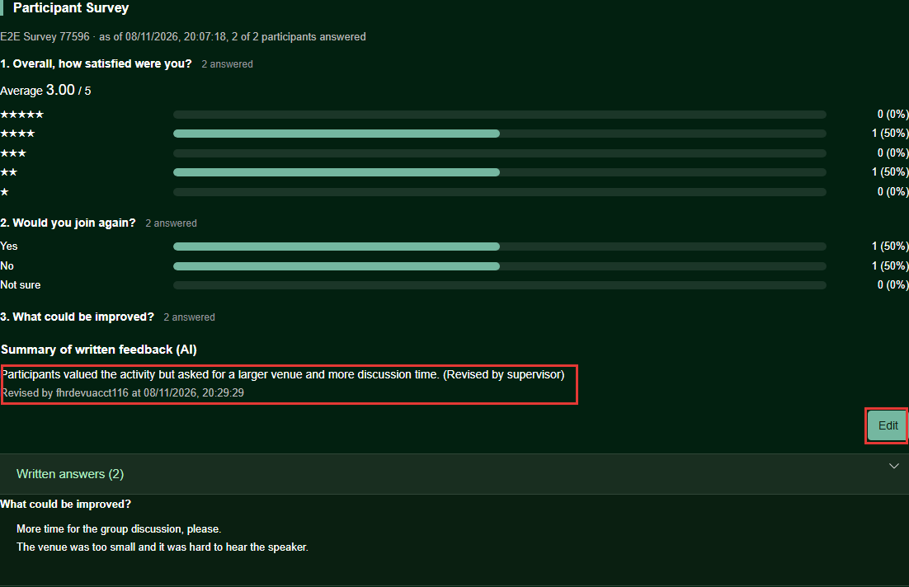

- 要恢復 AI 原文：再按 **Edit**，點 **Use AI version**。AI 原文一直保留，不會被覆蓋。
- AI 總結生成失敗時，Supervisor 可點 **Generate again**。
- 統計數字不能修改。

---

## 4. OC 聯署

### 4.1 發起聯署

報告填好後，在報告頁底部點 **Start Endorsement**。系統先儲存草稿，再檢查：

- 活動已獲批准**且已結束**；
- 已勾選照片 / 影片的同意聲明；
- OC 名單不是空的，且每位 OC 都有系統帳號（沒有的會自動建立，仍失敗則整單拒絕）；
- 手工新增、且不是活動已登記 OC 的成員已填寫差異備註。

通過後，報告轉為「**Pending Endorsement**」，**內容與 OC 名單鎖定**；系統凍結問卷統計、固定本輪引用的出席名單版本，並向全體 OC 發出站內通知（含直達簽署的連結）。

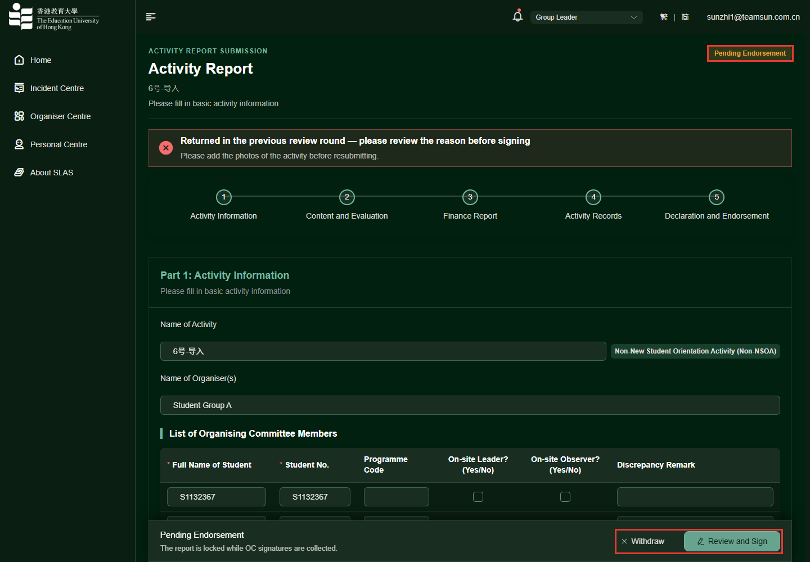

### 4.2 OC 簽署

**步驟 1**：OC 從站內通知或 Manage Activity Reports 進入報告，點底部的 **Review and Sign**。

**步驟 2**：閱讀聲明全文，勾選「I have reviewed the report and agree to sign this declaration.」，點 **Sign Report**。

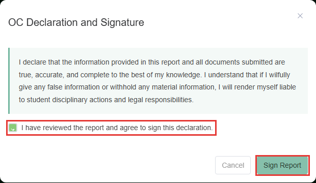

**最後一位 OC 簽署後**，報告即時轉為「**Submitted**」並進入審批。流程的發起人記為發起聯署的人，不是最後簽署的那位。

### 4.3 撤回聯署

待聯署期間，起草人可點 **Withdraw** 撤回。已收集的簽署作廢（保留於歷史，不計入下一輪），報告回到「Draft」；修訂輪則回到「Change Requested」。

### 4.4 轉移起草權（SAO）

當所有起草人都無法繼續處理報告（例如已畢業或退學），SAO 管理員可把報告轉移給另一位學生。

**步驟 1**：點 **Management Centre → View Activity List**，在該活動一行的 Actions 欄點 **Transfer Report Drafting** 按鈕。

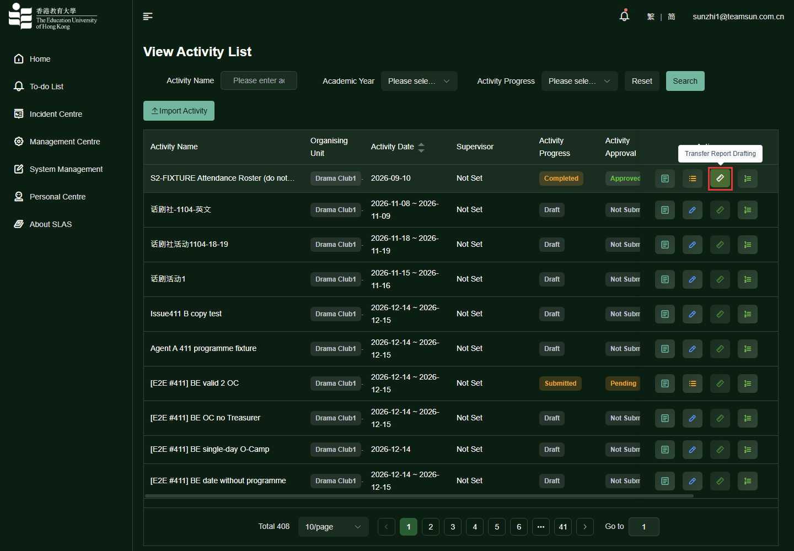

**步驟 2**：填寫接手學生的學號（**Replacement student number**）及原因（**Reason**），點 **Transfer**。

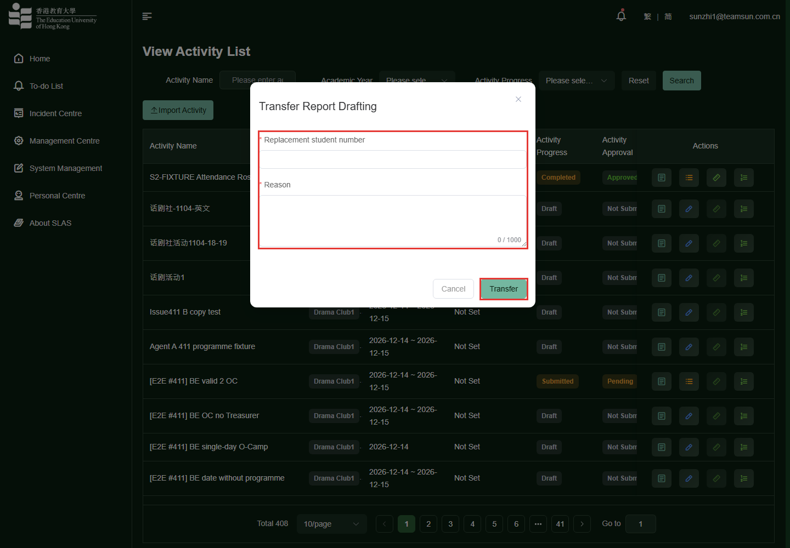

轉移後：

- 接手學生加入活動及報告的 OC 名單，可繼續起草；
- 報告內容保留；
- 正在進行的聯署會被重置，須重新發起；
- 操作人、原因、接手人及狀態變化記入操作日誌。

---

## 5. 審批

### 5.1 審批流程圖

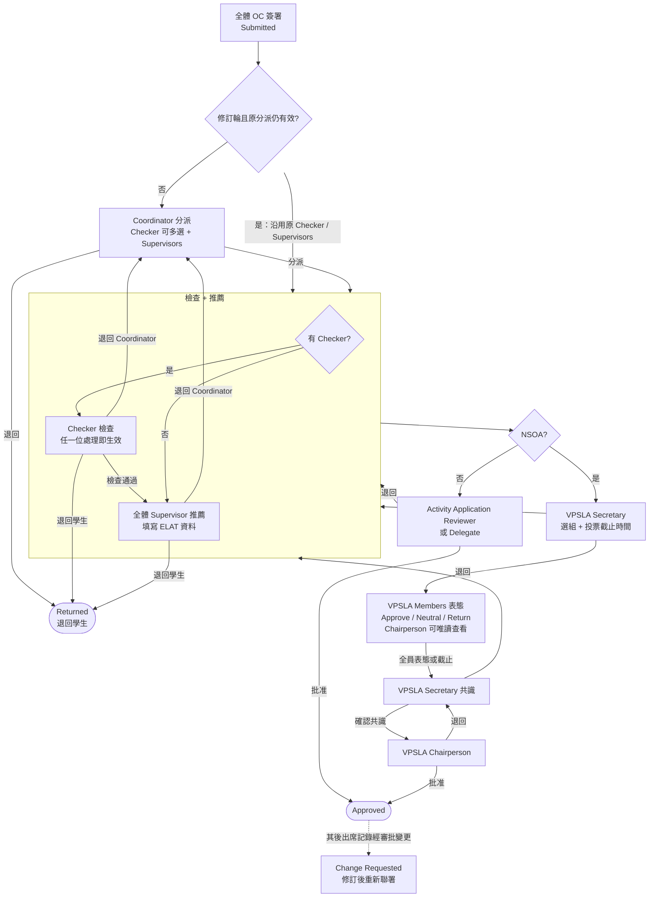

!!! note "退回的兩種去向"
    - **退回學生**（畫面選項「Group Leaders」）：本輪審批結束，報告轉「Returned」，OC 修改後**必須重新發起聯署、全體 OC 重新簽署**。
    - **退回 Coordinator**，以及 Reviewer、VPSLA Secretary 的退回（重跑檢查與推薦）：審批仍在進行，報告維持「Submitted」，OC 不需要做任何事。

    **所有退回都必須填寫意見**，未填寫時退回按鈕不可按。

### 5.2 從待辦進入審批頁

**步驟 1**：審批人登入後點左側選單 **To-do List**，找到流程名稱為「Activity Report S…」（Activity Report Submission）的任務，點 **Handle**。

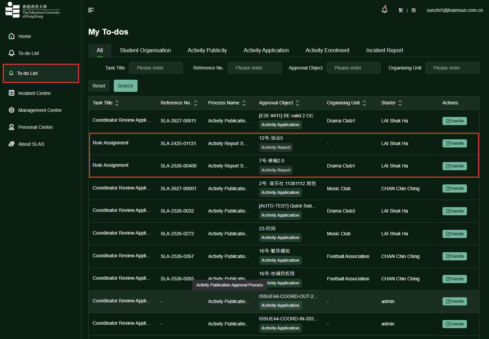

**步驟 2**：審批頁上方是報告全文（唯讀），下方是審批記錄及「**Action**」操作區。操作區按當前任務顯示不同按鈕。

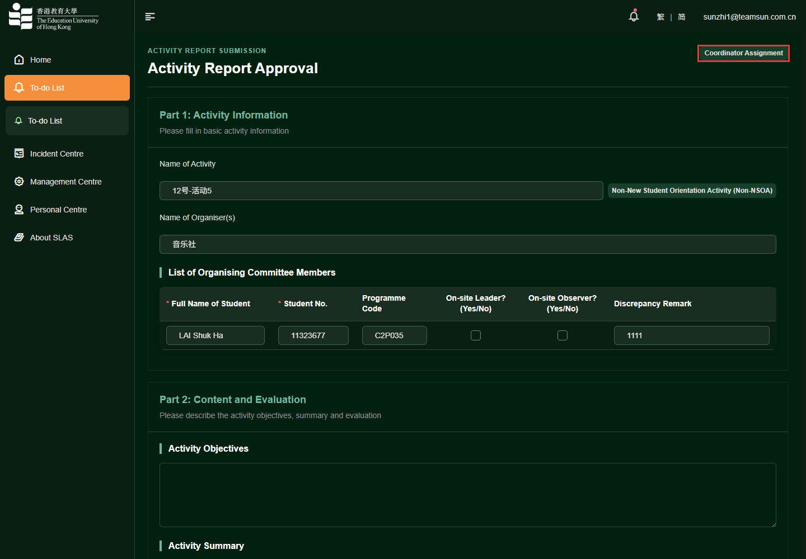

### 5.3 Coordinator 分派

操作區有 **Assign and Submit** 與 **Return** 兩個選項。

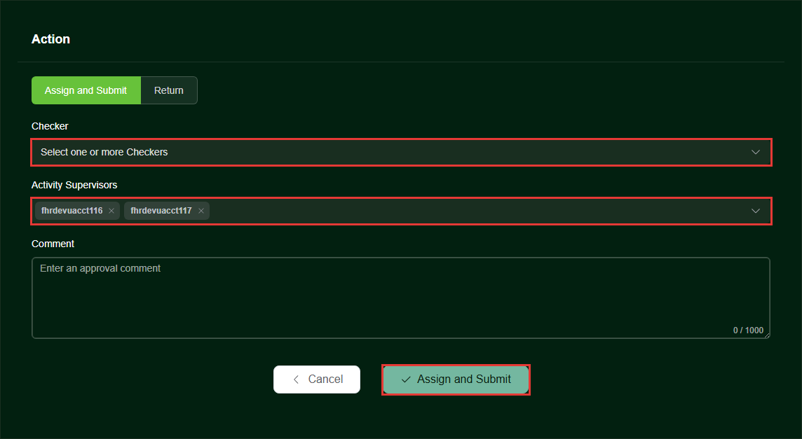

**分派：**

1. **Checker**：可選擇**一位或多位**持有 Activity Application Checker 角色的人；也可留空，流程直接進入 Supervisor 推薦。

    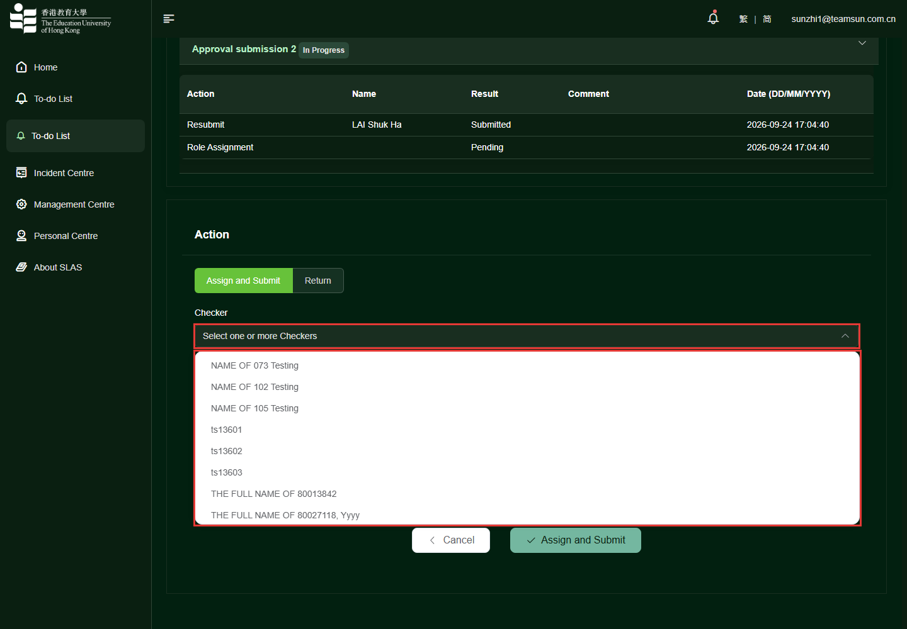

2. **Activity Supervisors**：預先帶出活動已登記的督導，**可增刪**；新增的人必須持有 Supervisor 角色。至少保留一位。

    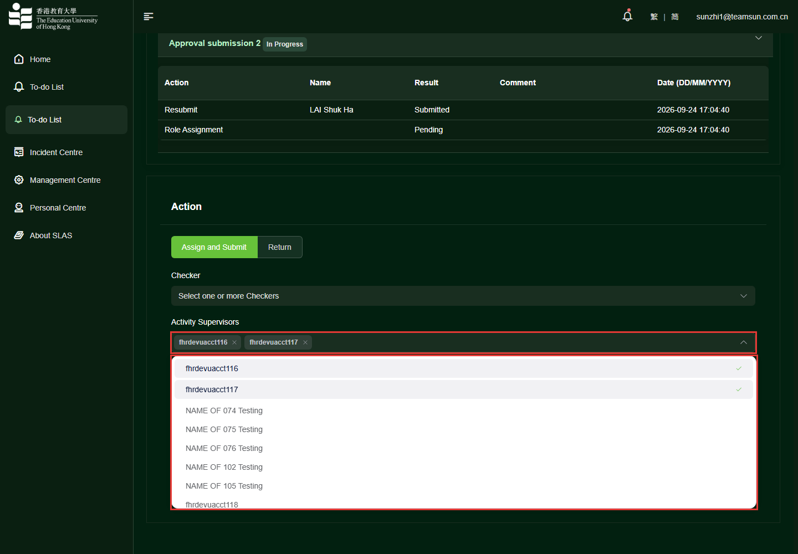

3. 填寫意見（選填），點 **Assign and Submit**。

!!! warning "已指定過 Checker 的報告不能留空"
    報告被退回學生、修改後重新提交時，若之前的分派曾指定 Checker，Coordinator 表單會預填該 Checker，**不能留空**（可以更換）。

**退回**：選 **Return**，填寫意見後提交，報告退回學生。

### 5.4 Checker 檢查

被指派的 Checker 從待辦進入審批頁，操作區有 **Confirm Checked** 與 **Return**。

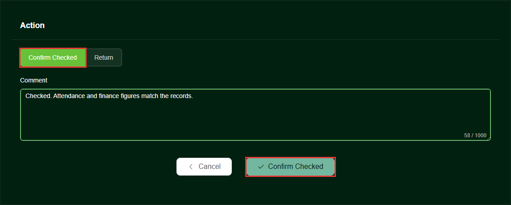

- **Confirm Checked**：檢查通過，Supervisor 的待辦隨即出現。
- **Return**：在 **Return To** 選擇退回 **Coordinator**（重新分派，報告維持 Submitted）或 **Group Leaders**（退回學生），並填寫意見。

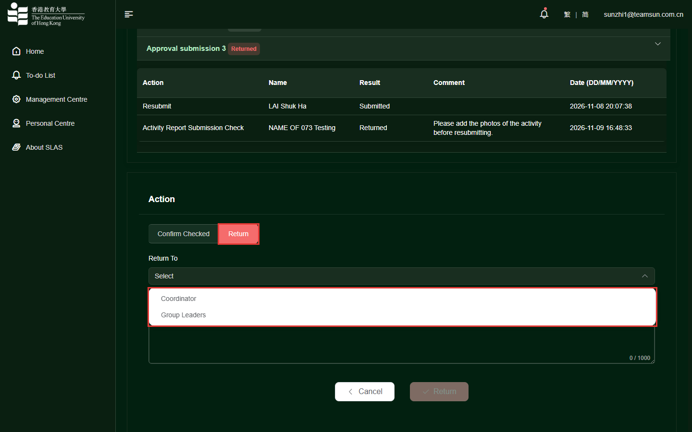

!!! note "多位 Checker"
    指派多位 Checker 時，**第一位**處理（檢查通過或退回）的人即決定結果，其他人的檢查任務自動取消。

    有 Checker 時，**Supervisor 的待辦要等檢查通過後才出現**。

### 5.5 Supervisor 推薦

Supervisor 的審批頁除報告全文外，還有兩個 Supervisor 專屬區塊：

- **Participant Survey**：可修訂問卷 AI 總結（見 [3.4](#34-報告中的問卷結果)）。

    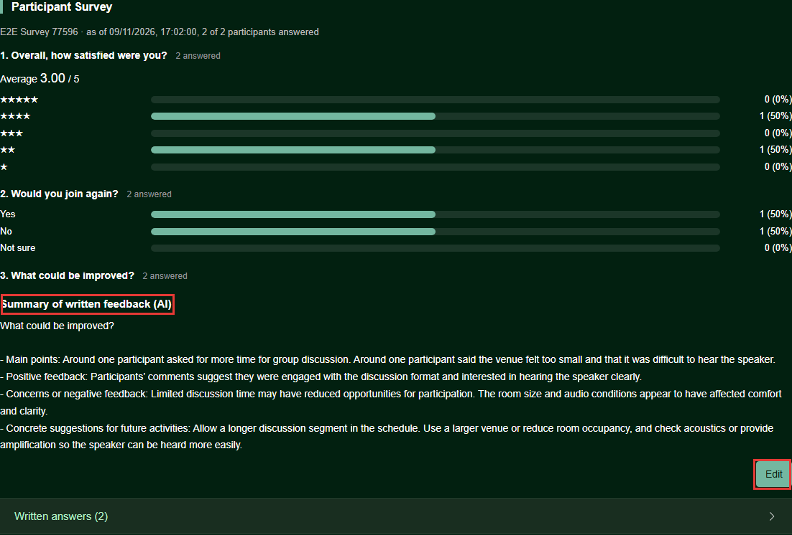

- **ELAT Information**：適用 ELAT 的活動須填寫（見 [6.2](#62-supervisor-填寫-elat-資料)）。

操作區有 **Recommend** 與 **Return**：

- **Recommend**：填寫意見（選填）後點 **Recommend**。ELAT 資料會在推薦時一併儲存。

    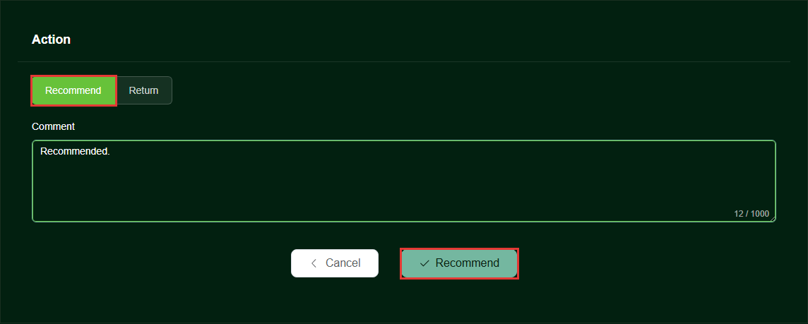

- **Return**：在 **Return To** 選擇 **Coordinator** 或 **Group Leaders**，填寫意見後點 **Return**。

    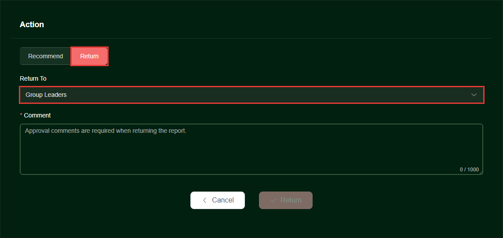

!!! note "多位 Supervisor"
    **全體 Supervisor 都推薦**才算通過；任一位退回，本輪推薦即中止，其他 Supervisor 的任務一併取消。

### 5.6 Activity Application Reviewer 審批（非 NSOA）

非 NSOA 活動在全體 Supervisor 推薦後，交由 Activity Application Reviewer（或 Delegate）審批。

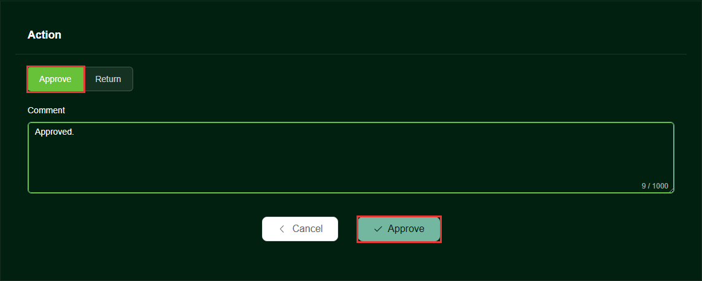

- **Approve**：報告轉為「Approved」。
- **Return**：填寫意見，退回重做檢查與推薦（報告維持 Submitted）。

### 5.7 VPSLA 審批（NSOA）

NSOA 活動在全體 Supervisor 推薦後，改由 VPSLA 審批：

1. **VPSLA Secretary 選組**：選擇傳閱小組（**VPSLA Group**）並設定投票截止時間（**Voting Deadline**），兩者必填；或退回（重做檢查與推薦）。
2. **VPSLA Members 表態**：小組成員並行表態，每人選 **Approve**、**Neutral** 或 **Return**（選 Return 須填寫意見）。
    - Return 只是一票意見，**不會立即退回報告**，由 Secretary 看結果後決定。
    - 到了投票截止時間，未表態的成員自動計為「**Neutral**（截止未表態）」，表態階段結束。
    - 同一期間，所選小組的 **Chairperson** 收到「Activity Report Under VPSLA Review」通知，可**唯讀**查看報告及本輪表態，不參與投票。
3. **VPSLA Secretary 共識**：全員表態或截止後，Secretary 看表態統計，選擇**確認共識**送交 Chairperson，或退回（重做檢查與推薦）。
4. **VPSLA Chairperson 審批**：批准即結案；退回則回到 Secretary 共識環節。

### 5.8 退回與重新提交

報告被退回學生時，狀態轉為「**Returned**」，頁面頂部紅色橫幅顯示退回原因，表單恢復可編輯。

OC 修改後點 **Start Endorsement**，**全體 OC 必須重新簽署一輪**才會再次進入審批——上一輪的簽署不會沿用。歷次審批記錄及意見都保留，可在審批記錄中逐輪查看。

### 5.9 審批結果與通知

報告獲批准後，狀態轉為「**Approved**」。

| 事件 | 收到通知的人 |
|:--|:--|
| 發起聯署 | 全體 OC |
| 進入某審批環節 | 該環節的審批人 |
| 進入 VPSLA 表態 | 小組成員；Chairperson 收到唯讀查看通知 |
| 退回、批准 | 原有收件人（學生 / OC），**加上本次審批中實際辦理過任務的人**；去重，並排除做出決定的人本人 |

### 5.10 出席記錄變更引發的報告修訂

出席名單定稿後如需更正，由活動建立人 / OC 在「管理出席」提出**出席記錄變更申請**，經審批生效（見 [activity-attendance-guide.md](activity-attendance-guide.md)）。變更生效後，報告按當時狀態處理：

| 變更獲批時的報告狀態 | 結果 | OC 要做甚麼 |
|:--|:--|:--|
| 尚未建立報告 | 建立報告時直接採用新名單 | 照常建立 |
| Draft / Returned / Change Requested | 下次發起聯署時採用新名單；OC 收到「活動報告需要修訂」通知 | 核對出席後照常發起聯署 |
| Pending Endorsement | **本輪聯署終止**，報告轉「Change Requested」 | 修訂後重新發起聯署 |
| Submitted | 審批**不被打斷**，審批頁提示出席已更新；本輪結束後系統接續處理 | 等待 |
| Approved | 開啟**修訂輪**，報告轉「Change Requested」；原已批准版本保持不變 | 修訂、發起聯署、全體 OC 重新簽署 |

**修訂輪的審批：**

1. 報告頁顯示黃色橫幅「出席記錄已獲批准變更，請修訂活動報告」，列表按鈕為 **Revise Report**。
2. OC 修訂後發起聯署，**全體 OC 重新簽署**。
3. 若原分派的 Checker 與 Supervisors 仍然有效，**跳過 Coordinator**，直接沿用；Checker **必須重新檢查**。
4. 若任何原分派人員已失效（不再持有角色、帳號停用等），改由 Coordinator 重新分派，審批頁說明原因並預填仍有效的人選。
5. 之後的推薦、審批及退回規則與首次提交相同。待辦類型顯示「活動報告（變更輪）」，審批頁標題旁有「報告修訂」標籤。

> 「出席變更帶動報告修訂」在每個環境有一項開關，預設關閉；關閉期間報告不會轉入「Change Requested」。使用前請向系統管理員確認已啟用。

---

## 6. ELAT 同步

活動報告獲批准後，SLAS 把活動資料及學生出席時數同步到 ELAT（Experiential Learning Activity Transcript）。

### 6.1 哪些活動會同步

只有**適用 ELAT** 的活動會同步。是否適用，由 Supervisor 在**活動申請審批**時勾選「ELAT Category B Eligibility」決定。不適用的活動，報告審批頁不會出現 ELAT 區塊。

### 6.2 Supervisor 填寫 ELAT 資料

Supervisor 在**報告的 Supervisor 推薦步驟**填寫審批頁上的「**ELAT Information**」區塊。區塊底部的「Not ready to sync. Missing:」列出尚欠的資料，以及同步狀態（Sync Status）。

| 欄位 | 說明 |
|:--|:--|
| **Activity Type (XX)** | GC / CP / PE / CC 四選一，決定 ELAT 活動編號中的類別碼 |
| **Experience Type** | 經驗類型；畫面會顯示申請人當時的選擇供參考 |
| **Activity Nature (start-up)** | 只在特定經驗類型出現 |
| **Geographic Location** | 活動地點，預設 Hong Kong |
| **Did participants interact virtually with non-local …** | 是否與境外人士線上互動 |
| **Service Learning** | 是否屬服務學習 |
| **GILOs** | 按活動類型自動勾選核心 GILO（不能取消），可再勾選其他 |
| **Mode** | 活動形式，預設 Face-to-Face |
| **Programme Name (English)** | 英文名稱，預設活動名稱 |

填好後點 **Save** 儲存；點 **Recommend** 推薦時也會自動儲存。「Missing」清單按已儲存的內容計算，儲存後才會更新。

!!! note "誰可以填寫"
    該報告的 Supervisor（包括 Coordinator 新增的 Supervisor）在推薦步驟填寫；SAO 管理員可在 ELAT Sync 頁面修改（見 [6.4](#64-sao-管理-elat-同步)）。

### 6.3 同步時間與內容

- 報告**最終批准**時，系統把該活動標記為「Requested（待同步）」。
- 系統於**每日 02:30** 自動同步待同步的活動，每次最多 200 個。
- 同步內容：
    - **活動編號**：以 SLAS 活動編號加上類別碼，例如 `SLA-2526-CC-0138`；主題加 `-001`，每個活動日一節加 `-NN`。
    - **學生出席時數**：按出席記錄計算，向上取整至 0.25 小時，最少 0.5 小時。
    - **主辦部門**：使用主辦單位的部門編號。
- 沒有學號的出席者會被略過，區塊會列出這些人。

### 6.4 SAO 管理 ELAT 同步

**步驟 1**：SAO 管理員點 **Management Centre → ELAT Sync**。列表顯示所有適用 ELAT 的活動，以及資料是否齊全（**Complete / Incomplete**）、ELAT 同步狀態及最後同步時間；可按活動編號或名稱搜尋。

**步驟 2**：點 **Edit** 打開該活動的 ELAT 資料，欄位與 Supervisor 填寫的相同。

- **Save and Request Sync**：儲存並標記為待同步，於當晚 02:30 同步。
- **Sync Now**：儲存並立即同步。

!!! warning "注意"
    - **Save and Request Sync** 與 **Sync Now** 不檢查報告是否已批准，請只對已批准報告的活動使用。
    - ELAT 處理中或已處理（見 6.5 中標示「鎖定」的狀態）的活動不能再修改或重新同步。
    - 錯誤訊息只有英文。

### 6.5 同步狀態

| 狀態 | 意思 | 可否修改 |
|:--|:--|:--|
| Not synced | 尚未同步 | 可 |
| Requested | 已請求同步，等待 ELAT 處理 | 可 |
| Resync requested | 已同步過、再次請求同步 | 可 |
| Release requested | ELAT 待發布 | 鎖定 |
| Rejected | ELAT 已拒絕 | 鎖定 |
| Released | ELAT 已發布 | 鎖定 |
| In progress | ELAT 處理中 | 鎖定 |
| Sync error | 同步出錯，**ELAT error** 欄顯示原因 | 可，修正後重新同步 |

---

## 7. 報告內容與入口

### 7.1 報告保存的內容

- **正文**：活動名稱、主辦單位、活動目標、執行總結、觀察與檢討、建議事項、財務合計、聲明確認、聯署狀態與輪次、提交人與時間、退回原因。
- **明細**：OC 名單（含差異備註）、財務明細、照片與影片、分輪次的聯署記錄（含撤回或終止的輪次）、歷次審批與意見、每輪引用的出席名單版本、問卷統計及 AI 總結（含 Supervisor 修訂版與 AI 原文）。

### 7.2 頁面入口

| 頁面 | 選單 | 使用者 |
|:--|:--|:--|
| 管理活動報告 | Organiser Centre → Manage Activity Reports | 活動 OC、建立人、Group Leader |
| 活動報告（填寫 / 簽署） | 從上一頁或站內通知進入 | 活動 OC |
| 報告審批 | To-do List → Handle | 各審批角色 |
| 問卷範本 | Management Centre → Survey Templates | SAO 管理員 |
| 活動問卷、轉移起草權 | Management Centre → View Activity List | SAO 管理員 |
| ELAT 同步 | Management Centre → ELAT Sync | SAO 管理員 |
| 問卷填寫 | 站內信 / 電郵中的「填寫問卷」按鈕 | 活動參與者 |

---

## 8. 端到端 Demo 指南

### 8.1 準備條件

1. 一個**已獲批准、已結束**、**適用 ELAT** 的活動，各活動日的出席記錄**已定稿**，且有簽到記錄。
2. 該活動有 2 位以上有系統帳號的 OC（演示多人聯署）。
3. 該活動已登記至少 1 位 Supervisor。
4. Coordinator、Activity Application Checker 帳號各一。
5. 非 NSOA 主線另需 Activity Application Reviewer 帳號；NSOA 主線另需 VPSLA Secretary、Members、Chairperson 帳號，以及一個 VPSLA 傳閱小組。
6. SAO 管理員帳號，且 Survey Templates 已有預設範本。

### 8.2 主線 A — 問卷 → 起草 → 非 NSOA 審批 → ELAT

1. SAO 確認發送時間及預設範本（[2.2](#22-設定發送時間sao)、[2.4](#24-管理範本與設定預設sao)）。
2. 到發送時間後，參與者從站內信填寫問卷（[2.7](#27-參與者填寫問卷)）。
3. OC 在 Manage Activity Reports 建立報告，填寫五個部分；Part 4 可見問卷即時統計。
4. 點 **Start Endorsement** → 狀態轉 Pending Endorsement；其餘 OC 逐一簽署 → 狀態轉 Submitted。驗證：Part 4 問卷統計已凍結，約一分鐘後出現 AI 總結。
5. Coordinator 分派：**不選 Checker**，確認 Supervisors → **Assign and Submit**。
6. Supervisor：修訂 AI 總結 → 填寫 ELAT Information → **Recommend**（多位 Supervisor 須全部推薦）。
7. Reviewer → **Approve**。驗證：報告 Approved；ELAT Sync 頁面該活動為「Requested」。
8. 翌日 02:30 後，驗證 ELAT 同步狀態已更新；或由 SAO 在 ELAT Sync 點 **Sync Now** 立即同步。

### 8.3 主線 B — 含 Checker

在 8.2 第 5 步選擇**一位或多位 Checker**，然後驗證：

- Checker 的待辦立即出現，**Supervisor 此時看不到待辦**。
- 任一位 Checker **Confirm Checked** 後，其他 Checker 的任務消失，Supervisor 的待辦出現。

### 8.4 主線 C — NSOA（VPSLA）

活動為 NSOA 時，8.2 第 7 步改為：

1. VPSLA Secretary 選擇傳閱小組，設定投票截止時間。
2. 各 Member 選 Approve / Neutral / Return；同時以 Chairperson 登入，驗證收到唯讀通知、可查看報告與表態。
3. 讓一位 Member 不表態直到截止時間，驗證其被計為 Neutral（截止未表態）。
4. Secretary 確認共識 → Chairperson **Approve** → 報告 Approved。

### 8.5 旁支 — 退回與重新提交

1. Checker 選 **Return → Coordinator**：報告維持 Submitted，Coordinator 重新收到分派任務。
2. Supervisor 選 **Return → Coordinator**：同上。
3. Supervisor 選 **Return → Group Leaders**：驗證未填意見時按鈕不可按；提交後報告轉 Returned，頁面頂部顯示退回原因。
4. OC 修改後重新發起聯署，驗證**全體 OC 須重新簽署**；Coordinator 表單預填原 Checker 且不能留空。
5. 驗證退回通知同時發給 OC 及此前辦理過任務的審批人。

### 8.6 旁支 — 轉移起草權

SAO 在 View Activity List 對一份待聯署的報告執行 **Transfer Report Drafting**，驗證：接手學生可開啟並編輯報告；原聯署已重置；報告內容保留。

### 8.7 旁支 — 出席變更引發的修訂輪

前提：報告已 Approved，目標環境已啟用出席變更與報告修訂聯動。

1. 對某個已定稿活動日提出出席記錄變更並審批通過。
2. 驗證：報告轉 Change Requested，顯示黃色修訂橫幅，Part 4 出席已是新名單。
3. OC 修訂後重新聯署，驗證：**沒有 Coordinator 任務**，原 Checker 收到標示「報告修訂」的待辦。

---

## 9. 邊界與已知限制

- **部分規則為暫定方案**：以下規則在客戶確認前先按建議實作，確認後可能調整——
    - 非 OC 的建立人及 Group Leader 仍保留起草權；SAO 以「轉移起草權」處理起草人失去資格的情況；
    - Supervisor 可退回 Coordinator 或學生，不能退回 Checker；內容未變的內部退回不強制 Checker 複查；
    - 多位 Checker 時第一位處理即生效；Checker / Supervisor 只能選已持有相應角色的人；
    - Coordinator 只能在分派環節調整人員，審批進行中不能增刪；
    - VPSLA Member 的 Return 只是意見、由 Secretary 決定；截止未表態計為 Neutral；Chairperson 只唯讀查看；
    - 退回 / 批准通知加上本次審批中實際辦理過任務的人。
- **VPSLA（NSOA）分支尚未有完整的端到端實跑記錄**，UAT 應優先覆蓋 [8.4](#84-主線-c--nsoavpsla)。
- **投票截止時間可設為過去的時間**，系統不會阻止；請 Secretary 設定合理的時間。
- **ELAT**：
    - Save and Request Sync 與 Sync Now 不檢查報告是否已批准；
    - 錯誤訊息只有英文；
    - 正式環境（PROD）尚未開放 ELAT Sync 頁面及每日同步。
- **問卷**：
    - 只發給有簽到記錄的人，訪客不會收到；
    - 不發送提醒；
    - 功能上線前已結束超過 3 日的活動不會補發。
- **PDF 匯出未實作**，目前只能在系統內查看報告。
- **活動未結束時發起聯署的提示措辭不準確**：畫面顯示「活動結束後方可填寫活動報告」，實際上草稿可隨時填寫，只是聯署須待活動結束。
- **只有出席記錄變更會開啟修訂輪**；已批准報告的其他內容目前沒有自行發起修訂的途徑。
- **報告修訂聯動依賴環境開關**（預設關閉）。
- **聲明的簡體中文措辭待需求方確認**（涉及學生紀律處分與法律責任）。

---

## 10. 常見問題

**Q1：我是活動 OC，為甚麼在 Manage Activity Reports 看不到活動？**
請確認：活動申請已獲批准；你在活動申請的 OC 名單上；左側選單有 **Organiser Centre → Manage Activity Reports**。

**Q2：為甚麼按 Start Endorsement 被拒絕？**
常見原因：活動尚未結束；未勾選照片 / 影片同意聲明；手工新增的 OC 未填寫差異備註；有 OC 無法建立系統帳號。

**Q3：參與者沒有收到問卷？**
依序檢查：活動是否已審批通過且未取消；參與者是否有簽到記錄；是否已到「結束後第 N 日 HH:mm」及之後 10 分鐘；在 View Activity List 打開該活動的問卷視窗，若顯示「Not sent」會註明原因。

**Q4：可以看到某位參與者的問卷答案嗎？**
不可以。問卷是匿名的，系統沒有記錄答案與參與者的對應關係。

**Q5：問卷還沒截止，可以發起聯署嗎？**
可以。統計以發起聯署那一刻為準，報告會註明當時的作答人數。

**Q6：Supervisor 看不到待辦？**
如 Coordinator 指定了 Checker，Supervisor 的待辦要等 Checker 檢查通過後才出現。

**Q7：報告被退回 Coordinator，學生需要做甚麼嗎？**
不需要。報告仍在審批中（Submitted），由 Coordinator 重新分派。只有退回「Group Leaders」時才需要學生修改並重新聯署。

**Q8：VPSLA Member 選了 Return，報告會立即被退回嗎？**
不會。Return 只是一票意見，由 Secretary 在共識環節看全體表態後決定。

**Q9：報告批准後，ELAT 甚麼時候會有資料？**
批准當晚 02:30 自動同步。需要立即同步時，SAO 可在 ELAT Sync 頁面點 **Sync Now**。

**Q10：ELAT 同步失敗怎麼辦？**
在 ELAT Sync 頁面打開該活動，查看 **ELAT error** 欄的原因及「Missing」清單，補齊資料後點 **Sync Now** 或 **Save and Request Sync**。
