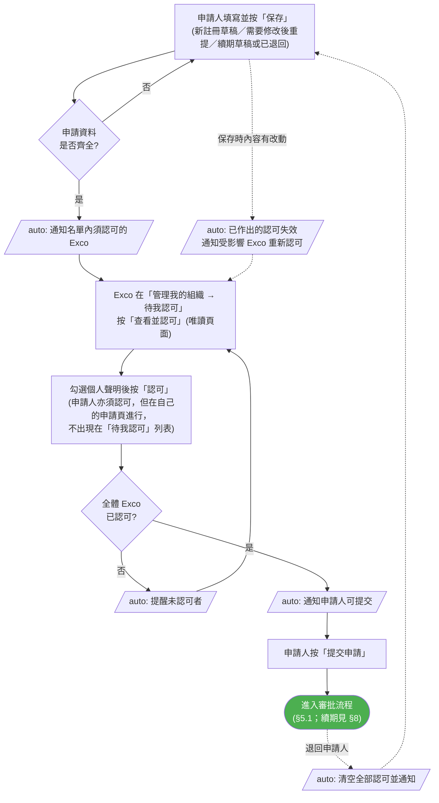
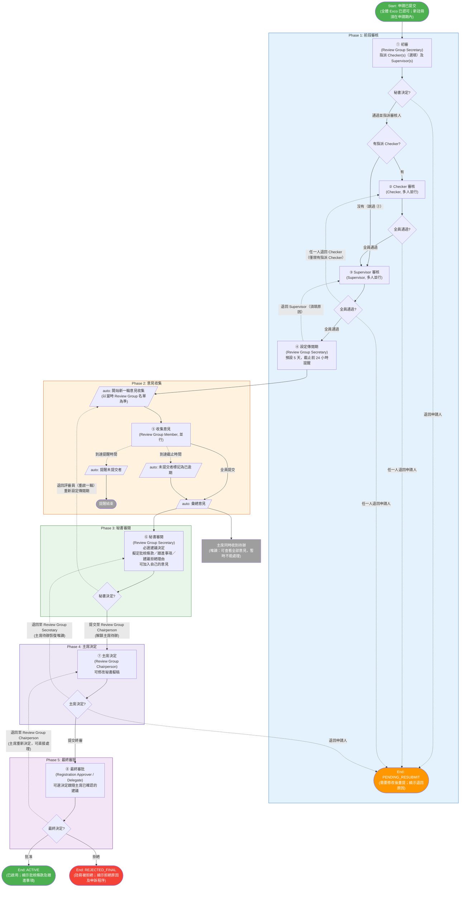
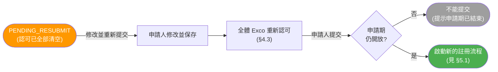
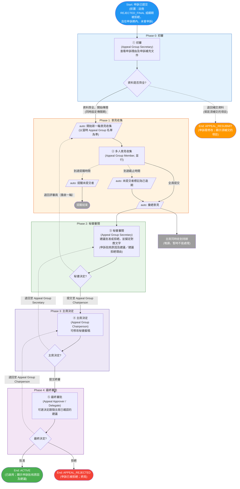
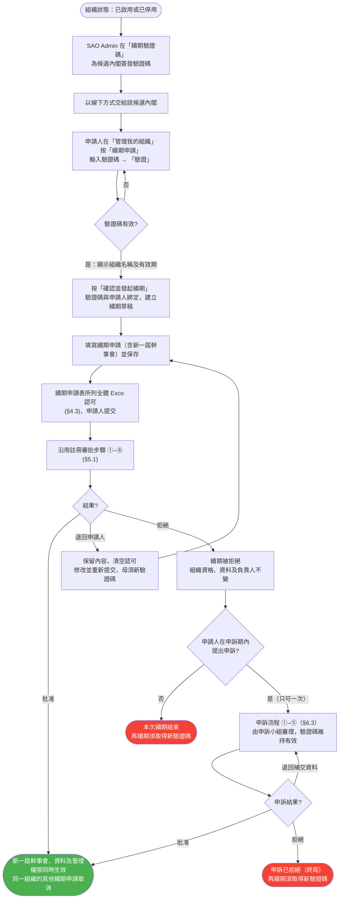

# 學生組織註冊、申訴及續期流程

> 本文檔描述 SLAS 系統**現行**的學生組織註冊、申訴及續期（renew）流程，以及提交前的幹事會（Exco）認可、組織類別申請期等配套功能。內容已按 2026-10-18 版本系統核對（2026-10-14 新增 Supervisor 退回 Checker、秘書退回 Supervisor；2026-10-15 Checker 改為選填；2026-10-16 採用甲方確認的待辦名稱、投票新增「中立」、秘書「建議決定」改為必填）。
>
> - 本文取代 2026-09 以前的舊版流程描述（舊版的「拒絕傳閱子流程」、Admin Checker／Academic Checker 已停用）。
> - 修訂過程及甲方確認事項見 [revised-workflow-flowcharts.md](./revised-workflow-flowcharts.md)（設計紀錄）。
> - 操作步驟見 [student-org-end-to-end-demo-guide.md](./student-org-end-to-end-demo-guide.md)。
> - **舊流程在途案件**：新流程上線前已在審批中的案件，仍按舊流程走完（待辦名稱如「匯總審核」「拒絕通知草擬」等），與本文無關。

---

## 1. 流程概覽

### 1.1 業務目標

- **註冊流程**：學生組織提交註冊申請，經多層審批，批准後組織正式生效。
- **申訴流程**：註冊或續期被終局拒絕者，可在申訴期內申請再次評審（每份申請一次）。
- **續期流程**：已註冊組織的新一屆幹事會，憑 SAO 簽發的續期驗證碼提交續期申請；審批步驟與註冊相同（見 §8）。

### 1.2 流程關係

```
[草稿 / 需要修改後重提] → 申請人填妥並保存 → 全體 Exco 認可（§4.3）→ 申請人提交
  → 註冊流程（須在該組織類別申請期內，§4.1）
      → 批准 → ACTIVE（已啟用）
      → 退回申請人 → PENDING_RESUBMIT（需要修改後重提，可修改後重新提交）
      → 拒絕 → REJECTED_FINAL（註冊被拒絕；可在申訴期內申訴一次）

REJECTED_FINAL → 申訴流程（§6.3）
      → 批准 → ACTIVE（已啟用）
      → 退回補交資料 → APPEAL_RESUBMIT（申訴需修改，補件後重新提交申訴）
      → 拒絕 → APPEAL_REJECTED（申訴已被拒絕，終局）

已啟用／已停用組織 → SAO 簽發續期驗證碼 → 新一屆申請人發起續期 → 全體 Exco 認可 → 提交
      → 沿用註冊審批步驟（§8）
      → 續期被拒絕 → 同樣可在申訴期內申訴一次，由申訴小組審理（§8.6）
            → 批准 → 續期生效
            → 拒絕 → 申訴已拒絕（終局）
```

### 1.3 狀態總覽

「管理我的組織」頁面顯示的狀態名稱如下：

| 狀態 | 頁面顯示 | 業務含義 | 頁面同時顯示 | 學生後續操作 |
|:--|:--|:--|:--|:--|
| `DRAFT` | 草稿 | 新註冊尚未提交（只有申請人看到） | 幹事會認可進度 | 繼續編輯、刪除；取得全體 Exco 認可後提交 |
| `PENDING` | 註冊審核中 | 註冊審批中 | — | — |
| `PENDING_RESUBMIT` | 需要修改後重提 | 註冊被退回申請人 | 退回原因、跟進事項（如有） | 修改並重新提交（須重新取得認可） |
| `REJECTED_FINAL` | 註冊被拒絕 | 註冊被終局拒絕 | 拒絕原因、申訴程序說明、申訴期限日期 | 於申訴期內申訴（一次） |
| `APPEAL_PENDING` | 申訴審核中 | 申訴審批中 | — | — |
| `APPEAL_RESUBMIT` | 申訴需修改 | 申訴資料不全，退回補件 | 須補交的項目 | 重新提交申訴 |
| `APPEAL_REJECTED` | 申訴已被拒絕 | 申訴被終局拒絕 | 拒絕原因（最終） | 無 |
| `ACTIVE` | 已啟用 | 註冊／申訴已批准，組織生效 | 批核條款、跟進事項（如有） | 可申請續期 |
| `INACTIVE` | 已停用 | SAO 將組織轉為非活躍 | — | 仍可申請續期；續期獲批後恢復活躍 |
| `DISSOLVED` | 已解散 | SAO 解散組織（不可復原） | — | 不能續期，亦不能舉辦新活動 |

續期申請另有獨立狀態，見 §8.4。

---

## 2. 角色與職責

角色沿用系統英文名稱，不另設中文名稱；中文「初審」「審閱」「決定」等字眼只描述操作。

### 2.1 註冊流程角色

| 角色 ID | 角色名稱 | 職責 |
|--:|:--|:--|
| 122 | Review Group Secretary | 初審；指派 Checker（選填）及 Supervisor；Supervisor 全員通過後設定傳閱期，亦可於此時退回 Supervisor；秘書審閱（必選「建議決定」，並擬定批核條款／跟進事項／建議拒絕理由，可加入自己的意見）；可退回評審員重啟一輪；維護 Review Group 成員；可在「審批人管理」替換未完成的 Checker／Supervisor |
| 142 | Checker | 由秘書**選填**指派（可零名，零名時跳過 Checker 審核），可多人並行；與活動申請流程共用同一 Checker 角色 |
| 116 | Supervisor | 由秘書指派，至少一名，可多人並行；審核時可退回申請人或退回 Checker |
| 123 | Review Group Member | 提供意見及投票（贊成／反對／中立），全體成員並行 |
| 138 | Review Group Chairperson | 秘書提交後作出決定：提交終審、退回秘書或退回申請人；可修改秘書擬稿 |
| 124 | Registration Approver | 最終審批：批准、拒絕或退回主席 |
| 134 | Registration Approver Delegate | 終審代辦人，決定權與 Registration Approver 相同 |

> 舊流程的 Admin Checker（136）及 Academic Checker（132）不再參與新案件，只用於處理舊流程在途案件。

### 2.2 申訴流程角色

| 角色 ID | 角色名稱 | 職責 |
|--:|:--|:--|
| 153 | Appeal Group Secretary | 申訴初審（資料齊全則設定傳閱期並開始傳閱，不齊全則退回補交資料）；秘書審閱；可退回評審員重啟一輪；維護 Appeal Group 成員 |
| 125 | Appeal Group Member | 提供申訴意見及投票，全體成員並行 |
| 139 | Appeal Group Chairperson | 秘書提交後作出決定：提交終審或退回秘書（**不可**退回申請人） |
| 126 | Appeal Approver | 最終審批：批准、拒絕或退回主席（**不可**退回申請人） |
| 135 | Appeal Approver Delegate | 終審代辦人，決定權與 Appeal Approver 相同 |

> 申訴小組同時審理**註冊申訴**及**續期申訴**（§8.6），兩者使用同一套步驟及同一組角色。

### 2.3 流程外參與者

| 參與者 | 職責 |
|:--|:--|
| 申請人（學生） | 填寫及提交註冊／續期申請；本身必定是 Exco 成員，同樣須認可；退回後修改並重新提交；發起及重新提交申訴。只有申請人可修改、提交、重新提交或申訴 |
| Exco（學生） | 申請表所列的全體幹事會成員；提交前查看申請並認可，不能修改（§4.3） |
| SAO Admin | 設定組織類別申請期；簽發／撤銷續期驗證碼；更改組織狀態（轉為非活躍、恢復活躍、解散） |

### 2.4 多人並行規則

| 環節 | 規則 |
|:--|:--|
| Checker 審核、Supervisor 審核 | 各自多人並行；**全員通過**才進入下一步；**任一人退回申請人**即結束本次流程，其餘未完成的同節點待辦自動取消，已提交的意見保留。Checker 環節為選填，未指派時整個 ② 跳過 |
| 流程內退回（不結束流程） | ③ 任一 Supervisor 可**退回 Checker**（僅限有指派 Checker 的案件）；④ 秘書設定傳閱期時可**退回 Supervisor**。兩者均取消本輪其餘未完成待辦，交回原指派的全體重新審核 |
| 意見收集 | 該輪開始時 Review Group／Appeal Group 的全體成員並行；全員提交或到達截止時間後彙總 |
| 秘書、主席 | 公共角色，角色內任何一人處理即可 |
| 最終審批 | Approver 與 Approver Delegate 任一人可作出決定 |

---

## 3. 圖例

| 形狀 | 含義 |
|:--|:--|
| 矩形 | 人工任務（待辦） |
| 平行四邊形 `auto:` | 系統自動執行 |
| 菱形 | 判斷分流 |
| 圓角 | 起點／終點 |

| 線條 | 含義 |
|:--|:--|
| 實線 | 正向流程 |
| 虛線 | 計時器（提醒／截止）、流程內退回、結束流程的退回 |

步驟編號：

| 流程 | 編號 | 待辦名稱（系統顯示） | 處理角色 |
|:--|:--:|:--|:--|
| 註冊 | ① | 註冊審議組秘書初審 | Review Group Secretary |
|  | ② | 審查員審核申請 | Checker（多人並行） |
|  | ③ | 活動指導審核申請 | Supervisor（多人並行） |
|  | ④ | 註冊審議組秘書設定傳閱期 | Review Group Secretary |
|  | ⑤ | 收集註冊審議組意見 | Review Group Member（並行） |
|  | ⑥ | 註冊審議組秘書總結審閱 | Review Group Secretary |
|  | ⑦ | 註冊審議組主席決策／註冊審議組主席重新決策 | Review Group Chairperson |
|  | ⑧ | 註冊審批員最終審批 | Registration Approver／Delegate |
| 申訴 | ① | 申訴審議組秘書初審 | Appeal Group Secretary |
|  | ② | 收集申訴審查員意見 | Appeal Group Member（並行） |
|  | ③ | 申訴審議組秘書總結審閱 | Appeal Group Secretary |
|  | ④ | 申訴審議組主席決策／申訴審議組主席重新決策 | Appeal Group Chairperson |
|  | ⑤ | 申訴審批員最終審批 | Appeal Approver／Delegate |

> 審批人一律在「待辦事項」的「學生組織」標籤找到待辦，按「辦理」進入。
>
> 上表為 **2026-10-16 甲方確認的待辦名稱**。舊稱（如「Checker 審核」「Supervisor 審核」「設定傳閱期」）系統仍保留為搜尋別名，用舊稱搜尋待辦同樣找得到。
>
> 註：待辦名稱中的「審查員」即 Checker、「活動指導」即 Supervisor；角色本身仍沿用英文名稱（§2）。

---

## 4. 提交前的條件

### 4.1 組織類別申請期

| 項目 | 規則 |
|:--|:--|
| 設定 | SAO Admin 在「管理中心 → 組織類別申請期」為每個組織類別設定一組開始日期及結束日期 |
| 日期 | 開始及結束日期均包括當天；兩個日期都留空表示不限制；只留空其中一個即取消該端的限制 |
| 適用 | 只限**提交新註冊**及**重新提交被退回的新註冊**；申請期外提交會提示「本類別申請期已於 YYYY-MM-DD 結束」或「本類別申請期將於 YYYY-MM-DD 開始」 |
| 不適用 | 保存草稿、Exco 認可、申訴、續期均不受申請期限制 |
| 列表狀態 | 不限制／開放中／尚未開始／已結束 |

> 申請期結束前未完成全體 Exco 認可，新註冊同樣不能提交。

### 4.2 申請表主要校驗

申請表分六步：開始申請 → 組織資料 → 幹事會 → 年度規劃 → 文件上傳 → 審核。以下為提交（及 Exco 認可）前必須符合的主要規則：

| 項目 | 規則 |
|:--|:--|
| 幹事會人數及職位 | 4 至 20 人；主席 1 名、副主席 1 至 2 名（副主席／內務副主席／外務副主席，每種職位各限一人）、財政 1 名、文書 1 名；同一學生不可重複；只可選用表格提供的職位 |
| 幹事會多於 12 人 | 須填寫理據（12 人或以下毋須填寫） |
| 申請人 | 必須列為幹事會成員；申請人一行預先載入，不能刪除，學號不能修改 |
| 成員資料 | 輸入「學號」後，「全名」「學年」「修讀課程編號」由學生資料庫自動帶入，不能自行修改；保存時系統會再以學生資料庫為準更新 |
| 日期 | 會籍的開始／結束日期及幹事會任期，必須在「註冊期間」之內，且開始不得遲於結束；否則提示「日期須在註冊期間內。」 |
| 年度活動計劃 | 至少 3 個，每個活動的必填欄位（標有星號，包括英文名稱、開始及結束日期）須填妥；某活動在「活動是否涉及任何預計收入或支出？」答「是」時，該活動最少須有一個預算項目 |
| 組織宗旨 | 英文、繁體中文及簡體中文三個版本均須填寫；缺任何一個版本，系統視為申請未齊全（Exco 不能認可、申請人不能提交） |
| 新註冊專有 | 須說明「擬成立學生組織之獨特性」；須上傳草擬會章 |
| 續期專有 | 見 §8.3 |

填表時按「下一步」，系統會先檢查本步驟，並在欄位旁顯示錯誤；未符合要求不能前往下一步（仍可經步驟列直接開啟任何步驟）。申請資料未齊全時，Exco 不能認可，申請人亦不能提交；系統會列出未填妥的步驟。

其他填表行為：

- 開啟新註冊時如系統偵測到未完成的草稿，可選「繼續填寫」或「重新開始」；選「重新開始」會再確認一次：下次保存時，已儲存的草稿會被新申請取代。此時按「繼續填寫」則仍載入原草稿。
- 切換系統語言會重新載入頁面：如表單內容與最近一次保存的版本不同（包括從未保存的新表單），系統會先提示確認。
- 關閉或重新整理瀏覽器頁面：只在已保存過、或開啟的是已有申請，且之後仍有未保存修改時，瀏覽器才會提示確認。
- Exco 以「查看並認可」開啟的唯讀頁面不設上述提示。

### 4.3 提交前全體 Exco 認可

適用於新註冊、退回後重新提交、續期及續期退回後重新提交；**申訴不設認可**。認可不是審批步驟，不影響 §5 的審批流程。



| 項目 | 規則 |
|:--|:--|
| 認可人 | 申請表所列全體 Exco；續期為續期申請表所列的新一屆 Exco。申請人必定在名單內，同樣須按「認可」，系統不會自動認可 |
| 個人聲明 | 按「認可」前須勾選四項個人聲明（遵守法律及大學規例、學生行為守則、履行章程職責、知悉違規後果） |
| 認可條件 | 申請資料必須齊全；資料未齊全時頁面顯示「申請人尚未填妥申請，待申請填妥後方可認可」 |
| 內容改動 | 申請人保存任何內容改動後，已作出的認可全部失效，狀態顯示「需重新認可」；保存但內容沒有改動則不影響 |
| 名單改動 | 新加入的 Exco 須認可；被移除者的認可記錄刪除 |
| 過時內容 | Exco 開啟頁面後，若申請人再保存了新內容，按「認可」時會提示「申請內容已更新，請先查看最新版本再認可」並重新載入 |
| Exco 權限 | 只可查看及認可，不能修改、保存、提交、重新提交或申訴 |
| 提交 | 只有申請人可提交；須全體已認可，且沒有未保存的改動。重複按提交只會提交一次 |
| 退回 | 申請被退回申請人時，全部認可清空，受影響的 Exco 收到「學生組織申請 - 已退回修改」通知（說明認可已失效，待申請人修改後再通知，不要求立即重新認可）；申請人作出退回後**第一次有改動的保存**時，系統才再請各人認可 |
| 退回後未修改 | 申請已退回但申請人尚未保存任何改動時，Exco 的認可頁面提示「申請人尚未修改這份已退回的申請，您仍可就現有內容作出認可」，申請人重新提交前亦有相應提示；兩者**均仍然允許繼續** |
| 重新認可 | 曾認可過的成員再次認可時，四項個人聲明預先勾選 |
| 待認可清單 | 「待我認可」列出申請編號；申請處於已退回狀態時，一併顯示退回原因及跟進事項 |
| 草稿 | 新註冊草稿存於系統，每名申請人一份，可刪除（相關認可記錄一併刪除）；草稿不產生組織編號、不佔用組織名稱，不會出現在管理後台的組織清單，也不會出現在其他人的組織列表（Exco 只在「待我認可」看到） |
| 帳號 | 全體 Exco 學號均須能對應系統用戶，否則不能提交 |

---

## 5. 審批流程圖

### 5.1 註冊主流程（續期沿用）



> **三條流程內退回路線**（不結束流程，學生毋須重新提交）：⑥ 秘書退回評審員重啟一輪；⑦ 主席退回秘書；⑧ 終審退回主席。
>
> **結束流程的退回**：①②③ 及 ⑦ 可「退回申請人」，申請變為「需要修改後重提」。終審**不能**直接退回申請人。
>
> **續期**沿用本圖全部步驟，但結果不改變組織的狀態，按 §8 處理；續期被拒絕同樣可在申訴期內申訴（§8.6）。

### 5.2 註冊重新提交

狀態為「需要修改後重提」時，申請人按「修改並重新提交」，修改並保存後重新取得全體 Exco 認可，再提交。提交會**啟動一個全新的註冊流程**，由 ① 初審重新開始。



### 5.3 申訴主流程



> 申訴有三條流程內退回路線：③ 秘書退回評審員、④ 主席退回秘書、⑤ 終審退回主席。**申訴主席及終審均不能退回申請人**；跟進事項可由組織成立後持續跟進。

### 5.4 申訴補件後重新提交


| 項目 | 規則 |
|:--|:--|
| 發起 | 只限「註冊被拒絕」的申請，由申請人在「管理我的組織」按「申訴」；每宗註冊只可發起一次申訴，其後只能在「申訴需修改」時重新提交 |
| 申訴理由 | 必填，最多 1000 字 |
| 申訴補充文件 | 選填；PDF、Word、PowerPoint、Excel 及圖片；最多 10 個；與註冊申請文件分開存放 |
| 重新提交 | 對話框預先列出已上傳的文件（顯示檔名及大小），可保留、移除或新增；以提交時的清單為準。在對話框刪除文件會即時刪除，即使其後取消對話框 |
| 查看 | 申訴秘書、小組成員、主席及終審人在審批頁的「申訴補充文件」查看及下載 |
| 退回通知 | 退回補交資料時，申請人收到「學生組織申訴已退回 - 請補充材料」通知（結果為「已退回」），不是拒絕通知 |
| 認可 | 申訴不設 Exco 認可 |

---

## 6. 步驟詳述

### 6.1 決定與意見的填寫規則（各審批頁通用）

- 先選擇決定，再填寫對應意見，最後提交。
- **退回**（任何對象）及**拒絕**均須填寫具體理由，欄位標示 *；空白不能提交。批准／通過的意見選填。
- 拒絕時，若秘書／主席已擬定「建議拒絕理由」，終審直接採用（顯示為「拒絕理由（採用已確認理由）」）；若未擬定，終審須自行填寫，頁面提示「請填寫具體拒絕意見」。
- 每一步的操作、處理人、輪次、時間及意見，均記錄在審批頁的「決定記錄」。

#### 格式化文字

審批頁的長文字欄位（評審員意見、秘書附加意見、批核條款、跟進事項、建議拒絕理由、各類退回及拒絕理由）可使用格式：

| 項目 | 規則 |
|:--|:--|
| 可用格式 | 粗體、斜體、底線、字體顏色、項目符號及編號列表、縮排、超連結 |
| 字數上限 | 10000 字，只計**可見文字**，格式本身不計入 |
| 必填判斷 | 同樣只看可見文字：只有格式而沒有文字的內容視為空白，不能提交 |
| 審批頁以外 | 離開審批頁的地方一律顯示純文字（保留換行）：組織頁面的拒絕理由、通知及電郵、流程記錄、AI 摘要 |
| 超連結 | 在新視窗開啟 |
| 被拒絕的申請人頁面 | 顯示終審決定的完整格式化拒絕理由 |

### 6.2 註冊流程

#### ① Review Group Secretary 初審

- **選項**：「通過並指派審核人」／「退回申請人」
- 通過時 **Checker 為選填**（可指派零名或多名），**Supervisor 須至少一名**；可多選，可按姓名、電郵或部門搜尋，只可選持有相應角色的用戶。表單提示「選填，不選則直接交由 Supervisor 審核」。
- **未指派 Checker 時跳過 ②，直接進入 ③ Supervisor 審核**；該案的 Supervisor 亦不提供「退回 Checker」選項。
- 退回時須填寫「退回原因」→ 流程結束（需要修改後重提）。

#### ② Checker 審核／③ Supervisor 審核

- **選項**：② 為「通過」／「退回申請人」；③ 為「通過」／「退回申請人」／**「退回 Checker」**（僅限 ① 有指派 Checker 的案件，否則不顯示，後端亦拒絕）
- 每名被指派者各自收到待辦。全員通過才進入下一步；任一人退回申請人即結束流程（需要修改後重提），其餘未完成的同節點待辦自動消失。
- **退回 Checker**（須填寫原因）：取消其餘未完成的 Supervisor 待辦，**流程不結束**；交回 ② 原指派的全部 Checker 重新審核（並行、全員通過才前進，Checker 仍可退回申請人），通過後再交回 ③ 原指派的全部 Supervisor 審核。退回記錄於決定記錄並通知相關人員。
- 處理前可由秘書在「審批人管理」替換尚未完成的人員（§9.3）。

#### ④ 設定傳閱期

- **執行人**：Review Group Secretary（Supervisor 全員通過後收到待辦）
- **選項**：「開始收集意見」／**「退回 Supervisor」**（須填寫原因）
- 「傳閱期（天）」預設 5，最少 1；「提醒時間（截止前小時數）」預設 24，最少 1，且須早於截止時間。頁面以現在時間預覽「意見截止時間」及「發送提醒時間」，實際由意見收集開始時起計。
- 按「開始收集意見」後，Review Group 全體成員收到「收集意見」待辦。
- **退回 Supervisor**：由 ③ 原指派的全部 Supervisor 重新審核，**流程不結束**。

#### ⑤ 收集意見

- 每名成員選擇「贊成」「反對」或「中立」並填寫意見（兩者必填）後提交。「中立」在統計上與「贊成」同樣不構成反對。
- 到達提醒時間：提醒尚未提交者，收集繼續。
- 到達截止時間：未提交者標記為「已逾期」，流程繼續彙總。
- 彙總後，秘書收到「Review Group Secretary 審閱」待辦，**主席同時**收到「Review Group Chairperson 決定」待辦（唯讀）。

#### ⑥ Review Group Secretary 審閱

- 頁面按輪次顯示成員意見及統計（已提交、贊成、反對、中立、待提交）。
- 「加入我的意見」：秘書可加入附加意見，帶「秘書」標籤，不計入成員統計。提交至主席前，秘書可**修改或刪除本輪自己的附加意見**。
- **「建議決定」為必填**：須選擇「建議批准」「建議退回修改」或「建議拒絕」，未選擇不能提交至主席。
- 擬定「批核條款」「跟進事項」「建議拒絕理由」。系統**只保留與所選建議決定對應的擬稿**（建議批准→批核條款；建議退回修改→跟進事項；建議拒絕→建議拒絕理由），其餘擬稿於提交時清除。
- 審閱文字欄位上限 10000 字。
- **選項**：
  - 「提交至 Review Group Chairperson」→ 主席收到可作出決定的通知，主席頁面變為可操作。
  - 「退回評審員（重啟一輪）」→ 須填寫「退回評審員原因」並重新設定傳閱期（預設恢復 5 天／24 小時）；主席的唯讀待辦隨即取消；向全體成員重新派發新一輪意見收集，已提交者亦須重新提交。歷次意見保留並按輪次顯示；重啟輪次不設上限。

#### ⑦ Review Group Chairperson 決定

- 秘書提交前，頁面顯示「待 Review Group Secretary 提交 — 您可查看所有意見，但暫時不能處理」，只有「返回」。
- 秘書提交後可操作，可修改**建議決定**及批核條款、跟進事項、拒絕理由。主席最後確認的建議決定，決定了終審可選的決定（見 ⑧）。
- **選項**：
  - 「提交終審」→ ⑧
  - 「退回至 Review Group Secretary」（須填原因）→ 秘書重新收到審閱待辦；主席待辦保留但恢復唯讀，待秘書再次提交。
  - 「退回申請人」→ 流程結束（需要修改後重提）。申請人看到的退回說明取決於有沒有擬定「跟進事項」：
    - **已擬定跟進事項**：申請人看到該跟進事項；主席自己的文字變成**選填的內部備註**，只留在決定記錄。
    - **未擬定跟進事項**：主席的文字即退回原因，**必填**，並直接顯示給申請人。
- 被終審退回時，待辦名稱為「註冊審議組主席重新決策」，頁面提示「Registration Approver / Delegate 已退回，請重新處理」，可直接處理，選項同上。若再退回秘書，主席待辦重新鎖定。

#### ⑧ 最終審批

- **執行人**：Registration Approver 或 Registration Approver Delegate
- **可選決定跟隨主席已確認的建議**（2026-10-21 起）：建議批准時只顯示「批准」及「退回主席」；建議拒絕時只顯示「拒絕」及「退回主席」；建議為「退回修改」或沒有建議時，「批准」「拒絕」兩者均可選。這樣「批准」不會被誤解為「批准該份擬稿」。
- **選項**：
  - 「批准」→ ACTIVE（已啟用），組織頁面顯示批核條款及跟進事項。
  - 「拒絕」→ REJECTED_FINAL（註冊被拒絕），申請人看到拒絕原因、申訴程序說明及「申訴」按鈕。拒絕理由規則見 §6.1。
  - 「退回至 Review Group Chairperson」（須填原因）→ 回到 ⑦（流程內，不結束）。
- **終審人的文字不傳給申請人**：「退回至主席」的原因只送交流程內參與者，申請人收到的進度更新不附帶該原因；申請人開啟自己的申請時，決定記錄亦不顯示終審步驟的意見。唯一例外是**拒絕理由**——那是須告知申請人的結果，照常顯示。

### 6.3 申訴流程

#### ⓪ 提出申訴的條件

| 項目 | 規則 |
|:--|:--|
| 可申訴的對象 | 終審被拒絕的**新註冊**，以及終審被拒絕的**續期**（見 §8.6） |
| 提出人 | 只限原申請人；頁面提示「只有原註冊申請人可提交申訴。」 |
| 次數 | 每份申請只可申訴**一次**；不符合條件時系統提示「只有終審被拒絕的註冊才可申訴，且只可一次」（申訴被退回補交資料後重新提交，不算另一次申訴，亦不再受申訴期限制） |
| 申訴期 | 自終審拒絕當日起計的自然日數，截止日**當天仍可**提交；由 SAO 在系統設置 `stugroup.appeal.period.days` 設定，預設 **14 天** |
| 期限提示 | 期內顯示「如有異議，可於 YYYY-MM-DD 前提出申訴。」；逾期顯示「申訴期限已於 YYYY-MM-DD 屆滿，不可再提出申訴。」 |
| 申訴內容 | 申訴理由上限 2000 字；可上傳補充文件 |

#### ① Appeal Group Secretary 初審

- 查看原拒絕資訊、申訴理由及申訴補充文件。
- **選項**：
  - 「資料齊全，開始傳閱」→ 同時設定傳閱期（預設 5 天／24 小時，規則同註冊 ④），Appeal Group 全體成員收到意見收集待辦。
  - 「退回補交資料」→ 須填寫「須補交的項目」→ 流程結束（申訴需修改）。

#### ② 多人意見收集

與註冊 ⑤ 相同（贊成／反對／中立＋意見、提醒、截止、彙總後秘書及主席同時收到待辦）。

#### ③ Appeal Group Secretary 審閱

大致與註冊 ⑥ 相同；選項為「提交至 Appeal Group Chairperson」或「退回評審員（重啟一輪）」。與註冊的分別：

- **「建議決定」只有「建議批准」及「建議拒絕」**；申訴不設「建議退回修改」。
- 擬稿文字在申訴中的名稱不同：建議批准時擬定的內容，在結果頁顯示為「申訴批核原因」及「建議」。

#### ④ Appeal Group Chairperson 決定

秘書提交前唯讀。選項只有「提交終審」及「退回至 Appeal Group Secretary」，**沒有**「退回申請人」。被終審退回時待辦名稱為「申訴審議組主席重新決策」。

#### ⑤ 最終審批

- **執行人**：Appeal Approver 或 Appeal Approver Delegate
- **選項**：「批准」→ ACTIVE；「拒絕」→ APPEAL_REJECTED（終局）；「退回至 Appeal Group Chairperson」→ 回到 ④。**沒有**退回申請人。
- 可選決定跟隨主席已確認的建議（建議批准則只可批准或退回主席，建議拒絕則只可拒絕或退回主席）；申訴的這項限制由系統強制，與建議相反的決定會被拒絕。

---

## 7. 結果對照表

### 7.1 註冊

| 決策點 | 決定 | 結果 | 申請人看到 | 申請人後續 |
|:--|:--|:--|:--|:--|
| ① 初審 | 退回申請人 | 需要修改後重提 | 退回原因 | 修改並重新提交 |
| ② Checker | 任一人退回申請人 | 需要修改後重提 | 退回原因 | 修改並重新提交 |
| ③ Supervisor | 任一人退回申請人 | 需要修改後重提 | 退回原因 | 修改並重新提交 |
| ③ Supervisor | 任一人退回 Checker | 流程內，交回原指派 Checker 重審（僅限有指派 Checker） | — | — |
| ④ 設定傳閱期 | 秘書退回 Supervisor | 流程內，交回原指派 Supervisor 重審 | — | — |
| ⑥ 秘書審閱 | 退回評審員 | 流程內，新一輪意見收集 | — | — |
| ⑦ 主席 | 退回秘書 | 流程內 | — | — |
| ⑦ 主席 | 退回申請人 | 需要修改後重提 | 跟進事項；未擬定跟進事項時為主席填寫的退回原因 | 修改並重新提交 |
| ⑧ 終審 | 退回主席 | 流程內 | —（進度更新不含終審人填寫的原因） | — |
| ⑧ 終審 | 批准 | 已啟用 | 批核條款、跟進事項 | — |
| ⑧ 終審 | 拒絕 | 註冊被拒絕 | 拒絕原因、申訴程序說明、申訴期限日期 | 於申訴期內申訴一次（§6.3 ⓪） |

### 7.2 申訴

| 決策點 | 決定 | 結果 | 申請人看到 | 申請人後續 |
|:--|:--|:--|:--|:--|
| ① 初審 | 退回補交資料 | 申訴需修改 | 須補交的項目 | 重新提交申訴 |
| ③ 秘書審閱 | 退回評審員 | 流程內 | — | — |
| ④ 主席 | 退回秘書 | 流程內 | — | — |
| ⑤ 終審 | 退回主席 | 流程內 | — | — |
| ⑤ 終審 | 批准 | 已啟用 | 申訴批核原因、建議 | — |
| ⑤ 終審 | 拒絕 | 申訴已被拒絕 | 拒絕原因（最終） | 無（終局） |

### 7.3 場景示例

```
場景 1（一次通過）
① 初審（指派 1 名 Checker、2 名 Supervisor）→ ② Checker 通過 → ③ 兩名 Supervisor 均通過
→ ④ 設定傳閱期 5 天／24 小時 → ⑤ 全體成員提交
→ ⑥ 秘書擬定批核條款，提交主席 → ⑦ 主席提交終審 → ⑧ 批准 → 已啟用

場景 2（前段退回）
① → ② → ③ 其中一名 Supervisor 退回申請人（另一名的待辦自動消失）
→ 需要修改後重提 → 申請人修改、全體 Exco 重新認可 → 重新提交（新流程）

場景 3（流程內往返）
… → ⑥ 秘書退回評審員（第 2 輪）→ ⑤ 再收集 → ⑥ 提交主席
→ ⑦ 主席退回秘書 → ⑥ 修訂後再提交 → ⑦ 提交終審
→ ⑧ 退回主席 → ⑦ 重新決定，提交終審 → ⑧ 批准（全程學生毋須重新提交）

場景 4（終審不同意建議批准）
⑥ 秘書選「建議批准」、擬批核條款 → ⑦ 主席提交終審
→ ⑧ 只見「批准」及「退回主席」兩個選項，選「退回主席」並說明理由
→ ⑦ 主席把建議決定改為「建議拒絕」、填寫建議拒絕理由，再提交終審
→ ⑧ 這次可選「拒絕」（直接採用已確認的拒絕理由）→ 註冊被拒絕

場景 5（申訴補件後通過）
註冊被拒絕 → 申訴（附補充文件）→ ① 退回補交資料 → 申訴需修改
→ 重新提交申訴（加上新文件）→ ① 資料齊全，開始傳閱 → ② → ③ → ④ → ⑤ 批准 → 已啟用
```

---

## 8. 續期（renew）

### 8.1 流程



### 8.2 續期驗證碼規則

| 項目 | 規則 |
|:--|:--|
| 簽發對象 | 只限「已啟用」或「已停用」的組織；草稿、審批中或已解散的組織顯示「不可續期」 |
| 候選內閣 | 每個驗證碼對應一個候選內閣，簽發時須輸入候選內閣名稱（最多 200 字） |
| 有效期 | 自簽發起 180 天，只可使用一次 |
| 數量上限 | 每個組織同一時間最多 3 個有效驗證碼；每個候選內閣最多 1 個。已用於仍在處理中（草稿／已退回／審批中／**申訴中**）的續期申請的驗證碼仍計算在內 |
| 顯示 | SAO Admin 可在「續期驗證碼」頁隨時查看已簽發的驗證碼（方便再次告知候選內閣）；簽發新驗證碼**不會**令該組織其他驗證碼失效。系統只保存驗證用的雜湊值及供 SAO 查看的驗證碼本身；2026-10-18 之前簽發的舊驗證碼不能再顯示，須撤銷後重新簽發 |
| 驗證 | 不分大小寫，空格及連字符會被忽略；只按「驗證」不會消耗驗證碼 |
| 綁定 | 按「確認並發起續期」並成功建立申請時，驗證碼即被使用並與該申請人綁定 |
| 每名學生 | 同一時間只可綁定一份處理中的續期申請 |
| 無效提示 | 已使用：「驗證碼無效：此驗證碼已被使用」；已過期：「驗證碼無效：此驗證碼已過期」；其他：「驗證碼無效」 |
| 撤銷 | 未使用的驗證碼可撤銷；已使用而續期申請仍為草稿或已退回的，撤銷會一併取消該續期申請；續期申請審批中時不能撤銷 |
| 並行續期 | 不同候選內閣可同時為同一組織申請續期；其中一份獲批後，其餘續期申請（包括審批中的）自動取消，未使用的驗證碼亦被撤銷。每個組織最終只有不多於一份續期申請獲批 |

### 8.3 續期申請表

| 項目 | 規則 |
|:--|:--|
| 預載 | 以組織現行生效資料預載；申請類型為「註冊續期申請」 |
| 與新註冊的差異 | 沒有「擬成立學生組織之獨特性」；須回答「組織是否擬修訂會章？」（選「是」須上傳草擬會章） |
| 選舉結果 | 須回答是否已按會章完成選舉或委任程序：已完成須上傳「已簽署之幹事會選舉結果」或「通過委任幹事會之會議紀錄」；未完成須勾選知悉須在任期前提交 |
| 終審前條件 | 終審**批准**前，申請必須已上傳選舉結果或委任紀錄；未上傳者系統不允許批准，審批頁會預先顯示警告並說明原因，審批人應退回申請人補交 |
| 幹事會 | 填寫新一屆名單，規則同 §4.2；申請人必須列為幹事會成員 |
| 申請期 | 不受組織類別申請期限制 |
| 審批頁 | 分別顯示「擬續期內容」（標籤「擬議」）及「現行生效的組織資料」（標籤「現行（生效中）」） |

### 8.4 續期申請狀態及結果

| 狀態 | 含義 | 申請人可做 |
|:--|:--|:--|
| 草稿 | 已發起，尚未提交 | 繼續填寫 |
| 審批中 | 已提交，按 §5.1 審批 | — |
| 已退回 | 被退回申請人（①②③⑦ 任一步） | 修改並重新提交（毋須新驗證碼，須重新取得認可；由 ① 重新審批） |
| 已批准 | 終審批准 | — |
| 已拒絕 | 終審拒絕 | **可在申訴期內申訴一次**（§8.6）；頁面顯示「組織的註冊資格維持不變。如需再次續期，須向 SAO 取得新的驗證碼。」及申訴期限 |
| 申訴審核中 | 已提出續期申訴，按 §6.3 由申訴小組審理 | — |
| 申訴待補交 | 申訴被退回補交資料 | 補充後重新提交申訴（不再受申訴期限制） |
| 申訴已拒絕 | 申訴終審拒絕 | 無（終局）；再續期須取得新驗證碼 |
| 已取消 | 另一份續期已獲批、驗證碼被撤銷或組織被解散 | — |

| 時點 | 組織資料及權限 |
|:--|:--|
| 審批期間 | 組織現行資料、狀態及原負責人權限不變；續期申請中的修改尚未生效；「我的組織」資料唯讀 |
| 批准時 | 新一屆幹事會、更新資料及管理權限同時生效，申請人成為負責人；組織編號不變；已停用的組織恢復為已啟用；批核條款及跟進事項更新為本次結果 |
| 交接期 | 不在新一屆幹事會內的原幹事會成員，可保留系統身份三個月以便交接（由註冊期屆滿日及續期獲批日兩者中較後者起計）；交接期內不計入成員列表，原負責人仍可審批入會申請；期滿後自動移除 |
| 拒絕時 | 組織資格、資料及負責人不變；申請人可在申訴期內申訴（§8.6） |
| 申訴期間 | 與審批期間相同：組織現行資料、狀態及權限不變；該續期所用的驗證碼維持有效，不可撤銷 |

### 8.5 組織狀態（SAO）

SAO Admin 在「續期驗證碼」頁選定組織後，可更改其狀態：

| 操作 | 前置狀態 | 效果 |
|:--|:--|:--|
| 轉為非活躍 | 活躍 | 組織仍可申請續期；續期獲批後恢復活躍 |
| 恢復活躍 | 非活躍 | — |
| 解散 | 活躍或非活躍 | **不可復原**；不能再申請續期或舉辦新活動；處理中的續期申請及未使用的驗證碼一併取消 |

### 8.6 續期申訴

終審被拒絕的續期可以申訴，沿用註冊申訴的同一套流程及同一個小組。

| 項目 | 規則 |
|:--|:--|
| 審理 | 申訴流程 ①–⑤（§6.3）：Appeal Group Secretary 初審 → 意見收集 → 秘書審閱 → Appeal Group Chairperson → Appeal Approver／Delegate |
| 提出人及次數 | 只限原續期申請人；每份續期申請只可申訴一次（申訴被退回補交資料後重新提交不另計） |
| 申訴期 | 同註冊：自終審拒絕當日起計，預設 14 天（§6.3 ⓪） |
| 審批頁 | 顯示續期的擬議內容與現行生效資料，與續期審批相同；申請類型標示為續期 |
| 驗證碼 | 申訴期間該續期所用的驗證碼維持有效（仍計入數量上限），不可撤銷 |
| 批准 | 等同續期獲批：新一屆幹事會、資料及管理權限生效（§8.4 的「批准時」）；結果頁顯示「申訴批核原因」及「建議」 |
| 拒絕 | 狀態為「申訴已拒絕」，終局；組織資格、資料及負責人不變，再續期須取得新驗證碼 |
| 被取代 | 本次拒絕之後，同一組織另一份續期獲批，則本續期**不能再申訴**（提示「本組織已有另一份續期獲批，此續期不可再申訴」）；已在申訴中的，申訴一併取消 |
| 取消通知 | 因另一候選內閣的續期獲批而被取消的續期或續期申訴，只發出取消通知，不再另發「已拒絕」通知 |

---

## 9. 管理工具

| 功能 | 菜單位置 | 使用角色 |
|:--|:--|:--|
| 組織類別申請期 | 管理中心 → 組織類別申請期 | SAO Admin |
| 續期驗證碼（含組織狀態） | 管理中心 → 續期驗證碼 | SAO Admin |
| 評審小組成員 | 管理中心 → 評審小組成員 | SAO Admin、Review Group Secretary、Appeal Group Secretary |
| 審批人管理 | 管理中心 → 審批人管理 | SAO Admin、Review Group Secretary |

### 9.1 組織類別申請期

見 §4.1。按「編輯」修改開始／結束日期；開始日期不得遲於結束日期。

### 9.2 評審小組成員

- 「Review Group」標籤由 Review Group Secretary 維護；「Appeal Group」標籤由 Appeal Group Secretary 維護；SAO Admin 可維護兩者。不負責維護的標籤顯示「您不負責維護此小組。」
- 可按姓名或帳號搜尋職員並「新增成員」，或「移除」成員（不影響該人的其他角色）。
- 小組不設有效期；每輪意見收集以**該輪開始時**的成員名單為準，中途增減成員不影響進行中的一輪。
- 同時持有多個角色的用戶，須先在頂欄切換到相應角色，菜單才會顯示對應功能。

### 9.3 審批人管理

- 「現行流程」標籤列出停留在 Checker 審核或 Supervisor 審核步驟的註冊案件（含續期），顯示已指派評審員及其狀態（待審核／已完成）。
- 只可「替換」**尚未完成**的評審員：選擇新評審員（不能選已指派的人）並填寫原因（必填）。
- 替換後原評審員的待辦消失，新評審員收到待辦且必須完成審核；已通過者的意見保留，毋須重審；節點仍須全員通過才前進。
- 「較早案件（舊流程）」標籤供處理舊流程在途案件的行政／學術審批人替換。
- 申訴流程不使用此功能。

---

## 10. 通知

| 時機 | 收件人 |
|:--|:--|
| 每個待辦產生 | 該待辦的處理人（右上角鈴鐺） |
| 秘書提交至主席 | 主席另收到「可作出決定」通知 |
| 流程內進展（秘書提交、重啟一輪、主席退回秘書、終審退回主席等）及結束結果（批准、退回、拒絕） | 只通知**本案參與者**：申請人、本案被指派的 Checker／Supervisor、本案各輪小組成員、曾處理本案的秘書／主席／終審人；未參與本案的同角色用戶不會收到 |
| 意見收集到達提醒時間 | 尚未提交的成員 |
| 申訴退回補交資料 | 申請人收到「學生組織申訴已退回 - 請補充材料」（結果為「已退回」） |
| Exco 認可 | Exco 加入名單時收到須認可的通知；部分認可時提醒未認可者；全員認可時通知申請人可提交；內容修改時通知受影響的 Exco「認可已失效，請查閱最新版本重新認可」；申請被退回時改發「已退回修改」通知（說明認可已失效、待申請人修改後再通知），直到申請人作出退回後第一次有改動的保存，系統才請各人重新認可。認可相關通知附有申請編號 |
| 續期 | 續期的批准／退回／拒絕及意見收集通知一律採用續期措辭，不再沿用註冊措辭 |
| 續期被取代 | 因另一候選內閣的續期獲批而被取消的續期（包括正在申訴的），只向申請人發出取消通知 |

通知標題及內容按**發送當時**收件人的語言偏好產生，其後切換語言不會改變舊通知。

---

## 11. 註冊與申訴主要差異

| 維度 | 註冊（含續期） | 申訴 |
|:--|:--|:--|
| 進入條件 | 新申請／需要修改後重提（新註冊須在申請期內）；續期憑驗證碼 | 註冊或續期被終審拒絕（須在申訴期內，每份申請只可一次）／申訴需修改 |
| 提交前 Exco 認可 | 須全體認可 | 不設 |
| 前段審核 | 初審 → Checker → Supervisor → 設定傳閱期 | 初審（同時設定傳閱期） |
| 小組 | Review Group（123） | Appeal Group（125） |
| 秘書 | Review Group Secretary（122） | Appeal Group Secretary（153） |
| 主席 | Review Group Chairperson（138） | Appeal Group Chairperson（139） |
| 主席可退回申請人 | 可 | 不可 |
| 終審 | Registration Approver／Delegate（124／134）：批准／拒絕／退回主席 | Appeal Approver／Delegate（126／135）：批准／拒絕／退回主席 |
| 流程內退回 | 秘書→評審員、主席→秘書、終審→主席 | 同左 |
| 秘書的建議決定 | 建議批准／建議退回修改／建議拒絕 | 只有建議批准／建議拒絕 |
| 最終拒絕結果 | 註冊被拒絕（可申訴）；續期被拒絕亦可申訴（§8.6） | 申訴已被拒絕（終局） |

---

## 12. 本次未提供的功能

以下項目不在現行系統範圍內：

| 項目 | 現況 |
|:--|:--|
| 批量審批／批量提醒 | 尚未定案，現時逐案審批及提醒 |
| 社團資料變更申請 | 流程另議；現時「我的組織」資料唯讀，須透過續期更新 |
| 流程結束後上載投票記錄 | 修訂設計曾提出，系統現時未提供上載入口 |
| 審批人查看 Exco 認可記錄 | 不提供；送審的申請必定已獲全體認可 |
